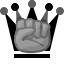
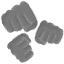
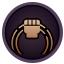

<!-- Generated by tools/build_pack_reference.py. Edit the pack sources and regenerate. -->

# Brawler

{ .entry-page-icon }

[All fighting styles](index.md) · [Mine Mine no Mi](../../reference/content/mineminenomi.md)

| Stat | Value |
| --- | --- |
| Style damage at 10,000 Doriki | 1.00× |
| At 50,000 Doriki with a fruit | 1.50× |
| At 50,000 Doriki while fruitless | 2.50× |
| At 50,000 Doriki with an eligible all-fruitless crew | 2.75× |

[See combat stats](../combat-stats.md).

!!! note "Reading the stats"
    Listed base damage is for the named part of the move. Pack and Doriki multipliers are shown separately. Times assume 20 ticks per second.

<!-- move mineminenomi:brawler_passive_bonus -->

## Brawler Passive Bonuses

*Passive*

<!-- move mineminenomi:charged_punch -->

## Charged Punch

*Active*

| Stat | Value |
| --- | --- |
| Cooldown | 8 s (160 ticks) |
| Base damage | 20 HP |

<!-- move mineminenomi:damage_absorption -->

## Damage Absorption

{ .entry-move-icon loading=lazy } *Active*

Allows the user to absorb all the incoming damage granting a damage buff at the end based on the total damage received.

| Stat | Value |
| --- | --- |
| Cooldown | 15 s (300 ticks) |

<!-- move mineminenomi:genkotsu_meteor -->

## Genkotsu Meteor

{ .entry-move-icon loading=lazy } *Active*

Throws a cannon ball from the user's hand or multiple cannon balls in Ryuseigun mode

| Stat | Value |
| --- | --- |
| Normal cooldown | 3 s (60 ticks) |
| Ryuseigun cooldown | 10 s (200 ticks) |
| Base damage | 16 HP |

<!-- move mineminenomi:hakai_ho -->

## Hakai Ho

{ .entry-move-icon loading=lazy } *Active*

The user punches with enough force to create a small explosion damaging all nearby enemies.

| Stat | Value |
| --- | --- |
| Cooldown | 12 s (240 ticks) |
| Base damage | 20 HP |

<!-- move mineminenomi:jishin_ho -->

## Jishin Ho

{ .entry-move-icon loading=lazy } *Active*

Punches the ground to cause a quake that damages everyone around

| Stat | Value |
| --- | --- |
| Cooldown | 15 s (300 ticks) |
| Base damage | 25 HP |

<!-- move mineminenomi:king_punch -->

## King Punch

{ .entry-move-icon loading=lazy } *Active*

A punch of exceptionally concentrated strength, capable of releasing an immense amount of air pressure, but needs a long time to fully charge

| Stat | Value |
| --- | --- |
| Min cooldown | 20 s (400 ticks) |
| Max cooldown | 70 s (1400 ticks) |
| Min damage | 33.3333 HP |
| Max damage | 83.3333 HP |

<!-- move mineminenomi:punch_rush -->

## Punch Rush

{ .entry-move-icon loading=lazy } *Active*

<!-- move mineminenomi:spinning_brawl -->

## Spinning Brawl

{ .entry-move-icon loading=lazy } *Active*

Grabs a nearby enemy spinning them around damaging any nearby entity it touches, and ending by throwing the grabbed entity a few blocks away.

| Stat | Value |
| --- | --- |
| Spin damage | 10 HP |
| Main damage | 30 HP |
| Cooldown | 12 s (240 ticks) |

<!-- move mineminenomi:suplex -->

## Suplex

{ .entry-move-icon loading=lazy } *Active*

Grabs an opponent from the back and launches it into the ground

| Stat | Value |
| --- | --- |
| Cooldown | 7 s (140 ticks) |
| Base damage | 20 HP |
| Explosion damage | 6 HP |

<!-- move mineminenomi:tackle -->

## Tackle

{ .entry-move-icon loading=lazy } *Active*

Tackles all enemies in front of the user.

| Stat | Value |
| --- | --- |
| Cooldown | 10 s (200 ticks) |
| Base damage | 15 HP |

<!-- move hakirework:blue_hole -->

## Blue Hole

{ .entry-move-icon loading=lazy }

Brawler. Garp's Armament-black hand grips the face of the one in front and slams them into the ground: it caves in and everyone around is thrown. Harder with Conqueror's coating. Needs Armament awake.

| Stat | Value |
| --- | --- |
| Conditional cooldown | 20 s (400 ticks) |

<!-- move hakirework:fist_of_love -->

## Fist of Love

{ .entry-move-icon loading=lazy }

Brawler. Garp's fist on the top of the head, the one that hurts even rubber: the one in front is hammered into the ground, dizzy. Lands past Logia bodies.

| Stat | Value |
| --- | --- |
| Conditional cooldown | 8 s (160 ticks) |

## Quests

See [the quest chapter](../../reference/quests/st_brawler.md) for milestones and rewards.
