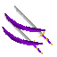
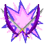
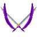
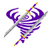
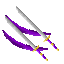
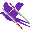
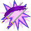

<!-- Generated by tools/build_pack_reference.py. Edit the pack sources and regenerate. -->

# Nitoryu

{ .entry-page-icon }

[All fighting styles](index.md) · [Blitz Utility](../../reference/content/blitzutility.md)

| Stat | Value |
| --- | --- |
| Style damage at 10,000 Doriki | 1.00× |
| At 50,000 Doriki with a fruit | 1.50× |
| At 50,000 Doriki while fruitless | 2.50× |
| At 50,000 Doriki with an eligible all-fruitless crew | 2.75× |

[See combat stats](../combat-stats.md).

!!! note "Reading the stats"
    Listed base damage is for the named part of the move. Pack and Doriki multipliers are shown separately. Times assume 20 ticks per second.

<!-- move blitzutility:gokuraku_anyo_rashomon -->

## Gokuraku Anyo Rashoman

{ .entry-move-icon loading=lazy } *Active*

Coating both swords in Conqueror's Haki, the user performs an ultimate Rashoman, tearing through guards and armor alike as black-red lightning crackles from the dash and the colossal slashes it releases. Requires a sword in each hand and Haoshoku Infusion, and drains the user's haki.

| Stat | Value |
| --- | --- |
| Cooldown | 35 s (700 ticks) |
| Dash damage | 50 HP |
| Slash damage | 35 HP |

<!-- move blitzutility:hirameki -->

## Hirameki

{ .entry-move-icon loading=lazy } *Active*

The user crosses both swords in two point-blank diagonal cuts, carving an X into anyone in front of them and blasting them away. Requires a sword in each hand.

| Stat | Value |
| --- | --- |
| Cooldown | 15 s (300 ticks) |
| Base damage | 37.5 HP |

<!-- move blitzutility:maguma -->

## Maguma

{ .entry-move-icon loading=lazy } *Active*

The user raises both swords high and brings them crashing down in a crossed cleave that blasts enemies away and leaves them reeling. Requires a sword in each hand.

| Stat | Value |
| --- | --- |
| Cooldown | 27 s (540 ticks) |
| Base damage | 35 HP |

<!-- move blitzutility:nanahyakuniju_pound_ho -->

## Nanahyakuniju Pound Ho

{ .entry-move-icon loading=lazy } *Active*

A far stronger Pound Ho: the user launches two enormous parallel blades of compressed air that cut through enemies and their armor. Requires a sword in each hand.

| Stat | Value |
| --- | --- |
| Cooldown | 26 s (520 ticks) |
| Base damage | 30 HP |

<!-- move blitzutility:nanajuni_pound_ho -->

## Nanajuni Pound Ho

{ .entry-move-icon loading=lazy } *Active*

Holding both swords above the shoulder, the user swings them in unison and launches two parallel blades of compressed air that cut through everything they hit. Requires a sword in each hand.

| Stat | Value |
| --- | --- |
| Cooldown | 15 s (300 ticks) |
| Base damage | 15 HP |

<!-- move blitzutility:nitoryu_iai_rashomon -->

## Nitoryu Iai: Rashoman

{ .entry-move-icon loading=lazy } *Active*

The user draws both swords in a lightning-fast iai dash, cutting through everything in their path and releasing two great slashes that carve through the terrain ahead. Free for Nitoryu users. Requires a sword in each hand.

| Stat | Value |
| --- | --- |
| Cooldown | 19 s (380 ticks) |
| Dash damage | 35 HP |
| Slash damage | 15 HP |

<!-- move blitzutility:otoro -->

## Otoro

{ .entry-move-icon loading=lazy } *Active*

The user brings both swords down in a crushing downward cut that slams enemies into the ground. Requires a sword in each hand.

| Stat | Value |
| --- | --- |
| Cooldown | 15 s (300 ticks) |
| Base damage | 37.5 HP |

<!-- move blitzutility:sai_kuru -->

## Sai Kuru

{ .entry-move-icon loading=lazy } *Active*

The user whirls both swords in a single violent spin, unleashing a massive tornado of blades that tears through everything around them in an instant. Requires a sword in each hand.

| Stat | Value |
| --- | --- |
| Cooldown | 17 s (340 ticks) |
| Base damage | 90 HP |

<!-- move blitzutility:samon -->

## Samon

{ .entry-move-icon loading=lazy } *Active*

The user swings both swords down from overhead in a crossing motion, firing two diagonal flying slashes. Requires a sword in each hand.

| Stat | Value |
| --- | --- |
| Cooldown | 15 s (300 ticks) |
| Base damage | 22.5 HP |

<!-- move blitzutility:taka_nami -->

## Taka Nami

{ .entry-move-icon loading=lazy } *Active*

The user sweeps both swords sideways in a wide arc, sending out a tall wave of air that cuts through every enemy in its path. Requires a sword in each hand.

| Stat | Value |
| --- | --- |
| Cooldown | 15 s (300 ticks) |
| Base damage | 25 HP |

<!-- move blitzutility:toro -->

## Toro

{ .entry-move-icon loading=lazy } *Active*

The user rips both swords upward in twin rising slashes, leaping into the air together with the enemies they launch. Requires a sword in each hand.

| Stat | Value |
| --- | --- |
| Cooldown | 15 s (300 ticks) |
| Base damage | 37.5 HP |

<!-- move blitzutility:toro_samon -->

## Toro Samon

{ .entry-move-icon loading=lazy } *Active*

From the Nigiri stance, the user leaps up with a rising slice that launches enemies alongside them, then drives straight down at the peak with a diagonal slash that slams them into the ground. The user takes no fall damage. Requires a sword in each hand.

| Stat | Value |
| --- | --- |
| Cooldown | 30 s (600 ticks) |
| Base damage | 20 HP |

## Quests

See [the quest chapter](../../reference/quests/st_nitoryu.md) for milestones and rewards.
