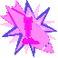
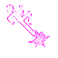
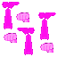

<!-- Generated by tools/build_pack_reference.py. Edit the pack sources and regenerate. -->

# Okama Kenpo

{ .entry-page-icon }

[All fighting styles](index.md) · [Blitz Utility](../../reference/content/blitzutility.md)

| Stat | Value |
| --- | --- |
| Style damage at 10,000 Doriki | 1.00× |
| At 50,000 Doriki with a fruit | 1.50× |
| At 50,000 Doriki while fruitless | 2.50× |
| At 50,000 Doriki with an eligible all-fruitless crew | 2.75× |

[See combat stats](../combat-stats.md).

!!! note "Reading the stats"
    Listed base damage is for the named part of the move. Pack and Doriki multipliers are shown separately. Times assume 20 ticks per second.

<!-- move blitzutility:bombardier -->

## Bombardier

{ .entry-move-icon loading=lazy } *Active*

The user hops into the air and shoots forward like a missile, spearing the target with a pointed kick from up to 5 extra blocks away.

| Stat | Value |
| --- | --- |
| Cooldown | 15 s (300 ticks) |
| Base damage | 25 HP |

<!-- move blitzutility:bombardier_arabesque -->

## Bombardier Arabesque

{ .entry-move-icon loading=lazy } *Active*

The user springs high into the air and dives down in a swan's arabesque, crushing the target with a devastating point kick that shatters guards and craters the ground.

| Stat | Value |
| --- | --- |
| Cooldown | 25 s (500 ticks) |
| Base damage | 40 HP |

<!-- move blitzutility:dozo_okamai_knuckle -->

## Dozo Okamai Knuckle

{ .entry-move-icon loading=lazy } *Active*

The user's next blow is a flamboyant straight punch to the face that leaves the target dizzy and fragile.

| Stat | Value |
| --- | --- |
| Cooldown | 15 s (300 ticks) |
| Base damage | 25 HP |

<!-- move blitzutility:grand_gouette_ano_natsu_no_hi_no_memoir -->

## Grand Gouette Ano Natsu no Hi no Memoir

{ .entry-move-icon loading=lazy } *Active*

The user pirouettes in place for three seconds, building up spinning momentum. Their next normal attack within 10 seconds deals 30 damage and knocks the target up and back.

| Stat | Value |
| --- | --- |
| Cooldown | 20 s (400 ticks) |
| Base damage | 30 HP |

<!-- move blitzutility:hakucho_arabesque -->

## Hakucho Arabesque

{ .entry-move-icon loading=lazy } *Active*

The user's next blow is a soaring swan's high kick that launches the target straight up.

| Stat | Value |
| --- | --- |
| Cooldown | 18 s (360 ticks) |
| Base damage | 35 HP |

<!-- move blitzutility:keri_pointe -->

## Keri Pointe

{ .entry-move-icon loading=lazy } *Active*

The user hops up and drives both pointed feet into the target, blasting them straight back and leaving them fragile.

| Stat | Value |
| --- | --- |
| Cooldown | 15 s (300 ticks) |
| Base damage | 25 HP |

<!-- move blitzutility:mascara_boomerang -->

## Mascara Boomerang

{ .entry-move-icon loading=lazy } *Active*

The user hurls a spinning bladed boomerang that cuts through enemies on its way out and again as it whirls back to the user, leaving them bleeding.

| Stat | Value |
| --- | --- |
| Cooldown | 22 s (440 ticks) |
| Base damage | 15 HP |

<!-- move blitzutility:ohikae_na_fouette -->

## Ohikae Na Fouette

{ .entry-move-icon loading=lazy } *Active*

The user dashes in and throws themselves into a backwards somersault, whipping a leg over the top into a crushing kick to the target's head.

| Stat | Value |
| --- | --- |
| Cooldown | 20 s (400 ticks) |
| Base damage | 30 HP |

<!-- move blitzutility:okama_chop -->

## Okama Chop

{ .entry-move-icon loading=lazy } *Active*

The user's next blow is a stiff knife-hand chop that leaves the target blinded.

| Stat | Value |
| --- | --- |
| Cooldown | 25 s (500 ticks) |
| Base damage | 15 HP |

<!-- move blitzutility:okama_dash -->

## Okama Dash

{ .entry-move-icon loading=lazy } *Active*

The user bounds forward in huge ballet leaps, covering ground at incredible speed for a short time.

| Stat | Value |
| --- | --- |
| Cooldown | 20 s (400 ticks) |

<!-- move blitzutility:urabure_swan_butokai -->

## Urabure Swan Butokai

{ .entry-move-icon loading=lazy } *Active*

The user breaks into a frenzied swan dance, unleashing a barrage of kicks and punches that each hit with their full punch strength plus 3.

| Stat | Value |
| --- | --- |
| Cooldown | 20 s (400 ticks) |
| Base damage | 3 HP |

## Quests

See [the quest chapter](../../reference/quests/st_okama_kenpo.md) for milestones and rewards.
