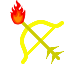
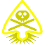
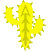
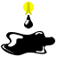

<!-- Generated by tools/build_pack_reference.py. Edit the pack sources and regenerate. -->

# Sniper

{ .entry-page-icon }

[All fighting styles](index.md) · [Mine Mine no Mi](../../reference/content/mineminenomi.md)

| Stat | Value |
| --- | --- |
| Style damage at 10,000 Doriki | 1.00× |
| At 50,000 Doriki with a fruit | 1.50× |
| At 50,000 Doriki while fruitless | 2.50× |
| At 50,000 Doriki with an eligible all-fruitless crew | 2.75× |

[See combat stats](../combat-stats.md).

!!! note "Reading the stats"
    Listed base damage is for the named part of the move. Pack and Doriki multipliers are shown separately. Times assume 20 ticks per second.

<!-- move mineminenomi:hi_no_tori_boshi -->

## Hi no Tori Boshi

{ .entry-move-icon loading=lazy } *Active*

Fires a flaming pellet in the form of a phoenix, that sets the target on fire

| Stat | Value |
| --- | --- |
| Cooldown | 5 s (100 ticks) |

<!-- move mineminenomi:hissatsu -->

## Hissatsu

{ .entry-move-icon loading=lazy } *Active*

Allows the next sniper ability to instantly hit the target

| Stat | Value |
| --- | --- |
| Cooldown | 15 s (300 ticks) |

<!-- move mineminenomi:kaen_boshi -->

## Kaen Boshi

*Active*

Fires a flaming pellet that sets the target on fire

| Stat | Value |
| --- | --- |
| Cooldown | 5 s (100 ticks) |

<!-- move mineminenomi:kemuri_boshi -->

## Kemuri Boshi

{ .entry-move-icon loading=lazy } *Active*

Fires a pellet that releases smoke on impact, poisoning and confusing targets

| Stat | Value |
| --- | --- |
| Cooldown | 6 s (120 ticks) |

<!-- move mineminenomi:nemuri_boshi -->

## Nemuri Boshi

{ .entry-move-icon loading=lazy } *Active*

Fires a pellet, that puts the enemy to sleep for a few seconds

| Stat | Value |
| --- | --- |
| Cooldown | 20 s (400 ticks) |

<!-- move mineminenomi:renpatsu_namari_boshi -->

## Renpatsu Namari Boshi

{ .entry-move-icon loading=lazy } *Active*

Fires a barrage of exploding pellets

| Stat | Value |
| --- | --- |
| Cooldown | 6 s (120 ticks) |

<!-- move mineminenomi:sakuretsu_saboten_boshi -->

## Sakuretsu Saboten Boshi

{ .entry-move-icon loading=lazy } *Active*

The fired projectile explodes and attaches several cacti to the target, dealing damage over time

| Stat | Value |
| --- | --- |
| Cooldown | 10 s (200 ticks) |

<!-- move mineminenomi:tetsu_boshi -->

## Tetsu Boshi

{ .entry-move-icon loading=lazy } *Active*

Fires a pellet that upon impact releases multiple small iron spikes on the ground

| Stat | Value |
| --- | --- |
| Cooldown | 7 s (140 ticks) |

<!-- move mineminenomi:tokuyo_abura_boshi -->

## Tokuyo Abura Boshi

{ .entry-move-icon loading=lazy } *Active*

Fires a pellet that upon impact releases oil coating the target in it and making the ground slippery

| Stat | Value |
| --- | --- |
| Cooldown | 7 s (140 ticks) |

<!-- move hakirework:tabasco_boshi -->

## Tabasco Boshi

{ .entry-move-icon loading=lazy }

Sniper. A pellet of hot sauce fired with the user's next bow or slingshot shot: whoever it hits is blinded, reels and slows down.

<!-- move hakirework:kayaku_boshi -->

## Kayaku Boshi

{ .entry-move-icon loading=lazy }

Sniper. A pellet of gunpowder fired with the user's next bow or slingshot shot, that blows up where it hits.

<!-- move hakirework:midori_boshi_devil -->

## Midori Boshi: Devil

{ .entry-move-icon loading=lazy }

Sniper. A Pop Green seed fired with the user's next bow or slingshot shot, that bursts into a man-eating plant: everyone near is held fast, bitten and poisoned.

| Stat | Value |
| --- | --- |
| Fixed hit damage | 6 HP |

## Quests

See [the quest chapter](../../reference/quests/st_sniper.md) for milestones and rewards.
