<!-- Generated by tools/build_pack_reference.py. Edit the pack sources and regenerate. -->

# Swordsman

{ .entry-page-icon }

[All fighting styles](index.md) · [Mine Mine no Mi](../../reference/content/mineminenomi.md)

| Stat | Value |
| --- | --- |
| Style damage at 10,000 Doriki | 1.00× |
| At 50,000 Doriki with a fruit | 1.50× |
| At 50,000 Doriki while fruitless | 2.50× |
| At 50,000 Doriki with an eligible all-fruitless crew | 2.75× |

[See combat stats](../combat-stats.md).

!!! note "Reading the stats"
    Listed base damage is for the named part of the move. Pack and Doriki multipliers are shown separately. Times assume 20 ticks per second.

<!-- move mineminenomi:hiryu_kaen -->

## Hiryu: Kaen

{ .entry-move-icon loading=lazy } *Active*

The user jumps high up into the air and slashes their opponent. After slashing them, the user's opponent then bursts into flames from where they were slashed.

| Stat | Value |
| --- | --- |
| Cooldown | 12 s (240 ticks) |
| Base damage | 20 HP |

<!-- move mineminenomi:sanbyakurokuju_pound_ho -->

## Sanbyakurokuju Pound Ho

{ .entry-move-icon loading=lazy } *Active*

The user launches a powerful ranged slash, causing great destruction

| Stat | Value |
| --- | --- |
| Cooldown | 16 s (320 ticks) |

<!-- move mineminenomi:sanjuroku_pound_ho -->

## Sanjuroku Pound Ho

*Active*

The user delivers a stronger version of their Sanjuroku Pound Ho.

| Stat | Value |
| --- | --- |
| Cooldown | 16 s (320 ticks) |
| Base damage | 30 HP |
| Projectile hit | 25 HP |

<!-- move mineminenomi:shi_shishi_sonson -->

## Shi Shishi Sonson

{ .entry-move-icon loading=lazy } *Active*

A stronger version of the original Shishi Sonson, where the user swings their sword in a very quick and powerful unsheathing move to slice their opponent.

| Stat | Value |
| --- | --- |
| Cooldown | 9 s (180 ticks) |
| Base damage | 30 HP |

<!-- move mineminenomi:yakkodori -->

## Yakkodori

{ .entry-move-icon loading=lazy } *Active*

Launches a crescent moon-shaped slash, which destroys everything in its path

| Stat | Value |
| --- | --- |
| Cooldown | 10 s (200 ticks) |

<!-- move mineminenomi:nanahyakuniju_pound_ho -->

## Nanahyakuniju Pound Ho

*Active*

A more powerful version of the Nanajuni Pound Ho. Holding their two swords horizontally above the shoulder, the user then performs a circular swing that launches two air compressed projectiles spiraling towards the target.

| Stat | Value |
| --- | --- |
| Cooldown | 16 s (320 ticks) |
| Base damage | 30 HP |
| Projectile hit | 25 HP |

<!-- move mineminenomi:nanajuni_pound_ho -->

## Nanajuni Pound Ho

*Active*

Same principle as the Sanjuroku Pound Ho. Holding their two swords horizontally above the shoulder, the user then performs a circular swing that launches two air compressed projectiles spiraling towards the target instead of one, making it twice as powerful.

| Stat | Value |
| --- | --- |
| Cooldown | 16 s (320 ticks) |
| Base damage | 30 HP |
| Projectile hit | 25 HP |

<!-- move mineminenomi:hyakuhachi_pound_ho -->

## Hyakuhachi Pound Ho

*Active*

Same principle as the thirty-six version of the same attack. Holding their two swords horizontally above the shoulder and the other in their mouth in the same direction, and then performs a circular swing that launches three air compressed projectiles spiraling towards the target instead of one or two, tripling the power of the technique.

| Stat | Value |
| --- | --- |
| Cooldown | 16 s (320 ticks) |
| Base damage | 30 HP |
| Projectile hit | 25 HP |

<!-- move mineminenomi:o_tatsumaki -->

## O Tatsumaki

*Active*

By spinning, the user creates a small tornado, which slashes and weakens nearby opponents

| Stat | Value |
| --- | --- |
| Cooldown | 12 s (240 ticks) |
| Base damage | 30 HP |

<!-- move mineminenomi:senhachiju_pound_ho -->

## Senhachiju Pound Ho

*Active*

A much stronger and powerful version of Hyakuhachi Pound Ho, where the user does the same exact movements as before, holding one of their swords horizontally above the shoulder of their sword arm, and then performs a circular swing that launches the air compressed projectile spiraling towards the target.

| Stat | Value |
| --- | --- |
| Cooldown | 16 s (320 ticks) |
| Base damage | 30 HP |
| Projectile hit | 25 HP |

<!-- move mineminenomi:tatsu_maki -->

## Tatsu Maki

{ .entry-move-icon loading=lazy } *Active*

By spinning, the user creates a small tornado, which slashes and weakens nearby opponents

| Stat | Value |
| --- | --- |
| Cooldown | 12 s (240 ticks) |

<!-- move blitzutility:menamu_gawa -->

## Menamu Gawa

{ .entry-move-icon loading=lazy } *Active*

The user readies their sword, then launches forward in a spinning slash that cuts through every enemy in its path and blasts away everyone around them. Requires a sword.

| Stat | Value |
| --- | --- |
| Cooldown | 6 s (120 ticks) |
| Base damage | 35 HP |

<!-- move blitzutility:yorikiri -->

## Yorikiri

{ .entry-move-icon loading=lazy } *Active*

The user sweeps their sword in a wide arc in front of them, leaving spiraling slash marks that launch everyone caught in it into the air. Requires a sword.

| Stat | Value |
| --- | --- |
| Cooldown | 5 s (100 ticks) |
| Base damage | 30 HP |

<!-- move blitzutility:amano_gawa -->

## Amano Gawa

{ .entry-move-icon loading=lazy } *Active*

The user leaps into the air and unleashes a wide spiraling slash beneath them that cuts everyone caught in it, leaving them bleeding and breaking their guard. Requires a sword.

| Stat | Value |
| --- | --- |
| Cooldown | 10 s (200 ticks) |
| Base damage | 40 HP |
| Bleed | 6 s (120 ticks) |

<!-- move blitzutility:higanbana -->

## Higanbana

{ .entry-move-icon loading=lazy } *Active*

The user dashes forward at crazy speeds bashing their sword into their target sending them flying. Requires Busoshoku Haki: Internal Destruction to be active.

| Stat | Value |
| --- | --- |
| Cooldown | 15 s (300 ticks) |
| Base damage | 45 HP |

<!-- move blitzutility:pandemonium -->

## Pandemonium

{ .entry-move-icon loading=lazy } *Active*

The user leaps up and brings their sword down with both hands with tremendous force and fires a slash of Conqueror's Haki. Requires Haoshoku Infusion.

| Stat | Value |
| --- | --- |
| Cooldown | 65 s (1300 ticks) |
| Landing damage | 40 HP |

## Quests

See [the quest chapter](../../reference/quests/st_swordsman.md) for milestones and rewards.
