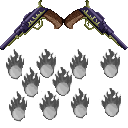
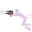
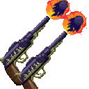
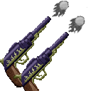
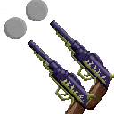
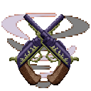

<!-- Generated by tools/build_pack_reference.py. Edit the pack sources and regenerate. -->

# Twin Barrel Style

{ .entry-page-icon }

[All fighting styles](index.md) · [Cart Addon](../../reference/content/cartaddon.md)

| Stat | Value |
| --- | --- |
| Style damage at 10,000 Doriki | 1.00× |
| At 50,000 Doriki with a fruit | 1.50× |
| At 50,000 Doriki while fruitless | 2.50× |
| At 50,000 Doriki with an eligible all-fruitless crew | 2.75× |

[See combat stats](../combat-stats.md).

!!! note "Reading the stats"
    Listed base damage is for the named part of the move. Pack and Doriki multipliers are shown separately. Times assume 20 ticks per second.

<!-- move cartaddon:back_flip -->

## Back Flip

{ .entry-move-icon loading=lazy } *Active*

The user does a back flip and avoids most attacks briefly.

| Stat | Value |
| --- | --- |
| Min cooldown | 4 s (80 ticks) |
| Max cooldown | 15 s (300 ticks) |

<!-- move cartaddon:bullet_blast_barrage -->

## Bullet Blast Barrage

{ .entry-move-icon loading=lazy } *Active*

The user lets out a barrage of blasting bullets.

| Stat | Value |
| --- | --- |
| Cooldown | 15 s (300 ticks) |
| Base damage | 14 HP |

<!-- move cartaddon:bullet_rush -->

## Bullet Rush

{ .entry-move-icon loading=lazy } *Active*

The user moves forward and fires bullets all around them. (Fruitless).

| Stat | Value |
| --- | --- |
| Cooldown | 25 s (500 ticks) |
| Base damage | 12 HP |

<!-- move cartaddon:dangirigan -->

## Dangirigan

{ .entry-move-icon loading=lazy } *Active*

The user fires two powerful shots, which count as slash attacks.

| Stat | Value |
| --- | --- |
| Cooldown | 10 s (200 ticks) |

<!-- move cartaddon:double_shots -->

## Double Shots

{ .entry-move-icon loading=lazy } *Active*

The user fires two shots at a time, consuming bullets. (Bullets are consumed 30% of the time!).

| Stat | Value |
| --- | --- |
| Cooldown | 6 s (120 ticks) |

<!-- move cartaddon:jump_shots -->

## Jump Shots

{ .entry-move-icon loading=lazy } *Active*

The user jumps up into the air, and fires shots below.

| Stat | Value |
| --- | --- |
| Cooldown | 10 s (200 ticks) |
| Base damage | 12 HP |

<!-- move cartaddon:point_blank -->

## Point Blank

{ .entry-move-icon loading=lazy } *Active*

The user fires a heavy point blank shot, doing massive damage and stunning their target. (Fruitless).

| Stat | Value |
| --- | --- |
| Cooldown | 15 s (300 ticks) |
| Base damage | 50 HP |

<!-- move cartaddon:spinning_barrel_shots -->

## Spinning Barrel Shots

{ .entry-move-icon loading=lazy } *Active*

The user spins in circles, firing shots.

| Stat | Value |
| --- | --- |
| Cooldown | 12 s (240 ticks) |
| Base damage | 7 HP |

## Quests

See [the quest chapter](../../reference/quests/st_weapon_arts.md) for milestones and rewards.
