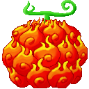
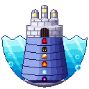
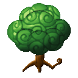

# Eternal Voyage

**Minecraft 1.20.1 · Forge · Multiplayer server**

Start in the Blues, chart your route with a Log Pose, and build a character who can survive the Grand Line. Eternal Voyage ties One Piece mods, dungeon loot, ship travel, and FTB Quests into a voyage through progressively tougher seas.

[**Getting Started** Join the server, choose your two professions, and get your crew ready to sail.](voyage/first-voyage.md)

[**Follow The Voyage** Build a ship, clear the Blues, and find your route to the New World.](voyage/index.md)

[**Build your character** Train Doriki and Haki, learn a fighting style, or awaken a Devil Fruit.](characters/index.md)

[**Look up combat stats** Find move damage, Doriki scaling, and fruitless crew bonuses.](characters/combat-stats.md)

## Mods behind Eternal Voyage

<!-- featured mods -->

[{ loading=lazy } **Mine Mine no Mi** Character creation, crews, Devil Fruits and the core combat system.](reference/content/mineminenomi.md)

[{ loading=lazy } **Haki Realm** Awaken Haki, build a mastery tree, train under a school master and earn Conqueror’s Haki.](reference/content/hakirework.md)

[{ loading=lazy } **Race Race no Mi** Races, subraces, lineage factors, cyborg parts and Germa Raid Suits.](reference/content/racenomi.md)

[{ loading=lazy } **Cruise Cruise no Mi** Fourteen trades, talent trees, shipbuilding, settlements, events and trade routes.](reference/content/inocruise.md)

[{ loading=lazy } **One Piece World** The Blues, Grand Line, Red Line, island routes, currents and Log Pose progression.](reference/content/ompworld.md)

[{ loading=lazy } **Eternal Voyage Companion** Regional encounters, Clima-Tact storms, starter island invitations, and ship recovery.](reference/content/eternalvoyage.md)

[{ loading=lazy } **Sky Island** Ride the Knock-Up Stream to Skypiea, explore the cloud sea and face the Upper Yard ordeals.](reference/content/inosky.md)

[{ loading=lazy } **Impel Down** The Calm Belt prison, from Gates of Justice to the Eternal Hell.](reference/content/inoimpel.md)

[{ loading=lazy } **Awaken Awaken no Mi** Awakened techniques and forms for Devil Fruit users.](reference/content/awakenawakennomi.md)

[{ loading=lazy } **InoFruits** Additional Paramecia, Logia and Zoan fruits, including fruit-specific moves and forms.](reference/content/inofruits.md)

[{ loading=lazy } **Missing Missing no Mi** An expanded fruit roster with new moves, forms and lineages.](reference/content/inomissing.md)

[{ loading=lazy } **Blitz Utility** Nitoryu, Okama Kenpo, weapon arts and additional Devil Fruits.](reference/content/blitzutility.md)

<!-- end featured mods -->

[Browse all mods](reference/content/index.md)

## Credits

Eternal Voyage builds on Mine Mine no Mi and community addons, including [Inovactio’s mods](https://inovactio.github.io/). Mod logos and item or ability icons are from the shipped mod builds.
