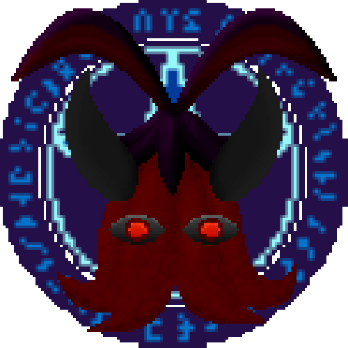

<!-- Generated by tools/build_pack_reference.py. Edit the pack sources and regenerate. -->

# Akuma no Mi

<div class="mod-page-icon" markdown="1">



</div>

Noble Box fruits, unusual transformations and bloodline powers.

Installed build `0.0.6-1.20.1`. [Browse all mods](index.md).

## Pack guides

- [Devil Fruit box contents](../../characters/fruit-boxes.md)
- [Bloodlines · Bloodline catalogue](../../characters/bloodlines/index.md#bloodline-catalogue)
- [Inherited Will](../../reference/quests/r_traits.md)

## Related mods

- [AkumaLib](akumalib.md)
- [Missing Missing no Mi](inomissing.md)

## Abilities

| In-game name | ID | In-game description |
| --- | --- | --- |
| Abyssal Gate: Create | `akuma:abyssal_gate_create` |  |
| Abyssal Gate: Summon | `akuma:abyssal_gate_summon` |  |
| Abyssal Gate: Teleport | `akuma:abyssal_gate_teleport` |  |
| Abyssal Passive | `akuma:abyssal_passive` |  |
| Agent Back Up | `akuma:agent_back_up` | The user calls for back up cipher pol agents |
| Area Tangibility | `akuma:rubber_tangibility_area` |  |
| Bohu's Wither | `akuma:bohu_wither` | While Bohu is held, plant life and small creatures within 6 blocks wither away. Hits inflict Weakness and Wither, and every 10th hit on the same target steals 10 health. |
| Depths Passive | `akuma:depths_passive` |  |
| Glaive of God | `akuma:glaive_of_god_glaive` |  |
| Gram's Wrath | `akuma:gram_wrath` | Damage dealt and received while wielding Gram fills a wrath meter. At 100 the wielder moves faster, jumps higher, swings faster and hits twice as hard until the wrath runs out. |
| Holy Guards | `akuma:heavenly_guard` | The user calls for their royal guards |
| Kami no Ikazuchi | `akuma:kami_no_ikazuchi` | Fires a thin, blinding bolt of light from the tip of the Spear of Longinus that pierces through everything in its path. |
| Nika Beast Point | `akuma:nika_beast_point` | The Sun God Nika takes over the weakened user, overpowering their will and pushing the Gomu Gomu no Mi to its peak. |
| Omen Application: Bestow | `akuma:omen_application_bestow` |  |
| Omen Application: Guard | `akuma:omen_application_guard` |  |
| Omen Application: Omen Projectile | `akuma:omen_application_projectile` |  |
| Omen Application: Point Blank | `akuma:omen_application_point_blank` |  |
| Omen Augmentation: Omen Limb Extension | `akuma:omen_augmentation_limb_extension` |  |
| Omen Augmentation: Omenmorphose | `akuma:omen_augmentation_omenmorphose` |  |
| Omen Blessing | `akuma:omen_blessing` |  |
| Omen Storage: Random Draw | `akuma:omen_storage_draw` |  |
| Omen Storage: Store | `akuma:omen_storage_store` |  |
| Possession: Possess | `akuma:possession_possess` |  |
| Possession: Select | `akuma:possession_select` |  |
| Revocation Protocol: Revoke | `akuma:revocation_protocol_revoke` |  |
| Revocation Protocol: Select | `akuma:revocation_protocol_select` |  |
| Rubber Tangibility | `akuma:rubber_tangibility` | The user's punch turns the target to rubber, letting them be struck through any defense without haki. In its alternate form the user turns the ground around them to rubber, sending everyone bouncing. |
| Rubber Tangibility | `akuma:rubber_tangibility_punch` |  |
| Shallows Passive | `akuma:shallows_passive` |  |
| Swell | `akuma:swell` | The user grabs a target turned to rubber, bites down and blows air into them until their body swells and bursts. |
| Sword of God | `akuma:glaive_of_god_sword` |  |
| Void Shield | `akuma:void_shield` | Crosses Bohu and Tohu and spins them into a shield of pure darkness. Anyone who strikes the user is torn apart by the void in return. |


## Effects

| In-game name | ID | In-game description |
| --- | --- | --- |
| Rubber Ground | `akuma:rubber_ground` |  |
| Rubber Tangibility | `akuma:rubber_tangibility` |  |


## Creatures and entities

| In-game name | ID | In-game description |
| --- | --- | --- |
| A Kuwaru Seal | `akuma:a_kuwaru_seal` |  |
| Abyss Portal | `akuma:abyss_portal` |  |
| Akuma Tail Jab | `akuma:akuma_tail_jab` |  |
| Bestow Halo | `akuma:bestow_halo` |  |
| Cipher Pol 0 Agent | `akuma:cipher_pol_0_agent` |  |
| Cipher Pol Aegis 0 Agent | `akuma:notorious_cipher_pol_0_agent` |  |
| Cipher Pol Agent | `akuma:cipher_pol_agent` |  |
| Cipher Pol Recruitment Officer | `akuma:cipher_pol_recruitment_officer` |  |
| Cipher Pol Sniper | `akuma:cipher_pol_sniper` |  |
| Gyuki Leg | `akuma:gyuki_leg` |  |
| Holy Knight | `akuma:holy_knight` |  |
| Kami no Ikazuchi | `akuma:kami_no_ikazuchi` |  |
| Omen Limb | `akuma:omen_limb` |  |
| Omen Missile | `akuma:omen_missile` |  |
| Rage Beam | `akuma:rage_beam` |  |
| Royal Guard | `akuma:royal_guard` |  |
| Stigma Beam | `akuma:stigma_beam` |  |
| Stigma Soul | `akuma:stigma_soul` |  |
| Tzitzimitl Halo | `akuma:tzitzimitl_halo` |  |
| Tzitzimitl Slash Mark | `akuma:tzitzimitl_slash_mark` |  |


## Items

| In-game name | ID | In-game description |
| --- | --- | --- |
| Bohu | `akuma:bohu` |  |
| Cerberus | `akuma:cerberus` |  |
| Cipherpol Boots | `akuma:cipherpol_boots` |  |
| Cipherpol Chestplate | `akuma:cipherpol_chestplate` |  |
| Cipherpol Glasses | `akuma:cipherpol_glasses` |  |
| Cipherpol Leggings | `akuma:cipherpol_leggings` |  |
| CP0 Boots | `akuma:cp0_boots` |  |
| CP0 Leggings | `akuma:cp0_leggings` |  |
| CP0 Suit | `akuma:cp0_suit` |  |
| Fragarach | `akuma:fragarach` |  |
| Glaive of God | `akuma:glaive_of_god` |  |
| Gorosei Leggings | `akuma:gorosei_leggings` |  |
| Gorosei Shoes | `akuma:gorosei_shoes` |  |
| Gorosei Suit | `akuma:gorosei_suit` |  |
| Gorosei Suit with Tie | `akuma:gorosei_tie_suit` |  |
| Gram | `akuma:gram` |  |
| Holy Knight Boots | `akuma:holy_knight_boots` |  |
| Holy Knight Chestplate | `akuma:holy_knight_chestplate` |  |
| Holy Knight Leggings | `akuma:holy_knight_leggings` |  |
| Holy Spear | `akuma:holy_spear` |  |
| Honebami Toshiro | `akuma:honebami_toshiro` |  |
| Imu's Boots | `akuma:imu_boots` |  |
| Imu's Cape | `akuma:imu_cape` |  |
| Imu's Pants | `akuma:imu_pants` |  |
| Nemesis | `akuma:nemesis` |  |
| Noble Box | `akuma:noble_box` |  |
| Royal Guard Boots | `akuma:royal_guard_boots` |  |
| Royal Guard Chestplate | `akuma:royal_guard_chestplate` |  |
| Royal Guard Helmet | `akuma:royal_guard_helmet` |  |
| Royal Guard Leggings | `akuma:royal_guard_leggings` |  |
| Shodai Kitetsu | `akuma:shodai_kitetsu` |  |
| Spawn Cipher Pol 0 Agent | `akuma:cipher_pol_0_agent_spawn_egg` |  |
| Spawn Cipher Pol Agent | `akuma:cipher_pol_agent_spawn_egg` |  |
| Spawn Cipher Pol Recruitment Officer | `akuma:cipher_pol_recruitment_officer_spawn_egg` |  |
| Spawn Cipher Pol Sniper | `akuma:cipher_pol_sniper_spawn_egg` |  |
| Spawn Holy Knight | `akuma:holy_knight_spawn_egg` |  |
| Spawn Notorious Cipher Pol 0 Agent | `akuma:notorious_cipher_pol_0_agent_spawn_egg` |  |
| Spawn Royal Guard | `akuma:royal_guard_spawn_egg` |  |
| Spear of Longinus | `akuma:spear_of_longinus` |  |
| Sword of God | `akuma:blade_of_god` |  |
| Tohu | `akuma:tohu` |  |
| Xingtain | `akuma:xingtain` |  |
| Yakuza Kasen | `akuma:yakuza_kasen` |  |


## Loot Tables

1 entries shipped by this JAR.

```text
akuma:dfboxes/noble_box
```
