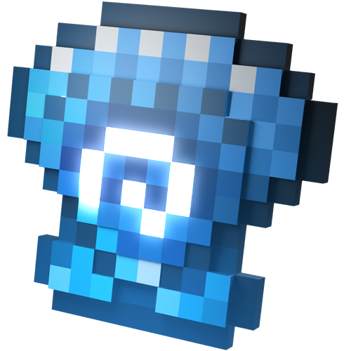

<!-- Generated by tools/build_pack_reference.py. Edit the pack sources and regenerate. -->

# Aquamirae

<div class="mod-page-icon" markdown="1">



</div>

Cold-water encounters, wrecks, equipment and hostile sea creatures.

Installed build `7.1.14`. [Browse all mods](index.md).

## Pack guides

- [Loot and encounters](../../world/loot.md)
- [Encounter stats](../../world/encounter-stats.md)

## Abilities

| In-game name | ID | In-game description |
| --- | --- | --- |
| (%s Pieces) | `aquamirae:pieces` |  |
| (1 Piece) | `aquamirae:piece` |  |
| Can be consumed as food, reducing its durability by {durability}. | `aquamirae:jawbreaker` |  |
| Your attacks deal {base_bonus} increased damage to Ice Maze creatures. Each Ice Maze creature you have ever slain permanently increases this bonus by {per_kill}, up to {max_bonus}. | `aquamirae:remnant_saber` |  |
| Your attacks deal {bonus} increased damage underwater. Each block below sea level grants {per_block}, up to {max_bonus}. | `aquamirae:tidepiercer` |  |
| Your attacks have a {villager_chance} chance to make villagers drop an Emerald. Against pillagers, this chance is increased to {pillager_chance}. Each attack also has a {break_chance} chance to instantly break the weapon. | `aquamirae:dagger_of_greed` |  |
| Your attacks inflict Superconductor for {duration} seconds. Striking an affected enemy triggers a chain discharge that jumps to nearby affected enemies, shocking them for {shock_duration} seconds. When lightning strikes an affected enemy, it also strikes nearby affected enemies. | `aquamirae:tempest_trident` |  |


## Effects

| In-game name | ID | In-game description |
| --- | --- | --- |
| Armor Shatter | `aquamirae:armor_shatter` |  |
| Crystallization | `aquamirae:crystallization` |  |
| Devouring Curse | `aquamirae:devouring_curse` |  |
| Fury of the Depths | `aquamirae:fury_of_the_depths` |  |
| Health Shatter | `aquamirae:health_shatter` |  |
| Maelstrom Omen | `aquamirae:maelstrom_omen` |  |
| Poison Immunity | `aquamirae:poison_immunity` |  |
| Resilience of the Depths | `aquamirae:resilience_of_the_depths` |  |


## Creatures and entities

| In-game name | ID | In-game description |
| --- | --- | --- |
| Abyssal Scyphoid | `aquamirae:abyssal_scyphoid` |  |
| Anglerfish | `aquamirae:anglerfish` |  |
| Eel | `aquamirae:eel` |  |
| Ghost of Captain Cornelia | `aquamirae:captain_cornelia` |  |
| Golden Moth | `aquamirae:golden_moth` |  |
| Maw | `aquamirae:maw` |  |
| Maze Mother | `aquamirae:maze_mother` |  |
| Maze Rose | `aquamirae:maze_rose` |  |
| Scuttler | `aquamirae:scuttler` |  |
| Shellback | `aquamirae:shellback` |  |
| Shipbreaker | `aquamirae:shipbreaker` |  |
| Spinefish | `aquamirae:spinefish` |  |
| Terrible Chakram | `aquamirae:terrible_chakram` |  |
| Tortured Soul | `aquamirae:tortured_soul` |  |


## Items

| In-game name | ID | In-game description |
| --- | --- | --- |
| Abyssal Amethyst | `aquamirae:abyssal_amethyst` |  |
| Abyssal Boots | `aquamirae:abyssal_boots` |  |
| Abyssal Brigandine | `aquamirae:abyssal_brigandine` |  |
| Abyssal Heaume | `aquamirae:abyssal_heaume` |  |
| Abyssal Leggings | `aquamirae:abyssal_leggings` |  |
| Abyssal Scyphoid Spawn Egg | `aquamirae:abyssal_scyphoid_spawn_egg` |  |
| Abyssal Tiara | `aquamirae:abyssal_tiara` |  |
| Angler Fang | `aquamirae:angler_fang` |  |
| Anglerfish Spawn Egg | `aquamirae:anglerfish_spawn_egg` |  |
| Captain Cornelia Spawn Egg | `aquamirae:captain_cornelia_spawn_egg` |  |
| Cooked Spinefish | `aquamirae:cooked_spinefish` |  |
| Cracked Record | `aquamirae:cracked_record` | One last song... |
| Dagger of Greed | `aquamirae:dagger_of_greed` |  |
| Dead Sea Scroll | `aquamirae:dead_sea_scroll` |  |
| Echo Compass | `aquamirae:echo_compass` |  |
| Eel Spawn Egg | `aquamirae:eel_spawn_egg` |  |
| Esca | `aquamirae:esca` |  |
| Esca Skewer | `aquamirae:esca_skewer` |  |
| Fin | `aquamirae:fin` |  |
| Frozen Key | `aquamirae:frozen_key` |  |
| Golden Moth Spawn Egg | `aquamirae:golden_moth_spawn_egg` |  |
| Jawbreaker | `aquamirae:jawbreaker` |  |
| Jellyfish Jelly | `aquamirae:jellyfish_jelly` |  |
| Logbook | `aquamirae:logbook` |  |
| Luminescent Bubble | `aquamirae:luminescent_bubble` |  |
| Maw Spawn Egg | `aquamirae:maw_spawn_egg` |  |
| Maze Mother Spawn Egg | `aquamirae:maze_mother_spawn_egg` |  |
| Maze Rose | `aquamirae:maze_rose` |  |
| Music Disc | `aquamirae:music_disc_horizon` | Bertsz - Horizon |
| Music Disc | `aquamirae:music_disc_forsaken_drownage` | The Exiled Fellow - Forsaken Drownage |
| Niveis Tear | `aquamirae:niveis_tear` |  |
| Oxygen Tank | `aquamirae:oxygen_tank` |  |
| Oxyhelium | `aquamirae:oxyhelium` |  |
| Poseidon Breakfast | `aquamirae:poseidon_breakfast` |  |
| Remnant Saber | `aquamirae:remnant_saber` |  |
| Rune of the Storm | `aquamirae:rune_of_the_storm` |  |
| Salvager Boots | `aquamirae:salvager_boots` |  |
| Salvager Helmet | `aquamirae:salvager_helmet` |  |
| Salvager Suit | `aquamirae:salvager_suit` |  |
| Salvager Waders | `aquamirae:salvager_waders` |  |
| Scuttler Spawn Egg | `aquamirae:scuttler_spawn_egg` |  |
| Sea Casserole | `aquamirae:sea_casserole` |  |
| Sea Stew | `aquamirae:sea_stew` |  |
| Sharp Bones | `aquamirae:sharp_bones` |  |
| Shatterblade | `aquamirae:shatterblade` |  |
| Shatterspike | `aquamirae:shatterspike` |  |
| Shell Horn | `aquamirae:shell_horn` |  |
| Shellback Spawn Egg | `aquamirae:shellback_spawn_egg` |  |
| Ship Graveyard Echo | `aquamirae:ship_graveyard_echo` |  |
| Smithing Template | `aquamirae:terrible_upgrade_smithing_template` |  |
| Smithing Template | `aquamirae:abyssal_upgrade_smithing_template` |  |
| Spinefish | `aquamirae:spinefish` |  |
| Spinefish Spawn Egg | `aquamirae:spinefish_spawn_egg` |  |
| Tempest Trident | `aquamirae:tempest_trident` |  |
| Terrible Blade | `aquamirae:terrible_blade` |  |
| Terrible Boots | `aquamirae:terrible_boots` |  |
| Terrible Chakram | `aquamirae:terrible_chakram` |  |
| Terrible Chestplate | `aquamirae:terrible_chestplate` |  |
| Terrible Cleaver | `aquamirae:terrible_cleaver` |  |
| Terrible Fang | `aquamirae:terrible_fang` |  |
| Terrible Helmet | `aquamirae:terrible_helmet` |  |
| Terrible Leggings | `aquamirae:terrible_leggings` |  |
| Tidepiercer | `aquamirae:tidepiercer` |  |
| Tortured Soul Spawn Egg | `aquamirae:tortured_soul_spawn_egg` |  |
| Void Squid | `aquamirae:void_squid` |  |
| Wisteria Niveis | `aquamirae:wisteria_niveis` |  |


## Blocks

| In-game name | ID | In-game description |
| --- | --- | --- |
| Collectible Painting | `aquamirae:painting_anglerfish` | Anglerfish by Obscuria |
| Collectible Painting | `aquamirae:painting_aurora` | Aurora by Obscuria |
| Collectible Painting | `aquamirae:painting_oxyhelium` | Oxyhelium by Obscuria |
| Collectible Painting | `aquamirae:painting_tortured_soul` | Tortured Soul by Obscuria |
| Frozen Chest | `aquamirae:frozen_chest` |  |
| Golden Moth Jar | `aquamirae:golden_moth_jar` |  |
| Luminescent Bubble | `aquamirae:luminescent_bubble` |  |
| Luminescent Lamp | `aquamirae:luminescent_lamp` |  |
| Oxyhelium | `aquamirae:oxyhelium` |  |
| Pirate Pouch | `aquamirae:pirate_pouch` |  |
| Treasure Pouch | `aquamirae:treasure_pouch` |  |
| Wisteria Niveis | `aquamirae:wisteria_niveis` |  |


## Loot Tables

27 entries shipped by this JAR.

```text
aquamirae:blocks/luminescent_bubble
aquamirae:blocks/luminescent_lamp
aquamirae:blocks/oxyhelium
aquamirae:blocks/pirate_pouch
aquamirae:blocks/treasure_pouch
aquamirae:blocks/wisteria_niveis
aquamirae:chests/camp_barrel
aquamirae:chests/frozen_chest
aquamirae:chests/maze_camp_chest
aquamirae:chests/ship_1
aquamirae:chests/ship_2
aquamirae:dead_sea_armor_piece
aquamirae:entities/abyssal_scyphoid
aquamirae:entities/anglerfish
aquamirae:entities/captain_cornelia
aquamirae:entities/eel
aquamirae:entities/golden_moth
aquamirae:entities/maw
aquamirae:entities/maze_captain
aquamirae:entities/maze_mother
aquamirae:entities/maze_pillager
aquamirae:entities/maze_vindicator
aquamirae:entities/scuttler
aquamirae:entities/spinefish
aquamirae:stashes/pirate_pouch
aquamirae:stashes/treasure_pouch
aquamirae:twilight_grotto_armor_piece
```

## Recipes

29 entries shipped by this JAR.

```text
aquamirae:abyssal_boots_smithing
aquamirae:abyssal_brigandine_smithing
aquamirae:abyssal_heaume_smithing
aquamirae:abyssal_leggings_smithing
aquamirae:abyssal_tiara
aquamirae:abyssal_upgrade_smithing_template
aquamirae:echo_compass
aquamirae:esca_skewer
aquamirae:luminescent_bubble
aquamirae:luminescent_lamp
aquamirae:maze_rose
aquamirae:niveis_tear
aquamirae:poseidon_breakfast
aquamirae:remnant_saber
aquamirae:salvager_boots
aquamirae:salvager_suit
aquamirae:salvager_waders
aquamirae:sea_stew
aquamirae:shatterblade
aquamirae:shatterspike
aquamirae:terrible_blade
aquamirae:terrible_boots_smithing
aquamirae:terrible_chakram
aquamirae:terrible_chestplate_smithing
aquamirae:terrible_cleaver
aquamirae:terrible_fang
aquamirae:terrible_helmet_smithing
aquamirae:terrible_leggings_smithing
aquamirae:terrible_upgrade_smithing_template
```

## Worldgen

34 entries shipped by this JAR.

```text
aquamirae:biome/ice_maze
aquamirae:configured_carver/canyon
aquamirae:configured_feature/oxyhelium
aquamirae:configured_feature/surface_camp
aquamirae:configured_feature/surface_cracked_ice
aquamirae:configured_feature/surface_ice_walls
aquamirae:configured_feature/surface_wisteria_niveis
aquamirae:noise_settings/the_maelstrom
aquamirae:placed_feature/oxyhelium
aquamirae:placed_feature/surface_camp
aquamirae:placed_feature/surface_cracked_ice
aquamirae:placed_feature/surface_ice_walls
aquamirae:placed_feature/surface_wisteria_niveis
aquamirae:processor_list/pirate_outpost
aquamirae:processor_list/pirate_shelter
aquamirae:processor_list/pirate_ship
aquamirae:structure/pirate_outpost
aquamirae:structure/pirate_shelter
aquamirae:structure/pirate_ship
aquamirae:structure/shipwreck
aquamirae:structure/surface/arch
aquamirae:structure/surface/spiral
aquamirae:structure_set/pirate_outpost
aquamirae:structure_set/pirate_shelter
aquamirae:structure_set/pirate_ship
aquamirae:structure_set/shipwreck
aquamirae:structure_set/surface
aquamirae:template_pool/pirate_outpost
aquamirae:template_pool/pirate_ship
aquamirae:template_pool/shelter/main
aquamirae:template_pool/shelter/tunnel_bottom
aquamirae:template_pool/shelter/tunnel_top
aquamirae:template_pool/surface/arch
aquamirae:template_pool/surface/spiral
```
