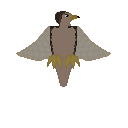

<!-- Generated by tools/build_pack_reference.py. Edit the pack sources and regenerate. -->

# Cart Addon

Additional combat abilities for Mine Mine no Mi.

Installed build `0.9.0-1.20.1`. [Browse all mods](index.md).

See the [fighting style catalog](../../characters/styles/index.md) for moves and training.

## Pack guides

- [Fighting styles](../../characters/fighting-styles.md)

## Abilities

| In-game name | ID | In-game description |
| --- | --- | --- |
| Bludgeon Damage | `cartaddon:bludgeon_damage` |  |
| Cheappo | `cartaddon:cheappo` | Geppo but cheap! |
| Daibutsu Point | `cartaddon:daibutsu_point` |  |
| Gekishin | `cartaddon:gekishin` |  |

## Effects

| In-game name | ID | In-game description |
| --- | --- | --- |
| Disoriented | `cartaddon:disoriented` |  |
| Jogo | `cartaddon:jogo` |  |

## Creatures and entities

| In-game name | ID | In-game description |
| --- | --- | --- |
| Gekishin | `cartaddon:gekishin` |  |
| Kundali Dragon Swarm | `cartaddon:kundali_dragon_swarm` |  |
| Omori Projectile | `cartaddon:omori_projectile` |  |
| Omori Visual | `cartaddon:omori_visual` |  |
| Shinsoku Haku | `cartaddon:shinsoku_haku` |  |

## Items

| In-game name | ID | In-game description |
| --- | --- | --- |
| Izou Kimono Bottom | `cartaddon:izou_kimono_bottom` |  |
| Izou Kimono Top | `cartaddon:izou_kimono_top` |  |
| Izou Sandals | `cartaddon:izou_sandals` |  |
