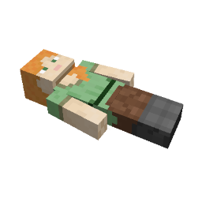

<!-- Generated by tools/build_pack_reference.py. Edit the pack sources and regenerate. -->

# Corpse

Death storage and recovery of dropped equipment.

Installed build `1.20.1-1.0.23`. [Browse all mods](index.md).

## Pack guides

- [Survival at sea · Downed players and death](../../world/survival.md#downed-players-and-death)

## Related mods

- [PlayerRevive](playerrevive.md)

## Creatures and entities

| In-game name | ID | In-game description |
| --- | --- | --- |
| Corpse | `corpse:corpse` |  |
| Corpse of %s | `corpse:corpse_of` |  |
