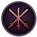
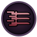
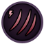

<!-- Generated by tools/build_pack_reference.py. Edit the pack sources and regenerate. -->

# Kyutoryu Asura

{ .entry-page-icon }

[Schools](index.md) · [Haki Realm](../../hakirework.md)

The school master and lesson requirements govern when these techniques unlock. Haki or fighting-style damage scaling applies when the attack uses that category.

[See combat stats](../../../../characters/combat-stats.md).

!!! note "Reading the stats"
    Listed base damage is for the named part of the move. Pack and Doriki multipliers are shown separately. Times assume 20 ticks per second.

<!-- move hakirework:kyutoryu_asura -->

## Kyutoryu: Asura

{ .entry-move-icon loading=lazy }

Kyutoryu Asura. A will so fierce it takes shape, three heads and six arms: every blow strikes three times. Needs a third sword carried.

| Stat | Value |
| --- | --- |
| Conditional cooldown | 30 s (600 ticks) |

<!-- move hakirework:ashura_ichibugin -->

## Ashura: Ichibugin

{ .entry-move-icon loading=lazy }

Kyutoryu Asura. All the blades at once in a dash straight through everyone in front. With Asura raised, every cut lands three times.

| Stat | Value |
| --- | --- |
| Conditional cooldown | 10 s (200 ticks) |

<!-- move hakirework:ashura_makyusen -->

## Ashura: Makyusen

{ .entry-move-icon loading=lazy }

Kyutoryu Asura. Demon Nine Flash: nine blades whirl around the user, and three times in a breath everyone near is cut.

| Stat | Value |
| --- | --- |
| Conditional cooldown | 13 s (260 ticks) |

<!-- move hakirework:kokujo_o_tatsumaki -->

## Kokujo: O Tatsumaki

{ .entry-move-icon loading=lazy }

Kyutoryu Asura. Black Rope Dragon Twister: the three blades whirled into a black tornado; everyone around is dragged in and up and cut again and again, then flung out.

| Stat | Value |
| --- | --- |
| Conditional cooldown | 20 s (400 ticks) |

<!-- move hakirework:king_of_hell -->

## King of Hell: Daisen Sekai

{ .entry-move-icon loading=lazy }

Kyutoryu Asura. The three blades coated in Conqueror's Haki: three slashes thrown at once in a fan, cutting through everyone in red-black lightning; the weak black out. Needs Conqueror's coating.

| Stat | Value |
| --- | --- |
| Conditional cooldown | 45 s (900 ticks) |

## Quests

See [the quest chapter](../../../quests/st_swordsman.md) for milestones and rewards.
