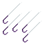
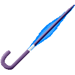

<!-- Generated by tools/build_pack_reference.py. Edit the pack sources and regenerate. -->

# Humming Fencing

{ .entry-page-icon }

[Schools](index.md) · [Haki Realm](../../hakirework.md)

The school master and lesson requirements govern when these techniques unlock. Haki or fighting-style damage scaling applies when the attack uses that category.

[See combat stats](../../../../characters/combat-stats.md).

!!! note "Reading the stats"
    Listed base damage is for the named part of the move. Pack and Doriki multipliers are shown separately. Times assume 20 ticks per second.

<!-- move blitzutility:gavotte_bond_en_avant -->

## Gavotte Bond en Avant

{ .entry-move-icon loading=lazy } *Active*

The user lunges forward quickly and skewers the first enemy they reach.

| Stat | Value |
| --- | --- |
| Cooldown | 8 s (160 ticks) |
| Base damage | 25 HP |

<!-- move blitzutility:swallow_bond_en_avant -->

## Swallow Bond en Avant

{ .entry-move-icon loading=lazy } *Active*

The user leaps high into the air, then dives straight down in a single drawing cut, slicing through everything below.

| Stat | Value |
| --- | --- |
| Cooldown | 12 s (240 ticks) |
| Base damage | 30 HP |

<!-- move blitzutility:aubade_coup_droit -->

## Aubade Coup Droit

{ .entry-move-icon loading=lazy } *Active*

The user jabs their sword forward with such force that a spiraling air slash is fired.

| Stat | Value |
| --- | --- |
| Cooldown | 10 s (200 ticks) |
| Jab damage | 20 HP |

<!-- move hakirework:kasuriuta_fubuki_giri -->

## Kasuriuta: Fubuki Giri

{ .entry-move-icon loading=lazy }

Humming Fencing. A cut too quick to see, then the cold of it: everyone in a wide arc in front is cut and frozen stiff.

| Stat | Value |
| --- | --- |
| Conditional cooldown | 15 s (300 ticks) |

<!-- move blitzutility:prelude_au_fer -->

## Prelude: Au Fer

{ .entry-move-icon loading=lazy } *Active*

The user rapidly jabs at their opponent's weapon, Disarming everyone the jabs hit without hurting them: they can't attack and are locked in place while the barrage keeps landing. While the barrage lasts the user guards, taking half damage and no knockback, and cannot use any other technique.

| Stat | Value |
| --- | --- |
| Cooldown | 20 s (400 ticks) |

<!-- move hakirework:soul_solid -->

## Soul Solid

{ .entry-move-icon loading=lazy }

Humming Fencing. Brook's chill of the underworld drawn along the blade: every sword blow leaves the one it hits frostbitten and slowed, and a blow on someone already slowed freezes them stiff for a moment.

| Stat | Value |
| --- | --- |
| Conditional cooldown | 30 s (600 ticks) |

<!-- move blitzutility:polka_remise -->

## Polka Remise

{ .entry-move-icon loading=lazy } *Active*

The user unleashes a storm of fast jabs, every jab hitting as hard as their sword.

| Stat | Value |
| --- | --- |
| Cooldown | 15 s (300 ticks) |
| Max jab damage | 5 HP |

<!-- move blitzutility:quinte_tierce_fantasia -->

## Quinte Tierce Fantasia

{ .entry-move-icon loading=lazy } *Active*

A quick draw that cuts through everyone in the user's path and everyone standing close by. The cuts land once the user finishes sheathing their blade.

| Stat | Value |
| --- | --- |
| Base damage | 40 HP |
| Cooldown | 15 s (300 ticks) |

<!-- move blitzutility:hanauta_sancho_yahazu_giri -->

## Hanauta Sancho: Yahazu Giri

{ .entry-move-icon loading=lazy } *Active*

Humming a tune, the user dashes through their target in a single quick draw and calmly sheathes their blade. Use it again to finish sheathing, and the cut finally lands.   NORMAL the standard quick draw   TYAMASI a freezing cut with more damage and a longer cooldown, Yomi Yomi no Mi users only

| Stat | Value |
| --- | --- |
| Base damage | 35 HP |
| Cooldown | 9 s (180 ticks) |
| Tyamasi damage | 10 HP |
| Tyamasi cooldown | 10 s (200 ticks) |

## Quests

See [the quest chapter](../../../quests/st_swordsman.md) for milestones and rewards.
