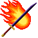
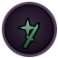
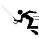
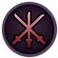
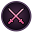
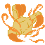
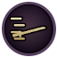

<!-- Generated by tools/build_pack_reference.py. Edit the pack sources and regenerate. -->

# Haki Realm · Schools

[Haki Realm overview](../../hakirework.md)

## Entries

[{ loading=lazy } **Dial Arts**](dial_arts.md)

[{ loading=lazy } **Fishman Jujutsu**](fishman_jujutsu.md)

[{ loading=lazy } **Fox Fire Style**](kitsunebi.md)

[{ loading=lazy } **Hasshoken**](hasshoken.md)

[{ loading=lazy } **Hawk-Eye Style**](hawk_eye.md)

[{ loading=lazy } **Humming Fencing**](hanauta.md)

[{ loading=lazy } **Kyutoryu Asura**](asura.md)

[{ loading=lazy } **Oden Two-Sword Style**](oden_nitoryu.md)

[{ loading=lazy } **Red-Hair Style**](red_hair.md)

[{ loading=lazy } **Ryusoken**](ryusoken.md)

[{ loading=lazy } **Shimotsuki Style**](shimotsuki.md)

[{ loading=lazy } **Sumo**](sumo.md)

