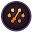

<!-- Generated by tools/build_pack_reference.py. Edit the pack sources and regenerate. -->

# Fox Fire Style

{ .entry-page-icon }

[Schools](index.md) · [Haki Realm](../../hakirework.md)

The school master and lesson requirements govern when these techniques unlock. Haki or fighting-style damage scaling applies when the attack uses that category.

[See combat stats](../../../../characters/combat-stats.md).

!!! note "Reading the stats"
    Listed base damage is for the named part of the move. Pack and Doriki multipliers are shown separately. Times assume 20 ticks per second.

<!-- move blitzutility:homura_saki -->

## Homura Saki

{ .entry-move-icon loading=lazy } *Active*

The user cuts diagonally through everything in front of them and fires a flaming air slash.

| Stat | Value |
| --- | --- |
| Cooldown | 20 s (400 ticks) |
| Slash damage | 15 HP |
| Projectile damage | 25 HP |

<!-- move blitzutility:karyu_issen -->

## Karyu Issen

{ .entry-move-icon loading=lazy } *Active*

The user leaps into the air and unleashes a flaming slash.

| Stat | Value |
| --- | --- |
| Cooldown | 22 s (440 ticks) |
| Base damage | 35 HP |

<!-- move hakirework:kitsunebi -->

## Kitsunebi

{ .entry-move-icon loading=lazy }

Fox Fire Style. The flames on the blade let go as wisps of foxfire that find the enemies in front and burn them.

| Stat | Value |
| --- | --- |
| Conditional cooldown | 10 s (200 ticks) |

<!-- move hakirework:kitsunebi_rinbu -->

## Kitsunebi: Rinbu

{ .entry-move-icon loading=lazy }

Fox Fire Style. The flames held on the blade let go and whirl round the user as a ring of foxfire that burns everyone who comes close; each held flame makes it hotter. Fire doesn't touch the user meanwhile.

| Stat | Value |
| --- | --- |
| Conditional cooldown | 15 s (300 ticks) |

<!-- move hakirework:fox_fire_slash -->

## Fox Fire Slash

{ .entry-move-icon loading=lazy }

Fox Fire Style. The flames held on the blade are thrown back as a burning crescent: each flame makes it bigger and hotter.

| Stat | Value |
| --- | --- |
| Conditional cooldown | 8 s (160 ticks) |

## Quests

See [the quest chapter](../../../quests/st_swordsman.md) for milestones and rewards.
