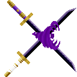
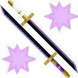

<!-- Generated by tools/build_pack_reference.py. Edit the pack sources and regenerate. -->

# Oden Two-Sword Style

{ .entry-page-icon }

[Schools](index.md) · [Haki Realm](../../hakirework.md)

The school master and lesson requirements govern when these techniques unlock. Haki or fighting-style damage scaling applies when the attack uses that category.

[See combat stats](../../../../characters/combat-stats.md).

!!! note "Reading the stats"
    Listed base damage is for the named part of the move. Pack and Doriki multipliers are shown separately. Times assume 20 ticks per second.

<!-- move hakirework:crossed_blade_guard -->

## Crossed Blade Guard

{ .entry-move-icon loading=lazy }

Oden Two-Sword Style. Both swords crossed in front: every blow from the front stops dead and the attacker is thrown back.

| Stat | Value |
| --- | --- |
| Conditional cooldown | 8 s (160 ticks) |

<!-- move blitzutility:gun_modoki -->

## Gun Modoki

{ .entry-move-icon loading=lazy } *Active*

The user crosses both swords in front of them and charges forward, cutting through everything in their way and sending them flying back. Requires a sword in each hand and Busoshoku Haki: Imbuing.

| Stat | Value |
| --- | --- |
| Cooldown | 12 s (240 ticks) |
| Base damage | 40 HP |

<!-- move blitzutility:tougen_shirataki -->

## Tougen Shirataki

{ .entry-move-icon loading=lazy } *Active*

The user raises both swords and brings them down in opposite directions, firing a diagonal slash from each sword. Requires a sword in each hand.

| Stat | Value |
| --- | --- |
| Cooldown | 12 s (240 ticks) |
| Base damage | 35 HP |

<!-- move hakirework:boiling_resolve -->

## Boiling Resolve

{ .entry-move-icon loading=lazy }

Oden Two-Sword Style. Oden in the boiling pot: no blow takes the last of the user's life, fire doesn't burn and nothing knocks them back.

| Stat | Value |
| --- | --- |
| Conditional cooldown | 60 s (1200 ticks) |

<!-- move blitzutility:tougen_totsuka -->

## Tougen Totsuka

{ .entry-move-icon loading=lazy } *Active*

The user charges and cuts down any that oppose them with an X shaped slash. Damage scales on health of the target. Base damage of 50 + percent health of the opponent above 50% for a max of 100 damage. Requires Haoshoku Infusion and a sword in each hand. Drains the user's haki.

| Stat | Value |
| --- | --- |
| Cooldown | 55 s (1100 ticks) |
| Base damage | 45 HP |

## Quests

See [the quest chapter](../../../quests/st_swordsman.md) for milestones and rewards.
