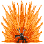

<!-- Generated by tools/build_pack_reference.py. Edit the pack sources and regenerate. -->

# Ryusoken

{ .entry-page-icon }

[Schools](index.md) · [Haki Realm](../../hakirework.md)

The school master and lesson requirements govern when these techniques unlock. Haki or fighting-style damage scaling applies when the attack uses that category.

[See combat stats](../../../../characters/combat-stats.md).

!!! note "Reading the stats"
    Listed base damage is for the named part of the move. Pack and Doriki multipliers are shown separately. Times assume 20 ticks per second.

<!-- move blitzutility:ryu_no_kagizume -->

## Ryu no Kagizume

{ .entry-move-icon loading=lazy } *Active*

The user seizes the target by the head with a dragon's claw, holds them up at arm's length, then slams them into the ground. Ignores armor and breaks the target's guard. Requires an empty hand.

| Stat | Value |
| --- | --- |
| Cooldown | 25 s (500 ticks) |
| Base damage | 40 HP |

<!-- move hakirework:ryu_no_gekirin -->

## Ryusoken: Ryu no Gekirin

{ .entry-move-icon loading=lazy }

Ryusoken. Dragon's Inverted Scale: claw strikes too fast to count, ending in one tearing claw that leaves the target fragile. Needs empty hands.

| Stat | Value |
| --- | --- |
| Conditional cooldown | 10 s (200 ticks) |

<!-- move hakirework:dragons_grip -->

## Ryusoken: Dragon's Grip

{ .entry-move-icon loading=lazy }

Ryusoken. A grip coated in Armament, hard enough to crush stone: the one in front is crushed, held fast and left fragile. Needs empty hands.

| Stat | Value |
| --- | --- |
| Conditional cooldown | 9 s (180 ticks) |

<!-- move blitzutility:ryu_no_ibuki -->

## Ryu no Ibuki

{ .entry-move-icon loading=lazy } *Active*

The user drives their hand into the ground and tears it apart, leaving everyone around them dizzy. The longer it charges, the wider it spreads and the harder the final eruption hits.

| Stat | Value |
| --- | --- |
| Cooldown | 12 s (240 ticks) |
| Min damage | 20 HP |
| Max damage | 60 HP |

## Quests

See [the quest chapter](../../../quests/st_brawler.md) for milestones and rewards.
