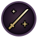

<!-- Generated by tools/build_pack_reference.py. Edit the pack sources and regenerate. -->

# Shimotsuki Style

{ .entry-page-icon }

[Schools](index.md) · [Haki Realm](../../hakirework.md)

The school master and lesson requirements govern when these techniques unlock. Haki or fighting-style damage scaling applies when the attack uses that category.

[See combat stats](../../../../characters/combat-stats.md).

!!! note "Reading the stats"
    Listed base damage is for the named part of the move. Pack and Doriki multipliers are shown separately. Times assume 20 ticks per second.

<!-- move hakirework:ryuma_iai -->

## Iai: Ryuma's Draw

{ .entry-move-icon loading=lazy }

Shimotsuki Style. The sword drawn and sheathed in one flash: the user is through the one they look at before they can move, cutting everyone on the way with Armament.

| Stat | Value |
| --- | --- |
| Conditional cooldown | 8 s (160 ticks) |

<!-- move hakirework:black_blade_shusui -->

## Black Blade: Shusui

{ .entry-move-icon loading=lazy }

Shimotsuki Style. Ryuma's sword turned black with Armament: the blade goes black and every blow with it hits half again as hard. Burns Haki while it lasts.

| Stat | Value |
| --- | --- |
| Conditional cooldown | 30 s (600 ticks) |

<!-- move hakirework:tenryu_otoshi -->

## Tenryu Otoshi

{ .entry-move-icon loading=lazy }

Shimotsuki Style. Heavenly Dragon Drop: a leap far up and forward, then one upright stroke that cuts everything in a line ahead of the landing, Logia bodies too.

| Stat | Value |
| --- | --- |
| Conditional cooldown | 13 s (260 ticks) |

<!-- move hakirework:ryu_giri -->

## Ryu Giri

{ .entry-move-icon loading=lazy }

Shimotsuki Style. The slash that cut a dragon: one great upright wave of Armament through everyone in its path, twice as deep into big creatures.

| Stat | Value |
| --- | --- |
| Conditional cooldown | 30 s (600 ticks) |

## Quests

See [the quest chapter](../../../quests/st_swordsman.md) for milestones and rewards.
