<!-- Generated by tools/build_pack_reference.py. Edit the pack sources and regenerate. -->

# Mods

Browse the mods in Eternal Voyage. Each page has its in-game content and links to the rules and guides that apply in this pack.

## Characters, abilities and progression

[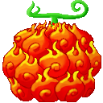{ loading=lazy } **Mine Mine no Mi** Character creation, crews, Devil Fruits and the core combat system.](../../reference/content/mineminenomi.md)

[{ loading=lazy } **Haki Realm** Awaken Haki, build a mastery tree, train under a school master and earn Conqueror’s Haki.](../../reference/content/hakirework.md)

[{ loading=lazy } **Race Race no Mi** Races, subraces, lineage factors, cyborg parts and Germa Raid Suits.](../../reference/content/racenomi.md)

[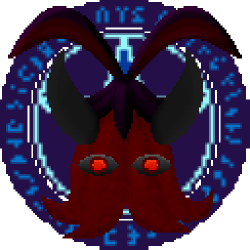{ loading=lazy } **Akuma no Mi** Noble Box fruits, unusual transformations and bloodline powers.](../../reference/content/akuma.md)

[{ loading=lazy } **AkumaLib** Body-size effects, lineage capacity, the shared fruit box pools and profession progression.](../../reference/content/akumalib.md)

[{ loading=lazy } **Awaken Awaken no Mi** Awakened techniques and forms for Devil Fruit users.](../../reference/content/awakenawakennomi.md)

[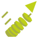{ loading=lazy } **Awaken Path** Unlock fruit awakenings through Doriki and active time with the fruit.](../../reference/content/mineminenomiawakenpath.md)

[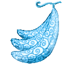{ loading=lazy } **InoFruits** Additional Paramecia, Logia and Zoan fruits, including fruit-specific moves and forms.](../../reference/content/inofruits.md)

[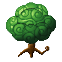{ loading=lazy } **Missing Missing no Mi** An expanded fruit roster with new moves, forms and lineages.](../../reference/content/inomissing.md)

[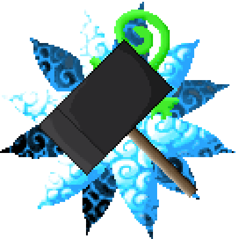{ loading=lazy } **Blitz Utility** Nitoryu, Okama Kenpo, weapon arts and additional Devil Fruits.](../../reference/content/blitzutility.md)

[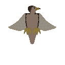{ loading=lazy } **Cart Addon** Additional combat abilities for Mine Mine no Mi.](../../reference/content/cartaddon.md)

[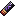{ loading=lazy } **Black Blades & Fists** Develop cursed blades, forge a Black Blade or progress with Black Fists.](../../reference/content/blackhaki.md)

[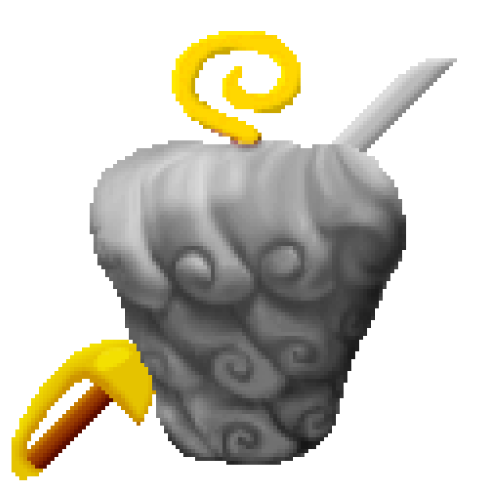{ loading=lazy } **Infusion no Mi** Bind a Devil Fruit to compatible equipment and develop its companion powers.](../../reference/content/infusion.md)

[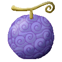{ loading=lazy } **Devil Fruit Lives** A lives mechanic for Devil Fruit powers.](../../reference/content/devilfruitlives.md)

[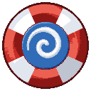{ loading=lazy } **Cruise Cruise no Mi** Fourteen trades, talent trees, shipbuilding, settlements, events and trade routes.](../../reference/content/inocruise.md)

## Exploration, sailing and encounters

[{ loading=lazy } **One Piece World** The Blues, Grand Line, Red Line, island routes, currents and Log Pose progression.](../../reference/content/ompworld.md)

[{ loading=lazy } **Eternal Voyage Companion** Regional encounters, Clima-Tact storms, starter island invitations, and ship recovery.](../../reference/content/eternalvoyage.md)

[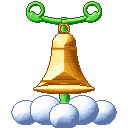{ loading=lazy } **Sky Island** Ride the Knock-Up Stream to Skypiea, explore the cloud sea and face the Upper Yard ordeals.](../../reference/content/inosky.md)

[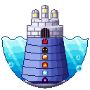{ loading=lazy } **Impel Down** The Calm Belt prison, from Gates of Justice to the Eternal Hell.](../../reference/content/inoimpel.md)

[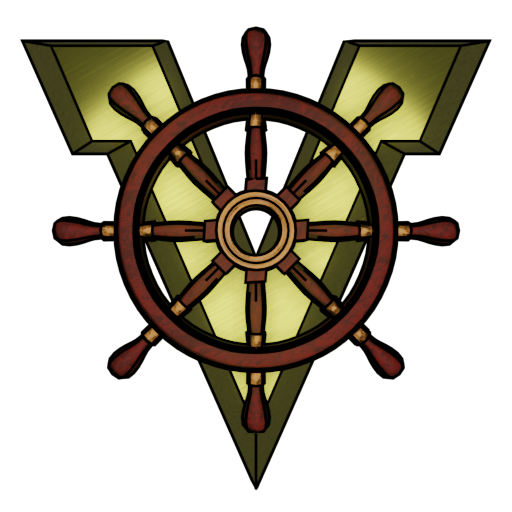{ loading=lazy } **Valkyrien Skies 2** Physics for ships built from blocks, including ship travel through the Knock-Up Stream.](../../reference/content/valkyrienskies.md)

[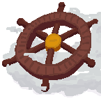{ loading=lazy } **Eureka! Ships!** Build and steer block-built ships with Valkyrien Skies.](../../reference/content/vs_eureka.md)

[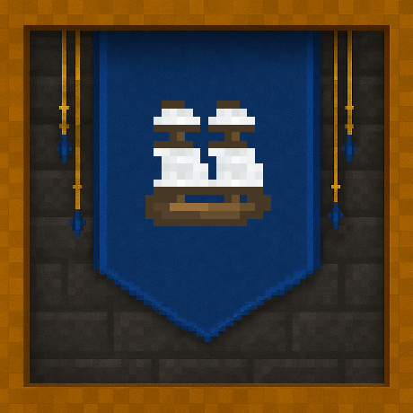{ loading=lazy } **Small Ships** Launch crafted sailing ships with cargo, sails, and ship cannons.](../../reference/content/smallships.md)

[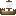{ loading=lazy } **Mine Mine no Mi Small Ships** Crew ownership and Jolly Roger sails for Small Ships.](../../reference/content/mmnm_small_ships.md)

[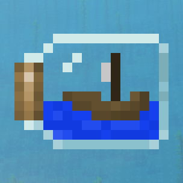{ loading=lazy } **Ship In A Bottle** Pack an assembled ship for transport and launch it again at open water.](../../reference/content/ship_in_a_bottle.md)

[{ loading=lazy } **Ship Retrieval Service** Name your ship and use equipped harbors to call it to a dock.](../../reference/content/srs.md)

[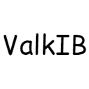{ loading=lazy } **Valkyrien Icebreakers** Fit an Ice Breaker to the bow for travel through surface ice.](../../reference/content/valkib.md)

[{ loading=lazy } **Respawning Structures** Selected structures can recover between visits.](../../reference/content/respawningstructures.md)

[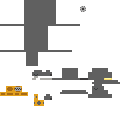{ loading=lazy } **Proximity Chat** Talk to nearby players in local text chat.](../../reference/content/proximitychat.md)

[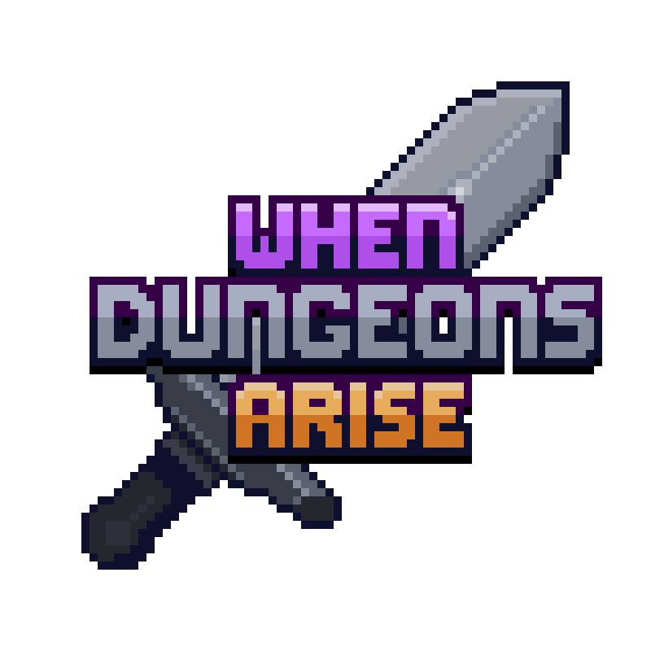{ loading=lazy } **When Dungeons Arise** Bandit camps, temples, mines and ruins with regional encounters and treasure.](../../reference/content/dungeons_arise.md)

[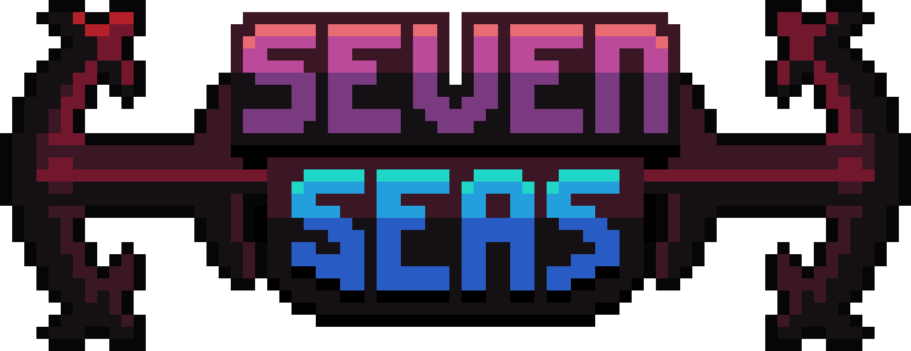{ loading=lazy } **When Dungeons Arise: Seven Seas** Fortified ships and sea encounters, including the Victory Frigate and Unicorn Galleon.](../../reference/content/dungeons_arise_seven_seas.md)

[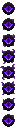{ loading=lazy } **L_Ender’s Cataclysm** Dungeons, bosses and equipment, with separate health values for major encounters.](../../reference/content/cataclysm.md)

[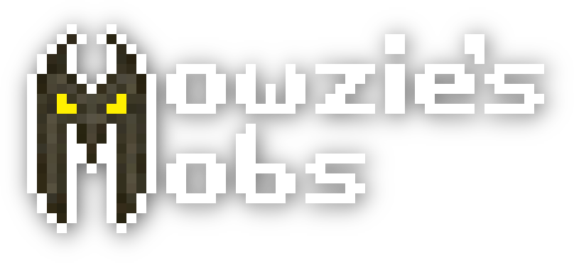{ loading=lazy } **Mowzie’s Mobs** Ruins, creatures and bosses such as the Ferrous Wroughtnaut, Frostmaw and Umvuthi.](../../reference/content/mowziesmobs.md)

[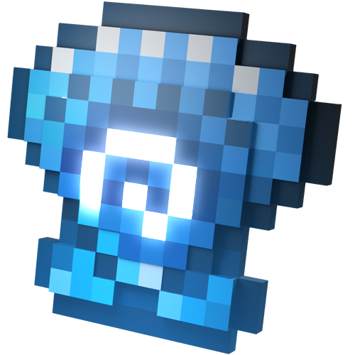{ loading=lazy } **Aquamirae** Cold-water encounters, wrecks, equipment and hostile sea creatures.](../../reference/content/aquamirae.md)

[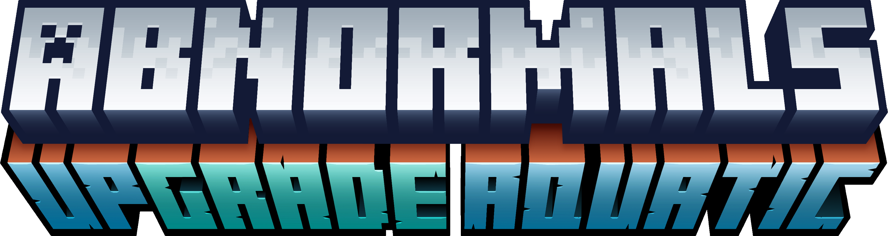{ loading=lazy } **Upgrade Aquatic** More ocean wildlife, aquatic plants, blocks and items.](../../reference/content/upgrade_aquatic.md)

[{ loading=lazy } **Weather2** Local storms, wind, hail, cyclones and forecasts that vary across the seas.](../../reference/content/weather2.md)

[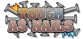{ loading=lazy } **Tough As Nails** Body temperature, climate hazards and armor materials for hot and cold voyages.](../../reference/content/toughasnails.md)

[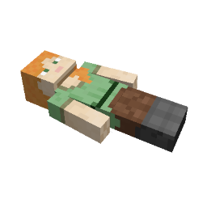{ loading=lazy } **Corpse** Death storage and recovery of dropped equipment.](../../reference/content/corpse.md)

[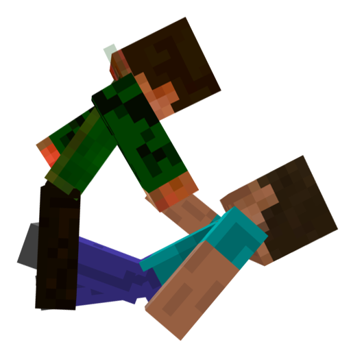{ loading=lazy } **PlayerRevive** Multiplayer bleed-out and teammate revival.](../../reference/content/playerrevive.md)

[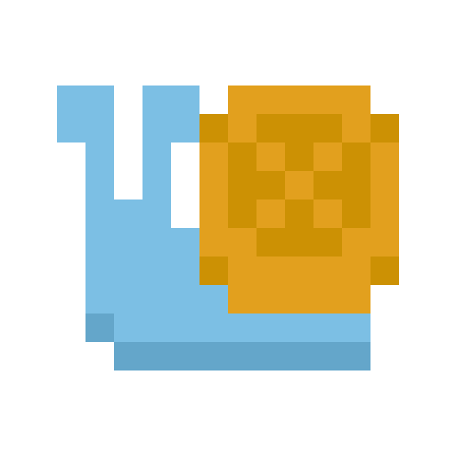{ loading=lazy } **Transponder Snails** In-world snail communications.](../../reference/content/transpondersnails.md)

[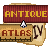{ loading=lazy } **Antique Atlas** Map landfalls, terrain, routes and waypoints while you explore.](../../reference/content/antique_atlas.md)

[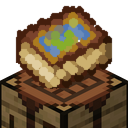{ loading=lazy } **AA4 Atlas** Atlas display support for voyagers using Antique Atlas.](../../reference/content/aa4_atlas.md)

[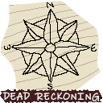{ loading=lazy } **Dead Reckoning** Show compass bearings and Atlas markers while you sail.](../../reference/content/dead_reckoning.md)

[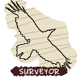{ loading=lazy } **Surveyor Map Framework** Discovery and map sharing for crews.](../../reference/content/surveyor.md)

## Quest book and support

[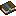{ loading=lazy } **FTB Quests** The Eternal Voyage quest book, with personal paths and shared milestones.](../../reference/content/ftbquests.md)

[{ loading=lazy } **FTB Teams** Quest team support. Your Eternal Voyage quest progress is personal.](../../reference/content/ftbteams.md)

[{ loading=lazy } **FTB Library** Shared menus and tools for the FTB mods used by the quest book.](../../reference/content/ftblibrary.md)

[{ loading=lazy } **FTB XMod Compat** Connects the quest book to pack-specific tasks and rewards.](../../reference/content/ftbxmodcompat.md)

[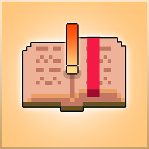{ loading=lazy } **ExtraQuests** Additional quest mechanics used in the book, including calendar-based quests.](../../reference/content/extraquests.md)

[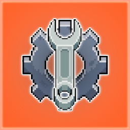{ loading=lazy } **ExtraLib** Shared support for ExtraQuests.](../../reference/content/extralib.md)

[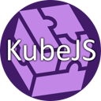{ loading=lazy } **KubeJS** Runs custom quests, treasure tables, fishing and arena rules.](../../reference/content/kubejs.md)

[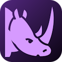{ loading=lazy } **Rhino** Runs the JavaScript used by the pack’s KubeJS scripts.](../../reference/content/rhino.md)

[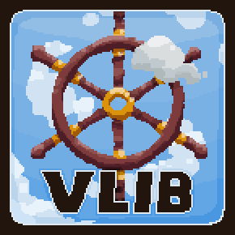{ loading=lazy } **VLib** Shared support for Valkyrien ship add-ons.](../../reference/content/vlib.md)

[{ loading=lazy } **GlitchCore** Shared library used by Tough As Nails.](../../reference/content/glitchcore.md)

