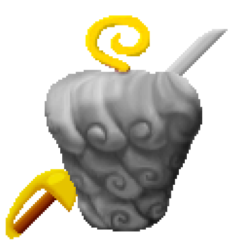

<!-- Generated by tools/build_pack_reference.py. Edit the pack sources and regenerate. -->

# Infusion no Mi

Bind a Devil Fruit to compatible equipment and develop its companion powers.

Installed build `0.0.5-1.20.1`. [Browse all mods](index.md).

## Pack guides

- [Blades, Wills and Haki](../../reference/quests/special_weapons.md)
- [Devil Fruits and awakenings](../../characters/devil-fruits.md)

## Abilities

| In-game name | ID | In-game description |
| --- | --- | --- |
| Ancient Bite | `infusion:ancient_bite_weapon` | Your next strike with the infused weapon bites like an allosaurus, dealing moderate damage and making the target bleed. |
| Ancient Stomp | `infusion:ancient_stomp_summon` | The summoned mammoth stomps the ground again and again, sending shockwaves that hurt and daze nearby enemies. Only the mammoth itself can use this. |
| Ancient Sweep | `infusion:ancient_sweep_weapon` | Sweeps the infused weapon like a mammoth trunk, hitting all enemies in a frontal cone. |
| Ancient Tail Spin | `infusion:ancient_tail_spin_weapon` | Spins around, hitting all nearby enemies with the infused weapon like an allosaurus tail. |
| Ancient Trunk Shot | `infusion:ancient_trunk_shot_weapon` | Your next strike with the infused weapon hits like a massive mammoth trunk, launching the target. |
| Anubisu no Shinpan | `infusion:anubisu_no_shinpan_weapon` | The user jumps at the target and bites it to finish it off, it does almost nothing to a healthy target but a lot to a target that is low on health. |
| Assault Point | `infusion:pteranodon_assault_point_weapon` | The weapon takes on the pteranodon's assault form, gaining +1 reach and +3 damage while held. Critical hits deal double the usual multiplier, and hits have a 1 in 5 chance to break the target's guard. |
| Assault Point | `infusion:phoenix_assault_point_weapon` | The weapon takes on the phoenix's assault form, dealing +2 damage while held and giving you +25 max health and 1.25x regeneration. |
| Assault Point | `infusion:eagle_assault_point_weapon` | The weapon strikes with an eagle's weight, dealing +3 damage and +0.5 attack speed while held. Its hits have a 1 in 20 chance to make the target bleed. |
| Assault Point | `infusion:falcon_assault_point_weapon` | The weapon moves with a falcon's speed, dealing +2 damage and +0.5 attack speed while held. |
| Assault Point | `infusion:albatross_assault_point_weapon` | The weapon carries the albatross's sea winds, dealing +1 damage while held and making you 5% faster while you are in an ocean biome. |
| Assault Point | `infusion:vampire_assault_point_weapon` | The weapon thirsts like a vampire, dealing +4 damage while held. Its hits have a 1 in 10 chance to steal between 10 and 20 health from the target and give it to you. |
| Assault Point | `infusion:pegasus_assault_point_weapon` | The weapon strikes with a pegasus hoof, dealing +4 damage while held. Its hits have a 1 in 20 chance to leave the target dizzy for a second. |
| Assault Point | `infusion:batto_assault_point_weapon` | The weapon takes on a bat's ferocity, dealing +2 damage while Assault Point is active. Its hits have a 1 in 10 chance to make the target bleed for 3 seconds. |
| Assault Point | `infusion:blitz_vampire_assault_point_weapon` | The weapon takes on the vampire's thirst, dealing +6 damage while Assault Point is active. Its hits have a 1 in 10 chance to steal 20 health from the target. |
| Axolotl Heal | `infusion:axolotl_heal_weapon` | Regenerates all friendlies nearby based on how many axolotls are around. The infused weapon always counts as one. |
| Banken | `infusion:banken_weapon` | The user guards the ally they look at and takes part of the hits for them, and growls so the enemies close by deal less damage. |
| Barizodon | `infusion:barizodon_weapon` | Swings the infused weapon like pteranodon wings, shooting out a barrage of air blades. |
| Batto Bite | `infusion:batto_bite_weapon` | Grab a target and sink bat fangs into it, weakening it, making it bleed and leaving it drowsy. |
| Beak Grab | `infusion:beak_grab_summon` | The summoned pteranodon grabs its target in its beak and carries it off. Only the pteranodon itself can use this. |
| Beak Strike | `infusion:albatross_beak_strike_weapon` | Throw yourself at the target and strike it with a long albatross beak, pushing it back. |
| Beetle Ram | `infusion:beetle_ram_summon` | The summoned beetle charges forward with its horn, damaging all enemies in its path and pushing them away. The charge also breaks leaves, glass and wood. Only the beetle itself can use this. |
| Beetle Upper | `infusion:beetle_upper_weapon` | Dash forward while spinning and headbutt all enemies in your path, launching them into the air. |
| Belly Bash | `infusion:belly_bash_weapon` | While in the hybrid form, the user throws themselves forward belly first, hitting the first enemy in their way and sending it far back. |
| Belly Drum | `infusion:belly_drum_weapon` | While in the hybrid form, the user drums on their belly, each beat hitting all the enemies around them. The last beat pushes them back. |
| Big Bark | `infusion:dachshund_big_bark_weapon` | Bark far too loud for your size at the enemies in front of you. Small creatures run away and the others are slowed and lose their target for a moment. |
| Bigan | `infusion:giraffe_bigan_weapon` | Your next strike with the infused weapon hits like the giraffe's hardened nose, launching the target away. |
| Bison Smash | `infusion:bison_smash_summon` | The summoned bison hurts and knocks back enemies it charges into. Only the bison itself can use this. |
| Blood Burst | `infusion:blood_burst_weapon` | Fire a pulsing burst of dark blood that splashes on impact and leaves the target bleeding. |
| Blood Step | `infusion:blood_step_weapon` | Melt into darkness and reappear a short distance ahead. |
| Blue Bird | `infusion:blue_bird_weapon` | Builds up momentum through the infused weapon's blue flames to deliver a devastating kick. |
| Bolo Breath | `infusion:bolo_breath_weapon` | Gathers flames and unleashes a devastating draconic heat ray. In its alternate mode three massive fireballs are spat out instead, exploding on impact. |
| Bolo Breath | `infusion:missing_seiryu_bolo_breath_weapon` | Breathe a great beam of fire that burns every enemy in it and blows up where it lands, breaking blocks and starting fires. It can't be used underwater. |
| Brachio Bomber | `infusion:brachio_bomber_weapon` | Leaps up and crashes down on the opponent with the infused weapon's brachiosaurus weight, blasting the ground. |
| Brachio Grab | `infusion:brachio_grab_weapon` | Grabs an opponent with the infused weapon's brachiosaurus strength and squashes them. |
| Brain Point | `infusion:ratatoskr_brain_point_weapon` | Calls forth Ratatoskr from the infused weapon. You can ride it, and it fights beside you using the Haki you have unlocked, Gnaw, Niflheim, Freeze Over and Shatter. |
| Brain Point | `infusion:cart_bake_danuki_brain_point_weapon` | The weapon takes on the Bake Danuki's trickery. While Brain Point is active it deals +3 damage and swings 15% faster, and every hit bursts into blue flames that set the target on fire for 2 seconds. |
| Burrow | `infusion:burrow_summon` | The summoned tanuki digs in where it stands. For a moment nothing can hit it, but it cannot move or use other abilities. Only the tanuki itself can use this. |
| Carry Off | `infusion:carry_off_weapon` | Calls your summoned eagle to swoop down, snatch you up and fly you somewhere safe: your bed or respawn point, or the world spawn if you have none. Use it again while being carried to be dropped off early. Needs the eagle to be summoned. |
| Charge | `infusion:pegasus_charge_summon` | The summoned pegasus gallops forward on the ground or in the air, running through every enemy in front of it and throwing them aside. Its riders stay on. Only the pegasus itself can use this. |
| Charge | `infusion:pegasus_charge_weapon` | The user gallops forward on the ground or in the air, running through every enemy in front of them and throwing them aside. The riders stay on. |
| Choyaku | `infusion:choyaku_weapon` | While in a jackal form, the user leaps very high where they look and lands without getting hurt. The whole jackal goes higher. |
| Claw Rake | `infusion:claw_rake_weapon` | Slash all the enemies in front of you with saber tiger claws, making them bleed and pushing them back. |
| Claw Strike | `infusion:claw_strike_weapon` | Your next strike with the infused weapon tears in like a leopard's sharp claws. |
| Clawed Palm Burst | `infusion:clawed_palm_burst_weapon` | Your next hit with the infused weapon unleashes concentrated fire on the target, launching an explosive flaming shockwave forward. |
| Cling | `infusion:cling_weapon` | Latch onto the enemy in front of you and maul it. It is slowed, bleeds and takes damage. Use the ability again to let go. |
| Cocoon | `infusion:cocoon_weapon` | Wind a nearby enemy that is already caught in a web, a trap or Marianette in a cocoon of silk. It cannot move and is poisoned for a while. |
| Coiled Guard | `infusion:coiled_guard_weapon` | Serpent necks close around you like a shield, reducing the damage you take. While it holds you are slowed and cannot attack. Use the ability again to open it. |
| Crow | `infusion:tama_crow_weapon` | Crow so loud that all enemies around you are shaken, slowing and weakening them for a moment. |
| Crushing Leap | `infusion:crushing_leap_summon` | The summoned spinosaurus leaps high and crushes the ground when landing, damaging and pushing away all nearby enemies. Only the spinosaurus itself can use this. |
| Daibutsu Point | `infusion:daibutsu_point_weapon` | Calls forth a giant golden Buddha from the infused weapon that fights beside you using the Haki you have unlocked. |
| Daija Shime | `infusion:daija_shime_weapon` | The user coils their body into a huge ring around them, then tightens it more and more. The enemies inside cant get out and get crushed together in the middle. |
| Dark Shot | `infusion:dark_shot_weapon` | Spit a shot of dark matter where you are looking, which blinds the enemy it hits. At night or in the dark, the shot splits in three. |
| Darkness | `infusion:darkness_weapon` | Spread an unnatural darkness around you in which enemies can barely see. It disappears after you take enough damage, and inside it your abilities work as if it were night. Use the ability again to lift it. |
| Dash | `infusion:tama_chick_dash_summon` | The summoned rooster leans forward and runs much faster for a few seconds. Only the rooster itself can use this. |
| Dash | `infusion:tama_chick_dash_weapon` | As a chick or a rooster the user leans forward and runs much faster for a few seconds. |
| Devil Forged: Item Infusion | `infusion:devil_forged_item_infusion` | Hold a zoan devil fruit in one hand and an item that can be infused in the other, then forge them together. The zoan has a 3 in 4 chance to be infused into the item. If the forging fails the item loses half of its durability. |
| Devil Forged: Separation | `infusion:devil_forged_separation` | Hold an infused item and pull the devil fruit back out of it. The item loses its infusion and the devil fruit returns to you. |
| Devour | `infusion:devour_summon` | One of the summoned Orochi heads bites a piece out of the enemy in front of it and swallows it, healing the Orochi by half of the damage dealt. Only the Orochi itself can use this. |
| Devour | `infusion:devour_weapon` | One of the user's heads bites a piece out of the enemy in front of them and swallows it, healing the user by half of the damage dealt. |
| Disguise | `infusion:kyubi_disguise_summon` | The summoned kitsune takes the look of the last creature it hit and keeps it until it is struck. Only the kitsune itself can use this. |
| Dive | `infusion:pegasus_dive_summon` | The summoned pegasus leaps into the air if it is on the ground, then dives on its target. Every enemy around the landing is hit and thrown out. Only the pegasus itself can use this. |
| Dive | `infusion:pegasus_dive_weapon` | The user leaps into the air if on the ground, then dives on the enemy they look at or the spot they aim at. Every enemy around the landing is hit and thrown out. |
| Dragon Storm | `infusion:missing_seiryu_storm_summon` | The summoned Seiryu calls a storm, roaring down lightning on the nearest enemies. Only Seiryu itself can use this. |
| Draining Bite | `infusion:draining_bite_weapon` | Bite the enemy in front of you and drain its youth. It grows old, slower and weaker while you are healed and become stronger and faster. Each bite makes you stronger. |
| Dread Gaze | `infusion:dread_gaze_summon` | The summoned onyudo stares down the nearby enemies looking at it, weakening and slowing them. Only the onyudo itself can use this. |
| Dread Gaze | `infusion:dread_gaze_weapon` | The user stares down the nearby enemies that are looking at them, weakening and slowing them. Enemies that look away are not affected. |
| Dream Manifestation: Items | `infusion:dream_manifestation_items_weapon` | Your next hit with the infused weapon on a sleeping target manifests a random item from their dreams. |
| Earth Splitter | `infusion:earth_splitter_summon` | The summoned onyudo raises its weapon and brings it down, splitting the ground in a long line in front of it. Enemies on the line take heavy damage and are knocked down. Only the onyudo itself can use this. |
| Echo Location | `infusion:batto_echo_location_summon` | The summoned bat lets out a high pitched screech that reveals every player and creature nearby through walls for 3 seconds, and its summoner sees them too. Only the bat itself can use this. |
| Echo Location | `infusion:vampire_echo_location_summon` | The summoned vampire bat screeches and reveals every player and creature nearby through walls, and its summoner sees them too. Only the vampire bat itself can use this. |
| Echolocation | `infusion:echolocation_weapon` | Let out a cry that reveals all nearby enemies through walls for a few seconds. At night or in the dark, the cry reaches further. |
| Eight Heads | `infusion:cart_eight_heads_summon` | Each of the summoned Yamata no Orochi's eight heads is a life. A killing blow costs it a head instead, and it only falls once all eight are cut. Heads that were cut grow back once it goes 2 minutes without taking damage. |
| Eight Lives | `infusion:eight_lives_summon` | The summoned Orochi has 8 heads. A blow that would kill it cuts off a head instead and leaves it with a quarter of its health. Lost heads grow back after 4 minutes. Only the Orochi itself has this. |
| Eightfold Strike | `infusion:eightfold_strike_weapon` | All eight serpent heads strike the enemy in front of you one after the other. The last hit sends it back. |
| Evasive Leap | `infusion:evasive_leap_summon` | The summoned saber tiger leaps backwards and cannot be hit during the jump. Only the saber tiger itself can use this. |
| Evasive Leap | `infusion:evasive_leap_weapon` | The user leaps backwards and can't be hit during the jump. |
| Feather Volley | `infusion:pegasus_feather_volley_weapon` | Beat pegasus wings and send a fan of feathers where you look, each one cutting the first enemy it meets. |
| Ferocious Leap | `infusion:ferocious_leap_weapon` | Leaps at the enemy with the infused weapon and damages all nearby enemies on landing. |
| Fiddle Banff | `infusion:fiddle_banff_weapon` | Charges forward with the infused weapon's bison strength, damaging and knocking back everything in the way. |
| Fly Point | `infusion:pteranodon_fly_point_weapon` | Calls forth a pteranodon from the infused weapon. You can ride and fly it, and it fights beside you using the Haki you have unlocked, Beak Grab and Tankyudon. |
| Fly Point | `infusion:phoenix_fly_point_weapon` | Calls forth a phoenix from the infused weapon. You can ride and fly it, and it fights beside you using the Haki you have unlocked and Tensei no Soen. |
| Fly Point | `infusion:nidhoggr_fly_point_weapon` | Calls forth Nidhoggr from the infused weapon. Up to four people can ride and fly it, and it fights beside you using the Haki you have unlocked, Ragna Izuchi, Ragna Go Arrow, Ragna Jinhiem, Thrudhiem and Lightning Reign. It shrugs off fire, lightning and freezing. |
| Fly Point | `infusion:nue_fly_point_weapon` | Calls forth a Nue from the infused weapon. You can ride and fly it, and it fights beside you using the Haki you have unlocked, its Imperial Flames and every Nue technique. |
| Fly Point | `infusion:kirin_fly_point_weapon` | Calls forth a Kirin from the infused weapon. You and a friend can ride and fly it, and it fights beside you using the Haki you have unlocked, Slumbertize, Dream Manifestation: Items and Nightmare Rifts. |
| Fly Point | `infusion:seiryu_fly_point_weapon` | Calls forth Seiryu, the azure dragon, from the infused weapon. Up to four people can ride and fly it, and it fights beside you using the Haki you have unlocked, Bolo Breath, Kaifu, Tatsumaki, Seiryu Chomp and Shoryu Kaen Hakke. Once it drops below a quarter of its health it wreathes itself in Kaen Daiko. |
| Fly Point | `infusion:eagle_fly_point_weapon` | Calls forth a great eagle from the infused weapon. Two people can ride and fly it, and it fights beside you using the Haki you have unlocked and Talon Strike. While it is out, Carry Off calls it to snatch you up and fly you somewhere safe. |
| Fly Point | `infusion:falcon_fly_point_weapon` | Calls forth a big falcon from the infused weapon. Two people can ride and fly it, and it fights beside you using the Haki you have unlocked, Kyukoka, Tsukami Otoshi and Tobizume. |
| Fly Point | `infusion:albatross_fly_point_weapon` | Calls forth a great albatross from the infused weapon. Two people can ride and fly it, and it fights beside you using the Haki you have unlocked and Beak Strike. |
| Fly Point | `infusion:vampire_fly_point_weapon` | Calls forth a giant vampire bat from the infused weapon that flies beside you and fights using the Haki you have unlocked, Red Dash and Swarm of Bats. |
| Fly Point | `infusion:pegasus_fly_point_weapon` | Calls forth a pegasus from the infused weapon. Two people can ride and fly it, and it fights beside you using the Haki you have unlocked, Charge, Dive, Rearing, Wing Gust and Feather Volley. |
| Fly Point | `infusion:missing_seiryu_fly_point_weapon` | Calls forth Seiryu, the azure dragon, from the infused weapon as a full 30 block serpent. Up to four people can ride and fly it along its back, and it fights beside you using the Haki you have unlocked, Bolo Breath, Kaifu, Seiryu Bite, Seiryu Claws, Tail Grab, Tail Sweep, Tatsumaki and Dragon Storm. Once it drops below a quarter of its health it wraps itself in Kaen Daiko. |
| Fly Point | `infusion:batto_fly_point_weapon` | Calls forth a bat companion from the infused weapon that flies beside you and fights using the Haki you have unlocked, Batto Bite, Sonic Boom and Echo Location. When it uses Echo Location you see what it reveals. |
| Fly Point | `infusion:blitz_vampire_fly_point_weapon` | Calls forth a mythical vampire bat from the infused weapon. It is very strong and fights beside you using the Haki you have unlocked and every Vampire ability. When it uses Echo Location you see what it reveals. |
| Fortune's Blessing | `infusion:cart_fortunes_blessing_summon` | The summoned Bake Danuki blesses itself and its allies with strength, speed, resistance, regeneration and luck while cursing nearby enemies with weakness, slowness, wither and bad luck. Only the Bake Danuki itself can use this. |
| Four Arm Rush | `infusion:four_arm_rush_weapon` | Launch a flurry of fast punches at the enemies in front of you. The last punch sends them flying. |
| Fox Fire | `infusion:kyubi_fox_fire_weapon` | Send three pale flames that follow the enemy you look at, or the nearest monster, and set it on fire. |
| Fox Fire Ring | `infusion:kyubi_fox_fire_ring_weapon` | Pale flames turn around you and burn the enemies they touch. Use it again to send the flames left at the enemy you look at. |
| Freeze Over | `infusion:freeze_over_weapon` | Unleashes a freezing blizzard from the infused weapon for 5 seconds, freezing nearby targets. Targets that are already Frozen are locked in Flash Freeze. |
| Frenzy | `infusion:frenzy_summon` | The summoned spinosaurus deals more damage to enemies that have less than half of their health. Only the spinosaurus itself can use this. |
| Frill Flight | `infusion:frill_flight_weapon` | A triceratops frill spins like a propeller around your neck, letting you fly for a while. |
| Frost Weapon | `infusion:missing_okuchi_frost_weapon_weapon` | The user coats what they fight with in ice, in any form or none. |
| Frozen Field | `infusion:freezing_field_weapon` | Plants the infused weapon and freezes a huge area around you along with everyone inside of it. |
| Fujiazami | `infusion:fujiazami_weapon` | While midair, forms a protective swirl of the infused weapon's fire in front of you that blocks most attacks. |
| Gagan | `infusion:gagan_weapon` | Shoot a fang shaped blast of air at the enemy you are looking at. It goes through part of its armor. |
| Gekko Jusshigan | `infusion:gekko_jusshigan_weapon` | Jump at the target and stab it with all 10 claws. Deals more damage during the night. |
| Giant's Stomp | `infusion:giants_stomp_summon` | The summoned onyudo stomps the ground. All nearby enemies standing on it are damaged and knocked down for a moment. Only the onyudo itself can use this. |
| Giant's Stomp | `infusion:giants_stomp_weapon` | The user stomps the ground, all nearby enemies standing on it are damaged and knocked down for a moment. |
| Give Back | `infusion:give_back_weapon` | Give back the youth you drained. Everyone you have bitten is young again and you lose the strength you gained. |
| Gnaw | `infusion:gnaw_summon` | The summoned Ratatoskr grabs an opponent and bites them with freezing teeth, leaving them dizzy and locked in Flash Freeze. Only Ratatoskr itself can use this. |
| Great Stomp | `infusion:great_stomp_summon` | The summoned elephant stomps the ground, sending out a shockwave that hurts and lifts nearby enemies. Only the elephant itself can use this. |
| Great Sweep | `infusion:great_sweep_weapon` | Sweep the infused weapon in a wide arc in front of you, hitting all the enemies there and sending them away. A better weapon deals more damage. |
| Ground Stomp | `infusion:ground_stomp_summon` | The summoned triceratops stomps the ground. All nearby enemies standing on it are damaged, pushed away and slowed. Only the triceratops itself can use this. |
| Guard Point | `infusion:zou_guard_point_weapon` | Calls forth an elephant from the infused weapon. Two people can ride it, and it fights beside you using the Haki you have unlocked, Great Stomp, Trunk Shot and Ivory Dart. |
| Guard Point | `infusion:kame_guard_point_weapon` | Calls forth a turtle from the infused weapon. You can ride it, and it fights beside you using the Haki you have unlocked. |
| Guard Point | `infusion:brachiosaurus_guard_point_weapon` | Calls forth a brachiosaurus from the infused weapon. Three people can ride it, and it fights beside you using the Haki you have unlocked. |
| Guard Point | `infusion:mammoth_guard_point_weapon` | Calls forth a mammoth from the infused weapon. Three people can ride it, and it fights beside you using the Haki you have unlocked, Ancient Stomp and Trample. |
| Guard Point | `infusion:onyudo_guard_point_weapon` | Calls forth a giant onyudo monk from the infused weapon that fights beside you using the Haki you have unlocked, Giant's Stomp, Dread Gaze and Earth Splitter. |
| Guard Point | `infusion:rosamygale_guard_point_weapon` | The weapon drips with Venom Bite's poison, dealing +3 damage while held. Its hits have a 1 in 5 chance to poison the target for 3 seconds. |
| Guard Point | `infusion:triceratops_guard_point_weapon` | Calls forth a triceratops from the infused weapon. Two people can ride it, and it fights beside you using the Haki you have unlocked, Horn Charge, Horn Lift, Ground Stomp and Thick Hide. |
| Hane Arashi | `infusion:hane_arashi_weapon` | Flap falcon wings, pushing back all enemies in front of you. Projectiles are sent back too. |
| Hane Tsubute | `infusion:hane_tsubute_weapon` | Flap falcon wings and throw 4 sharp feathers where you are looking. |
| Hard Gum | `infusion:hard_gum_weapon` | Throw a mass of sticky web where you are looking. It holds everything that walks into it, disappears after a while, burns easily and shatters in the cold. |
| Hayabusa no Me | `infusion:hayabusa_no_me_weapon` | Look around with the eyes of a falcon. All living beings around you can be seen through walls for 10 seconds. |
| Hayatobi | `infusion:hayatobi_weapon` | While in a cheetah form, the user leaps on the target and strikes it. Deals more damage if the user was running. |
| Heavy Point | `infusion:giraffe_heavy_point_weapon` | The weapon takes on the giraffe's heavy build, gaining +2 reach and +2 damage while held. |
| Heavy Point | `infusion:bison_heavy_point_weapon` | The weapon takes on the bison's heavy build, dealing +3 damage while held. Its hits have a 1 in 5 chance to leave the target dizzy. |
| Heavy Point | `infusion:zou_heavy_point_weapon` | The weapon takes on the elephant's heavy build, gaining +1 reach and +2 damage while held. |
| Heavy Point | `infusion:mogu_heavy_point_weapon` | Calls forth a mole from the infused weapon that fights beside you using the Haki you have unlocked. |
| Heavy Point | `infusion:sai_heavy_point_weapon` | The weapon takes on the rhino's heavy build, dealing +3 damage and +1 knockback while held. Its hits have a 1 in 5 chance to make the target bleed. |
| Heavy Point | `infusion:axolotl_heavy_point_weapon` | The weapon takes on the axolotl's hybrid form, dealing +2 damage and raising your regeneration rate by 5 percent while held. Its hits have a 1 in 5 chance to poison the target. |
| Heavy Point | `infusion:leopard_heavy_point_weapon` | The weapon takes on the leopard's hybrid form, dealing +3 damage and +2 attack speed while held. Its hits have a 1 in 5 chance to make the target bleed. |
| Heavy Point | `infusion:allosaurus_heavy_point_weapon` | The weapon takes on the allosaurus' hybrid form, dealing +5 damage and +1 knockback while held. Its hits have a 3 in 10 chance to leave the target fragile and bleeding. |
| Heavy Point | `infusion:brachiosaurus_heavy_point_weapon` | The weapon takes on the brachiosaurus' long reach, gaining +2 reach and +4 damage while held. |
| Heavy Point | `infusion:mammoth_heavy_point_weapon` | The weapon takes on the mammoth's hybrid form, gaining +2 reach and +4 damage and giving you +15 armor and +1 toughness while held. Its hits have a 1 in 5 chance to break the target's guard. |
| Heavy Point | `infusion:cerberus_heavy_point_weapon` | The weapon takes on Cerberus' hybrid form, dealing +3 damage while held. Each hit has a 1 in 5 chance to strike 2 extra times, and a 1 in 5 chance to set the target in hell flames. |
| Heavy Point | `infusion:ratatoskr_heavy_point_weapon` | Empower: the weapon deals +5 damage while held, and its hits have a 1 in 5 chance to Flash Freeze the target. When infused into the Ragnir it gets a second mode, Hammer, which calls forth Ratatoskr wearing its hammer, with double the defensive and offensive stats, quicker abilities and extra moves like Slam, Tail Spin and Charged Punch. |
| Heavy Point | `infusion:nue_heavy_point_weapon` | The weapon takes on the Nue's imperial flames, dealing +8 damage and setting targets on fire while held. Its hits have a 1 in 5 chance to inflict Doku poison. |
| Heavy Point | `infusion:kirin_heavy_point_weapon` | The weapon takes on the Kirin's hybrid form, dealing +5 damage and giving you +10 armor and +2 toughness while held. Its hits have a 1 in 5 chance to put the target into sleep paralysis. |
| Heavy Point | `infusion:seiryu_heavy_point_weapon` | The weapon takes on the azure dragon's might, dealing +6 damage while held. Its hits ignore 50% of the target's armor and have a 1 in 10 chance to set them on fire. |
| Heavy Point | `infusion:okuchi_heavy_point_weapon` | The weapon is chilled by the guardian wolf deity, dealing +5 damage while held. Its hits have a 1 in 10 chance to inflict frostbite. |
| Heavy Point | `infusion:tanuki_heavy_point_weapon` | The weapon takes on the tanuki's sturdiness, dealing +1 damage while held and digging like an iron shovel. |
| Heavy Point | `infusion:wolf_heavy_point_weapon` | The weapon grows wolf claws, dealing +3 damage while held. Its hits have a 1 in 5 chance to make the target bleed. |
| Heavy Point | `infusion:kabutomushi_heavy_point_weapon` | The weapon grows a rhinoceros beetle horn, dealing +2 damage and +1 reach while held. Its hits have a 1 in 5 chance to knock the target into the air. |
| Heavy Point | `infusion:suzumebachi_heavy_point_weapon` | The weapon drips with hornet venom, dealing +3 damage while held. Its hits have a 1 in 5 chance to poison the target. |
| Heavy Point | `infusion:onyudo_heavy_point_weapon` | The weapon swings with a giant monk's strength, dealing +6 damage while held, +7 on a great grade weapon and +8 on a supreme grade weapon. Its hits have a 1 in 5 chance to fill the target with dread, weakening and slowing it. |
| Heavy Point | `infusion:saber_tiger_heavy_point_weapon` | The weapon grows saber fangs, dealing +4 damage while held. Its hits have a 1 in 5 chance to make the target bleed for 2 seconds. |
| Heavy Point | `infusion:pachycephalosaurus_heavy_point_weapon` | The weapon hits like a hammer hard skull, dealing +4 damage with double knockback and giving you +5 armor while held. Its hits have a 1 in 20 chance to leave the target dizzy. |
| Heavy Point | `infusion:spinosaurus_heavy_point_weapon` | The weapon grows spinosaurus claws, dealing +5 damage while held. Its hits have a 1 in 5 chance to make the target bleed for 2 seconds. |
| Heavy Point | `infusion:triceratops_heavy_point_weapon` | The weapon is covered in triceratops hide, dealing +4 damage and giving you +10 armor and +1 armor toughness while held. Its hits have a 1 in 10 chance to make the target bleed for 3 seconds. |
| Heavy Point | `infusion:kyubi_heavy_point_weapon` | Pale fox fire flickers along the weapon, dealing +4 damage while held. Its hits have a 1 in 5 chance to set the target on fire. |
| Heavy Point | `infusion:missing_seiryu_heavy_point_weapon` | The weapon takes on the azure dragon's might, dealing +6 damage while held. Its hits ignore 50% of the target's armor and have a 1 in 10 chance to set them on fire. |
| Heavy Point | `infusion:dachshund_heavy_point_weapon` | The weapon takes on the dachshund's tenacity. While Heavy Point is active it deals +2 damage, swings 5% faster and reaches 1 block further. |
| Heavy Point | `infusion:cart_orochi_heavy_point_weapon` | The weapon strikes with all eight of the Orochi's heads, dealing +2 damage while held. Its hits have a 1 in 5 chance to strike 8 more times, one for each head, and each hit has a 1 in 20 chance to inflict Hebi Poison for 2 seconds. |
| Heavy Point | `infusion:anaconda_heavy_point_weapon` | The weapon takes on the anaconda's crushing strength, dealing +4 damage while Heavy Point is active. |
| Heavy Point | `infusion:king_cobra_heavy_point_weapon` | The weapon takes on the king cobra's venom, dealing +3 damage while Heavy Point is active. Its hits have a 1 in 10 chance to corrode the target. |
| Heavy Point | `infusion:dalmatian_heavy_point_weapon` | The weapon takes on the dalmatian's bite, dealing +2 damage while Heavy Point is active. |
| Heavy Point | `infusion:jackal_heavy_point_weapon` | The weapon takes on the jackal's ferocity, dealing +3 damage while Heavy Point is active. |
| Heavy Point | `infusion:uma_heavy_point_weapon` | The weapon takes on a horse's power, dealing +3 damage while Heavy Point is active. Its hits have a 1 in 20 chance to send the target flying like a horse kick. |
| Heavy Point | `infusion:missing_okuchi_heavy_point_weapon` | The weapon takes on the wolf god's cold, dealing +5 damage while Heavy Point is active. Its hits have a 1 in 10 chance to freeze the target. |
| Heavy Point | `infusion:cheetah_heavy_point_weapon` | The weapon takes on the cheetah's claws, dealing +3 damage while Heavy Point is active. Its hits have a 1 in 20 chance to make the target bleed for 3 seconds. |
| Heavy Slam | `infusion:heavy_slam_weapon` | The user hardens their tail with Armament Haki, wraps it round the enemy in front of them, lifts it and slams it head first into the ground. Needs Armament Haki hardening unlocked. |
| Heavy Stick | `infusion:heavy_stick_weapon` | The user hardens their tail with Armament Haki and thrusts it straight where they look, far ahead, into the first enemy in its way. Needs Armament Haki hardening unlocked. |
| Hebigami-Tsuki: Salamander | `infusion:hebigami_tsuki_salamander_weapon` | Two cobras of flames rise out of the ground beside the user and bite the nearby enemies in turn from both sides, setting them on fire. |
| Heliceratops | `infusion:heliceratops_weapon` | While flying with the frill, strike the enemies in front of you many times with the infused weapon. The last hit sends them flying, and a better weapon deals more damage. |
| Hell Hound Cross | `infusion:hellhound_cross_weapon` | Your next swing with the infused weapon sends out a flaming cross slash, leaving foes bleeding and burning in hell flames. |
| Hikagami Gari | `infusion:hikagami_gari_weapon` | The user jumps at the target and bites the back of its legs, the target is much slower and cant jump for a while. |
| Himorogiri | `infusion:himorogiri_weapon` | Leap into the air and crash down in a whirling slash, cutting everyone around you and leaving them frostbitten. |
| Himorogiri | `infusion:missing_himorogiri_weapon` | The user leaps, spins their weapon with a swirl of ice round their claws and strikes down from above, freezing the enemies where they land. |
| Hoegoe | `infusion:hoegoe_weapon` | The user barks very sharp, the enemies around are pushed back and stop what they were doing. |
| Hoof Kick | `infusion:pegasus_hoof_kick_weapon` | Buck and kick behind you with pegasus hooves, throwing back every enemy there. |
| Horn Charge | `infusion:horn_charge_summon` | The summoned triceratops charges forward horns first, damaging all enemies in its path and throwing them far away. The charge also breaks blocks up to stone. Only the triceratops itself can use this. |
| Horn Dash | `infusion:horn_dash_weapon` | Dashes forward with the infused weapon like a charging rhino, damaging and knocking back whoever is in the way. |
| Horn Dive | `infusion:horn_dive_weapon` | While in the air, dive horn first where you are looking, damaging all enemies around the impact and sending them flying. The bigger the dive, the higher the damage. |
| Horn Lift | `infusion:horn_lift_summon` | The summoned triceratops puts its horns under the enemies in front of it and throws them into the air. Only the triceratops itself can use this. |
| Horn Toss | `infusion:horn_toss_weapon` | Pick up the enemy in front of you with a beetle horn and throw it over your back. |
| Ice Wall | `infusion:missing_okuchi_ice_wall_weapon` | A wall of ice rises in front of the user and stops enemies and projectiles for a while. Using the ability again brings the wall down. |
| Icicle Barrage | `infusion:icicle_barrage_weapon` | Produces and launches a barrage of icicles at your opponent. |
| Ikaku | `infusion:ikaku_weapon` | The user spreads their hood and hisses. Nearby enemies are frightened. Small creatures run away and the others are weakened and slowed. Modoku's poison lasts twice as long on a frightened enemy. |
| Ikidomaria | `infusion:ikidomaria_weapon` | Weave a wall of net in front of you that stops enemies and projectiles. It disappears after a while, burns easily and shatters in the cold. |
| Impact Blast | `infusion:impact_blast_weapon` | Launches a golden shockwave forward when you hit an enemy or swing the infused weapon at the air, hurting everything in its path. |
| Imperial Flame Ring Commandment | `infusion:imperial_flame_ring_commandment_summon` | The summoned Nue surrounds itself in rings of fire and jets forward, crashing into enemies with fiery explosions. Only the Nue itself can use this. |
| Imperial Flaming Serpent | `infusion:imperial_flaming_serpent_weapon` | Fires off a flaming dragon from the infused weapon at your opponents. |
| Imperial Venom Serpent | `infusion:imperial_venom_serpent_weapon` | Fires off a venomous dragon from the infused weapon at your opponents. |
| Ivory Dart | `infusion:ivory_dart_weapon` | Launches you forward with the infused weapon's elephant might, damaging enemies and breaking through blocks. |
| Ivory Stomp | `infusion:ivory_stomp_weapon` | Your next strike with the infused weapon carries an elephant's weight, launching the enemy. |
| Jaw Crush | `infusion:jaw_crush_summon` | The summoned spinosaurus bites the enemy in front of it with its powerful jaws, dealing heavy damage and making it bleed. Only the spinosaurus itself can use this. |
| Jaw Grab | `infusion:jaw_grab_summon` | The summoned Orochi main head grabs its target and lifts it in its jaws. The target cannot move and takes damage. Only the Orochi itself can use this. |
| Jusshigan | `infusion:jusshigan_weapon` | Stab the enemy in front of you with all 10 clawed fingers, one after another. |
| Kaen Daiko | `infusion:kaen_daiko_summon` | Once badly hurt, the summoned Seiryu wreathes its body in a colossal blazing dragon of flame, burning everything around it. Only attacks imbued with Emission, Internal Destruction or Haoshoku Infusion can reach it, everyone else gets burned for their trouble. Only Seiryu itself can use this. |
| Kaen Daiko | `infusion:missing_seiryu_kaen_daiko_summon` | A giant dragon of fire wraps the summoned Seiryu. Blows without Haki can't touch it and burn whoever strikes, and enemies against its body burn too. Using it again lunges jaws first with Kaen Hakke. Only Seiryu itself can use this. |
| Kagamiyama | `infusion:kagamiyama_summon` | The summoned Okuchi no Makami coats itself in a heavy armor of ice, reducing the damage it takes for a short while. Only Okuchi no Makami itself can use this. |
| Kagamiyama | `infusion:missing_kagamiyama_weapon` | The user coats themselves in ice that takes the blows for them. While it holds, their other abilities hit harder and freeze longer. |
| Kagitsuke | `infusion:kagitsuke_weapon` | While in a cheetah form, the user smells the creature they are looking at, even through walls. It glows, and the user alone sees the trail it left in the last 30 seconds and the one it leaves now. |
| Kagizume | `infusion:kagizume_weapon` | Slash the enemies in front of you a few times with falcon talons. The last slash sends them into the air. |
| Kaifu | `infusion:kaifu_weapon` | Fires volleys of cutting air blades from the infused weapon. |
| Kaifu | `infusion:missing_seiryu_kaifu_weapon` | Throw a fan of wind blades that cut the first enemy each one meets. |
| Kamikudaki | `infusion:kamikudaki_weapon` | The user bites hard the enemy in front of them. |
| Kamitsuki | `infusion:kamitsuki_summon` | The summoned wolf jumps at the target and bites it, making it bleed. Only the wolf itself can use this. |
| Kamitsuki | `infusion:kamitsuki_weapon` | The user jumps at the target and bites it, making it bleed. The whole wolf bites harder. |
| Kamiyose | `infusion:kamiyose_weapon` | The user uses their jaws. |
| Kiba Shigan | `infusion:kiba_shigan_weapon` | While in the hybrid form, the user darts at the enemy and bites it as fast as a Shigan, the fangs go through the armor and the wound bleeds. |
| Kokutei Cross | `infusion:kokutei_cross_weapon` | Your next strike with the infused weapon crosses through the opponent like bison hooves, launching them forward. |
| Kyoken | `infusion:kyoken_weapon` | The user throws themself on the target like a mad dog and bites and claws it again and again, faster and faster, without letting it go. |
| Kyukaku | `infusion:kyukaku_weapon` | Smell all nearby creatures, making them glow for 10 seconds even through walls. |
| Kyukoka | `infusion:kyukoka_summon` | The summoned falcon dives straight down at very high speed, damaging all enemies around the impact and sending them flying. Only the falcon itself can use this. |
| Kyukoka | `infusion:kyukoka_weapon` | While in the air, the user dives straight down at very high speed, damaging all enemies around the impact and sending them flying. The higher the dive, the bigger the damage. |
| Lashout | `infusion:cart_lashout_summon` | The summoned Yamata no Orochi stomps and slams its heads around, hurting everything nearby. Only the Orochi itself can use this. |
| Leaf of Many Forms | `infusion:cart_leaf_of_many_forms_weapon` | Turn the infused weapon you are holding into a leaf sword, axe, hoe, pickaxe or shovel. The weapon is kept safe inside the leaf, use the ability again to turn it back. Switching the form while holding a leaf changes it straight into the new tool, and dropping the leaf drops the weapon. |
| Life Steal Bite | `infusion:life_steal_bite_weapon` | Grab a target and drain its life through a bite, sapping its color and strength while restoring your own health. |
| Lightning Reign | `infusion:lightning_reign_summon` | The summoned Nidhoggr calls down massive lightning pillars onto nearby enemies, amplified during thunderstorms. It never targets its owner or their allies. Only Nidhoggr itself can use this. |
| Long Neck | `infusion:long_neck_weapon` | One serpent head shoots far ahead and bites the enemy you are looking at. |
| Long Thrust | `infusion:long_thrust_weapon` | Thrust the infused weapon straight ahead with both hands, hitting all the enemies in a long line and pushing them back. A better weapon deals more damage. |
| Magnumceratops | `infusion:magnumceratops_weapon` | While flying with the frill, dive head first where you are looking, damaging all enemies around the impact and sending them flying. The higher the dive, the higher the damage. |
| Mahoroba | `infusion:mahoroba_weapon` | Dash toward your opponent, slamming into them, carrying them along and inflicting frostbite. |
| Makitsuki | `infusion:makitsuki_weapon` | The user winds their long body round the enemy in front of them and squeezes it. It can't move, jump or strike and takes damage. A blow on the user lets it go. Use the ability again to let it go. |
| Mandible Bite | `infusion:mandible_bite_weapon` | Bite the enemy in front of you with hornet mandibles, dealing heavy damage. |
| Marianette | `infusion:marianette_weapon` | Shoot threads at the enemy you are looking at, binding its limbs so it cannot move. Use the ability again to let it go. |
| Mauling | `infusion:mauling_summon` | The summoned Cerberus grabs a target with all three heads and mauls them, leaving them bleeding and burning in hell flames. Only Cerberus itself can use this. |
| Miburui | `infusion:miburui_weapon` | The user shakes like a wet dog and gets rid of slowness, water and fire, the fire wont catch them again for a moment. |
| Modoku | `infusion:modoku_weapon` | The user spits a corrosive purple venom where they look. The enemy it hits is poisoned and its armor corroded. If it misses, it leaves a cloud of poison smoke. |
| Mogura Banana | `infusion:mogura_banana_weapon` | Your next strike with the infused weapon hits like big mole claws, launching the enemy away. |
| Mogura Tonpo | `infusion:mogura_tonpo_weapon` | Digs a massive tunnel forward with the infused weapon, hurting anyone in the way. |
| Monk's Guard | `infusion:monks_guard_weapon` | Take a guard stance that greatly reduces the damage coming from in front of you. While it holds you are slowed and cannot attack. Use the ability again to end it. |
| Mule Kick | `infusion:mule_kick_summon` | The summoned Kirin wheels around and bucks with its hind legs, launching anyone in front of it and leaving them dizzy. Only Kirin itself can use this. |
| Multi Bite | `infusion:multi_bite_weapon` | Each serpent head bites one of the enemies in front of you. |
| Namuji Hyoga | `infusion:namuji_hyoga_weapon` | Hold still and breathe out a continuous beam of pure ice that freezes whatever it strikes. |
| Namuji Hyoga | `infusion:missing_namuji_hyoga_weapon` | The user rears back and breathes out a blast of cold air that throws a wave of ice straight ahead, freezing the first enemy it hits. |
| Needle Dash | `infusion:needle_dash_weapon` | Dash very fast where you are looking, damaging and poisoning all enemies in your path. |
| Niflheim | `infusion:niflheim_weapon` | Your next hit with the infused weapon is a devastating freezing strike that locks the target in Flash Freeze. |
| Nightmare Rifts | `infusion:nightmare_rifts_summon` | The summoned Kirin opens a Nightmare Rift that keeps up to 6 nightmares from another realm at your side. They fight whatever attacks you or the Kirin and whatever you attack, follow your Command ability, and vanish when the Kirin is gone. Only the Kirin itself can use this. |
| Nine Tails | `infusion:kyubi_nine_tails_weapon` | Nine fox tails strike in front of you one after the other, hitting every enemy there nine times. |
| Numbing Sting | `infusion:numbing_sting_weapon` | Stab the enemy in front of you with a stinger whose venom paralyzes it for a few seconds. |
| O Rankyaku | `infusion:o_rankyaku_weapon` | While in the hybrid form, the user flicks their tail so fast it throws a thin air blade. |
| Orochi Guard Point | `infusion:orochi_guard_point_weapon` | Calls forth the Yamata no Orochi from the infused weapon. Two people can ride it, and it fights beside you using the Haki you have unlocked, Eight Lives, Devour, Jaw Grab and Thrash. |
| Orochi Heavy Point | `infusion:orochi_heavy_point_weapon` | Serpent heads coil around the weapon, dealing +2 damage and +2 reach while held. Each swing has a 1 in 5 chance for the heads to keep striking, up to 8 hits in total, and its hits have a 1 in 20 chance to inflict Doku poison and weakness for 3 seconds. |
| Oshizumaria | `infusion:oshizumaria_weapon` | Pull apart the arms of the enemy bound by Marianette. It is weakened and takes more damage from everyone for a while. |
| Paddle Tail | `infusion:paddle_tail_summon` | The summoned spinosaurus spins and sweeps its huge tail around it, hitting all nearby enemies, pushing them away and breaking weak blocks. Only the spinosaurus itself can use this. |
| Peck | `infusion:tama_peck_weapon` | Peck the enemy in front of you with a rooster beak. |
| Phantom Cloak | `infusion:phantom_cloak_summon` | The summoned vampire bat dissolves into darkness and vanishes for a short time. Only the vampire bat itself can use this. |
| Phantom Clones | `infusion:cart_phantom_clones_summon` | The summoned Bake Danuki conjures two phantom clones of its summoner, wearing their skin and gear, that fight alongside you. Only the Bake Danuki itself can use this. |
| Phantom Veil | `infusion:phantom_veil_weapon` | Raise a towering pillar of darkness that drags down and slows everything inside it, then flit between the trapped targets and strike from the shadows seven times. |
| Phoenix Goen | `infusion:phoenix_goen_weapon` | Launches high speed blue flames from the infused weapon while midair. |
| Pin Down | `infusion:pin_down_summon` | The summoned pachycephalosaurus holds the enemy in front of it under its claws. The enemy cannot move and takes damage. Only the pachycephalosaurus itself can use this. |
| Pink Hornets | `infusion:pink_hornets_weapon` | Summon a swarm of pink hornets that attacks the enemy you are looking at, or the one attacking you, and poisons it. |
| Play Dead | `infusion:play_dead_summon` | When badly hurt the summoned axolotl plays dead, taking less damage and regenerating. Only the axolotl itself can use this. |
| Play Dead | `infusion:tanuki_play_dead_summon` | The summoned tanuki drops on its side and plays dead, making creatures lose interest in it. Only the tanuki itself can use this. |
| Poison Spit | `infusion:poison_spit_weapon` | Spits a small dose of the axolotl's poison. |
| Pounce | `infusion:pounce_summon` | The summoned saber tiger leaps at its target and throws the first enemy it meets to the ground, where it cannot move for a moment. Only the saber tiger itself can use this. |
| Ragna Go Arrow | `infusion:ragna_go_arrow_weapon` | Fires a barrage of small lightning balls from the infused weapon. Inside a Freeze Over blizzard they freeze over and inflict Frostbite. |
| Ragna Izuchi | `infusion:ragna_izuchi_weapon` | Your next hit with the infused weapon calls an El Thor down onto the target. |
| Ragna Jinhiem | `infusion:ragna_jinhiem_weapon` | Focuses electricity above the target, then sends two lightning bolts crashing down side by side. |
| Rankyaku | `infusion:rankyaku_weapon` | Kicks at very high speed with the power of the infused weapon, launching an air blade at the opponent. |
| Rankyaku: Koro | `infusion:rankyaku_koro_weapon` | Kick the air and launch an air blade in the shape of a wolf. |
| Rearing | `infusion:pegasus_rearing_weapon` | Rear up and crash pegasus hooves down. The shock throws up every enemy in front of you. |
| Red Dash | `infusion:red_dash_summon` | The summoned vampire bat disappears in a red burst and reappears further ahead, slashing all the enemies on its way. Only the bat itself can use this. |
| Red Dash | `infusion:red_dash_weapon` | The user disappears in a red burst and reappears further where they are looking, slashing all the enemies on their way. |
| Rending Claw | `infusion:rending_claw_weapon` | Slash the enemies in front of you with spinosaurus claws, making them bleed and sending them flying. |
| Rhino Smash | `infusion:rhino_smash_summon` | The summoned rhino hurts and knocks back enemies it charges into. Only the rhino itself can use this. |
| Roar | `infusion:roar_summon` | The summoned saber tiger roars, pushing back and weakening all nearby enemies. Only the saber tiger itself can use this. |
| Roar | `infusion:roar_weapon` | The user roars, pushing back and weakening all nearby enemies. |
| Rokaru Area Network | `infusion:rokaru_area_network_weapon` | While in the hybrid form, the user rushes at the enemy in sight with Soru and slashes them with both hands so fast they seem to have many. |
| Rokuogan | `infusion:rokuogan_weapon` | Your next strike with the infused weapon focuses all your physical strength into a devastating shockwave. |
| Rooster Point | `infusion:tama_rooster_point_weapon` | Calls forth a fighting rooster from the infused weapon that fights beside you using the Haki you have unlocked, Peck, Dash, Wing Flurry and Crow. |
| Saber Bite | `infusion:saber_bite_weapon` | Bite the enemy in front of you with long saber fangs that go through part of its armor and make it bleed. Deals more damage while crouching or from behind. |
| Saisei no Hono | `infusion:saisei_no_hono_weapon` | Uses the infused weapon's blue flames to heal the target you hit. Using it while crouching heals friendlies around you, yourself included, at the cost of a longer cooldown. |
| Scramble | `infusion:scramble_weapon` | Sends out three flaming hell hound heads that hunt down a target, breaking their guard and setting them ablaze with hell flames. Infused into a sword, the heads carry its blades in their jaws. |
| Screech | `infusion:screech_weapon` | Let out a piercing cry that shakes all enemies around you, slowing and weakening them for a moment. |
| Scurry | `infusion:scurry_summon` | The summoned tanuki dashes forward low to the ground, running between the enemies in its way, hitting and slowing them. Only the tanuki itself can use this. |
| Seiryu Bite | `infusion:missing_seiryu_bite_weapon` | Snap dragon jaws on the enemies right in front of you. |
| Seiryu Chomp | `infusion:seiryu_chomp_summon` | The summoned Seiryu clamps its jaws around a target, dragging them into its maw and biting down repeatedly. Only Seiryu itself can use this. |
| Seiryu Claws | `infusion:missing_seiryu_claws_weapon` | Rake dragon claws across the enemies in front of you and push them away. |
| Shatter | `infusion:shatter_weapon` | Shatters all ice around you. Nearby Flash Frozen targets are freed but take massive damage, your own Frozen state breaks at a health cost, and Frostbite stacks burst away dealing damage per stack. |
| Shell Guard | `infusion:shell_guard_weapon` | Close a beetle shell around you for a few seconds, taking much less damage and sending enemy projectiles back, but you cannot attack while it is active. |
| Shigan | `infusion:shigan_weapon` | Your next strike with the infused weapon pierces like a finger pistol. |
| Shigan: Madara | `infusion:shigan_madara_weapon` | Stab the enemies in front of you many times very fast with both index finger claws, making them bleed. |
| Shimetsuke | `infusion:shimetsuke_weapon` | The user winds their long body round the enemy in front of them and slowly chokes it. Every time it moves or strikes the coils tighten and it runs out of breath. Only a strong blow on the user makes them let go. Use the ability again to let it go. |
| Shippu | `infusion:shippu_summon` | The summoned wolf runs at full speed, knocking down all enemies in its path. Only the wolf itself can use this. |
| Shoryu Kaen Hakke | `infusion:shoryu_kaen_hakke_summon` | The summoned Seiryu hurls its blazing body at the nearest enemy, detonating on impact in a massive fiery explosion. Only Seiryu itself can use this. |
| Shred | `infusion:shred_weapon` | Slash the enemies in front of you many times with both claws. Each hit makes them bleed longer. |
| Skull Barrage | `infusion:skull_barrage_weapon` | Headbutt the enemies in front of you many times in a row. The last hit stuns them and sends them back. |
| Slither Point | `infusion:cart_orochi_slither_point_weapon` | Calls forth the mythical Yamata no Orochi from the infused weapon that fights beside you using the Haki you have unlocked, Venomous Breathe, Lashout, Yamata Snare and its Eight Heads. Each head is a life, and cut heads grow back once it goes 2 minutes without taking damage. |
| Slumbertize | `infusion:slumbertize_weapon` | Shoots a small beam from the infused weapon that puts the target to sleep for a short duration. In its alternate mode your next hit with the infused weapon puts the target to sleep instead. |
| Snake Dance | `infusion:snake_dance_weapon` | The user reads the blows with Observation Haki and sways their body like a dance, so every blow and projectile misses them for a while. Explosions still hit. Needs Observation Haki unlocked. |
| Sonic Boom | `infusion:sonic_boom_weapon` | Charge up and unleash a blast of sound that tears through everything in its path and leaves its victims dizzy. The Nagi Nagi no Mi silences it. |
| Soru: Inazuma | `infusion:soru_inazuma_weapon` | While in the hybrid form, the user zigzags with Soru from one enemy to the next and bites each of them. |
| Stinger | `infusion:stinger_weapon` | Stab the enemy in front of you with a hornet stinger, applying a strong poison. |
| Swarm of Bats | `infusion:bat_swarm_summon` | The summoned vampire bat bursts into a swarm of bats, letting every attack go through it for a short time. Only the bat itself can use this. |
| Tail Grab | `infusion:missing_seiryu_tail_grab_summon` | The summoned Seiryu catches an enemy with its whisker and squeezes it, then throws it, hurting it if it hits a wall. Only Seiryu itself can use this. |
| Tail Grab | `infusion:seiryu_tail_grab_weapon` | The user wraps their tail around the enemy they look at and squeezes it. As the dragon it is Whisker Grab, a whisker catching the enemy from further away. Use the ability again to throw it, it gets hurt if it hits a wall. |
| Tail Sweep | `infusion:tail_sweep_weapon` | Spin and sweep a dinosaur tail around you, hitting all nearby enemies and pushing them away. |
| Tail Sweep | `infusion:kyubi_tail_sweep_weapon` | Sweep nine fox tails all around you, hitting every enemy nearby and throwing them away. |
| Tail Sweep | `infusion:missing_seiryu_tail_sweep_summon` | The summoned Seiryu swings its tail round in front of it and sends the enemies in a wide arc flying. Only Seiryu itself can use this. |
| Tail Swipe | `infusion:tail_swipe_weapon` | Spin around and sweep a tanuki tail around you, hitting all nearby enemies and pushing them away. |
| Tailwind | `infusion:pegasus_tailwind_weapon` | Beat pegasus wings and let a wind carry you, your riders and your pets faster for a while. Other players must be crouching to be carried. |
| Talon Strike | `infusion:talon_strike_weapon` | While in the air, dive at the target and strike it with eagle talons and all your weight, pushing it back and slowing it. |
| Tamaceratops | `infusion:tamaceratops_weapon` | A spinning frill propels you forward horns first, damaging all enemies in your path and throwing them away. |
| Tankyudon | `infusion:tankyudon_summon` | The summoned pteranodon flies into enemies at great speed, hurting and knocking them back. Only the pteranodon itself can use this. |
| Tanuki Bite | `infusion:tanuki_bite_weapon` | Quickly bite the enemy in front of you. |
| Tatsumaki | `infusion:tatsumaki_weapon` | Whips up a raging vortex of violent tornadoes that lift and crush nearby enemies. |
| Tatsumaki | `infusion:missing_seiryu_tatsumaki_summon` | The summoned Seiryu raises tornadoes that drag enemies toward its jaws. Only Seiryu itself can use this. |
| Tekkai | `infusion:tekkai_weapon` | Hardens your body to protect yourself while holding the infused weapon. Heavy mode can't move but protects more, Walk mode can move but protects less. |
| Tekkai Kenpo: Don Poro | `infusion:tekkai_kenpo_weapon` | While in the hybrid form, the user punches the enemy in front of them in the stomach with an iron fist, leaving them winded. |
| Tekkai Kenpo: Roga no Kamae | `infusion:roga_no_kamae_weapon` | Harden your body like iron, taking less damage and no knockback but moving slower. |
| Tekkai: Kaeshi Kiba | `infusion:tekkai_kaeshi_kiba_weapon` | While in the hybrid form, the user freezes in Tekkai and takes less damage, the first enemy that hits them gets bitten back. |
| Tekkai: Kibasen | `infusion:tekkai_kibasen_weapon` | Harden your body and fangs and leap face first where you are looking. The first enemy you meet is hit through part of its armor and sent back, and you take less damage during the leap. |
| Tempuraudon | `infusion:tempuraudon_weapon` | Draws the infused weapon back and releases it really fast, firing a sniper shot. |
| Tensei no Soen | `infusion:tensei_no_soen_summon` | The summoned phoenix gathers spiraling flames in the air, then slams into the ground releasing a massive shockwave. Only the phoenix itself can use this. |
| Thick Hide | `infusion:thick_hide_summon` | A single hit cannot deal more than 20% of the summoned triceratops max health. Only the triceratops itself can use this. |
| Thick Skull | `infusion:thick_skull_summon` | The summoned pachycephalosaurus stuns the enemies it headbutts, and it cannot be pushed back or stunned while charging. Only the pachycephalosaurus itself can use this. |
| Thrash | `infusion:thrash_summon` | The summoned Orochi sweeps its necks in front of it, hitting all enemies there, sending them flying and breaking weak blocks. Only the Orochi itself can use this. |
| Thread Pull | `infusion:thread_pull_weapon` | Throw a thread at the block you are looking at and get pulled to it. Use the ability again to let go. |
| Throat Hold | `infusion:throat_hold_summon` | After a Pounce, the summoned saber tiger holds the enemy it threw down under its fangs. The enemy cannot move and takes damage through part of its armor. Only the saber tiger itself can use this. |
| Thrudhiem | `infusion:thrudhiem_weapon` | Fires a concentrated lightning beam from the infused weapon, then detonates the impact point in a massive electrical storm sphere that crackles with arcing bolts. |
| Tobikakari | `infusion:tobikakari_weapon` | The user jumps on the target and knocks it down, holding it on the ground with their paws so it cant move for a moment. |
| Tobizume | `infusion:tobizume_summon` | The summoned falcon dives at the target and slashes it with its talons. Only the falcon itself can use this. |
| Tobizume | `infusion:tobizume_weapon` | While in the air, the user dives at the target and slashes it with their talons. |
| Toboe | `infusion:toboe_weapon` | Howl, weakening and slowing all nearby enemies. During the night you also hit harder and run faster for a while. |
| Trample | `infusion:trample_summon` | The summoned mammoth tramples everything near it while charging, flattening foliage in its way. Only the mammoth itself can use this. |
| Triceratops Flight | `infusion:triceratops_flight_weapon` | Lets you fly while Frill Flight is spinning. |
| Triple Incineration | `infusion:triple_incineration_weapon` | Three flaming beams pour out of the infused weapon. Where they meet, a sphere of hellfire swells up and bursts in a huge fiery explosion. |
| Trunk Shot | `infusion:trunk_shot_weapon` | Lashes out with an elephant trunk from the infused weapon, weakening whoever it hits. |
| Tsukami Otoshi | `infusion:tsukami_otoshi_summon` | The summoned falcon grabs the enemy under it with its talons and carries it off before dropping it. Only the falcon itself can use this. |
| Tsumekake | `infusion:tsumekake_weapon` | While in a cheetah form, the user hooks the leg of the enemy in front of them with a claw. The enemy falls and can't move for a moment, then it is slow for a while. |
| Ul-Meteor | `infusion:ul_meteor_weapon` | Grab the enemy in front of you, hold it and headbutt it. |
| Ul-Zugan | `infusion:ul_zugan_weapon` | Leap where you are looking and headbutt the first enemy you meet. |
| Uma Kamitsuki | `infusion:uma_kamitsuki_weapon` | While in a horse form, the user bites the enemy in front of them. The bite hurts more if that enemy just hit the user's rider or an ally. |
| Vanish | `infusion:kyubi_vanish_summon` | The summoned kitsune vanishes for a short time, making the creatures chasing it lose track of it. Striking a blow makes it seen again. Only the kitsune itself can use this. |
| Vanish | `infusion:kyubi_vanish_weapon` | The user vanishes for a short time and leaves a false image of themselves where they stood. Monsters go for the image, which dissipates at the first blow. |
| Venom Bite | `infusion:venom_bite_summon` | The summoned spider bites the enemy in front of it with its fangs and injects a strong poison. Only the spider itself can use this. |
| Venom Spray | `infusion:venom_spray_weapon` | Spray venom at the eyes of all enemies in front of you, blinding, slowing and poisoning them. |
| Venomous Breathe | `infusion:cart_venomous_breathe_weapon` | Breathe a stream of poisonous venom clouds at the target. |
| Walk Point | `infusion:giraffe_walk_point_weapon` | Calls forth a giraffe from the infused weapon. You can ride it, and it fights beside you using the Haki you have unlocked and Bigan. |
| Walk Point | `infusion:bison_walk_point_weapon` | Calls forth a bison from the infused weapon. You can ride it, and it fights beside you using the Haki you have unlocked and Bison Smash. |
| Walk Point | `infusion:kame_walk_point_weapon` | The weapon takes on the turtle's shell, giving you +2 toughness, +20 armor and +2 damage while held. Its hits have a 1 in 5 chance to slow the target. |
| Walk Point | `infusion:sai_walk_point_weapon` | Calls forth a rhino from the infused weapon. You can ride it, and it fights beside you using the Haki you have unlocked and Rhino Smash. |
| Walk Point | `infusion:axolotl_walk_point_weapon` | Calls forth an axolotl from the infused weapon that fights beside you using the Haki you have unlocked, and plays dead to recover when badly hurt. |
| Walk Point | `infusion:leopard_walk_point_weapon` | Calls forth a leopard from the infused weapon that fights beside you using the Haki you have unlocked. |
| Walk Point | `infusion:allosaurus_walk_point_weapon` | Calls forth an allosaurus from the infused weapon. You can ride it, and it fights beside you using the Haki you have unlocked. |
| Walk Point | `infusion:cerberus_walk_point_weapon` | Calls forth Cerberus from the infused weapon. Two people can ride it, and it fights beside you using the Haki you have unlocked, Scramble, Triple Incineration, Hell Hound Cross and Mauling. |
| Walk Point | `infusion:okuchi_walk_point_weapon` | Calls forth Okuchi no Makami, the guardian wolf deity, from the infused weapon. Two people can ride it, and it fights beside you using the Haki you have unlocked, Frozen Field, Icicle Barrage, Namuji Hyoga, Mahoroba, Himorogiri and Kagamiyama. It skates on ice, grows stronger in the cold and shrugs off freezing. |
| Walk Point | `infusion:tanuki_walk_point_weapon` | Calls forth a tanuki from the infused weapon that fights beside you using the Haki you have unlocked, Tanuki Bite, Tail Swipe, Scurry, Burrow and Play Dead. |
| Walk Point | `infusion:wolf_walk_point_weapon` | Calls forth a wolf from the infused weapon that fights beside you using the Haki you have unlocked and every wolf technique: Rankyaku: Koro, Roga no Kamae, Gekko Jusshigan, Jusshigan, Kyukaku, Toboe, Shippu and Kamitsuki. |
| Walk Point | `infusion:kabutomushi_walk_point_weapon` | Calls forth a giant rhinoceros beetle from the infused weapon. Two people can ride it, and it fights beside you using the Haki you have unlocked, Beetle Ram, Beetle Upper, Horn Toss, Four Arm Rush and Shell Guard. |
| Walk Point | `infusion:suzumebachi_walk_point_weapon` | Calls forth a giant hornet from the infused weapon. Two people can ride and fly it, and it fights beside you using the Haki you have unlocked, Stinger, Pink Hornets, Needle Dash, Venom Spray, Numbing Sting and Mandible Bite. |
| Walk Point | `infusion:rosamygale_walk_point_weapon` | Calls forth a giant Rosamygale spider from the infused weapon that fights beside you using the Haki you have unlocked, Venom Bite and Web Trap, climbing any wall in its way. |
| Walk Point | `infusion:saber_tiger_walk_point_weapon` | Calls forth a saber tiger from the infused weapon that fights beside you using the Haki you have unlocked, Roar, Evasive Leap, Pounce and Throat Hold. |
| Walk Point | `infusion:pachycephalosaurus_walk_point_weapon` | Calls forth a pachycephalosaurus from the infused weapon that fights beside you using the Haki you have unlocked, Thick Skull, Skull Smash and Pin Down. |
| Walk Point | `infusion:spinosaurus_walk_point_weapon` | Calls forth a spinosaurus from the infused weapon that fights beside you using the Haki you have unlocked, Frenzy, Jaw Crush, Paddle Tail and Crushing Leap. |
| Walk Point | `infusion:kyubi_walk_point_weapon` | Calls forth a nine tailed kitsune from the infused weapon that fights beside you using the Haki you have unlocked, Tail Sweep, Nine Tails, Fox Fire, Fox Fire Ring, Vanish and Disguise, taking the look of the last creature it hit. |
| Walk Point | `infusion:dachshund_walk_point_weapon` | Calls forth a dachshund from the infused weapon that fights beside you using the Haki you have unlocked, Big Bark, Won't Let Go, Badger Hunt and Low Run. Right click it to make it sit or stand. It hunts any rabbit it sees and brings the drops back to you. |
| Walk Point | `infusion:cart_bake_danuki_walk_point_weapon` | Calls forth a mythical Bake Danuki from the infused weapon that fights beside you using the Haki you have unlocked, Will O Wisp, Fortune's Blessing and Phantom Clones. Crouch and right click it to open its pouch. If the weapon loses its infusion or breaks, everything in the pouch drops. |
| Walk Point | `infusion:anaconda_walk_point_weapon` | Calls forth a giant anaconda from the infused weapon that fights beside you using the Haki you have unlocked and every Anaconda ability. |
| Walk Point | `infusion:king_cobra_walk_point_weapon` | Calls forth a giant king cobra from the infused weapon that fights beside you using the Haki you have unlocked and every King Cobra ability. |
| Walk Point | `infusion:dalmatian_walk_point_weapon` | Calls forth a dalmatian from the infused weapon that fights beside you using the Haki you have unlocked and every Dalmatian ability. |
| Walk Point | `infusion:jackal_walk_point_weapon` | Calls forth a jackal from the infused weapon that fights beside you using the Haki you have unlocked and every Jackal ability. |
| Walk Point | `infusion:uma_walk_point_weapon` | Calls forth a horse from the infused weapon that two people can ride, and it fights beside you using the Haki you have unlocked and every Uma Uma ability. |
| Walk Point | `infusion:missing_okuchi_walk_point_weapon` | Calls forth the great white wolf god Okuchi no Makami from the infused weapon. Two people can ride it, and it fights beside you using the Haki you have unlocked and every Okuchi no Makami ability. |
| Walk Point | `infusion:cheetah_walk_point_weapon` | Calls forth a cheetah from the infused weapon that fights beside you using the Haki you have unlocked and every Cheetah ability. |
| Wall Breaker | `infusion:wall_breaker_weapon` | Charge forward head first, damaging and stunning all enemies in your path. The charge breaks the blocks in its path, even stone, ores and iron. |
| Wall Walker | `infusion:wall_walker_summon` | The summoned spider climbs the walls it walks against. Only the spider itself can use this. |
| Weapon Point | `infusion:daibutsu_weapon_point` | The weapon takes on the golden Buddha's might, gaining +10 damage, +2 reach and +5 knockback while held. Its hits have a 3 in 10 chance to leave the target dizzy. |
| Weapon Point | `infusion:nidhoggr_weapon_point` | The weapon becomes a lightning rod for Nidhoggr's power, dealing +8 damage while held and making you immune to lightning attacks while active. Its hits have a 1 in 2 chance to leave the target fragile and a 1 in 5 chance to break their guard. |
| Weapon Point | `infusion:tama_weapon_point_weapon` | The weapon takes on a rooster's fighting spirit, dealing +3 damage while held. |
| Web Trap | `infusion:web_trap_summon` | The summoned spider lays a hidden web on the ground where it stands. The first enemy to step on it is held in place and wrapped in sticky web. Only the spider itself can use this. |
| Web Trap | `infusion:web_trap_weapon` | The user lays a hidden web on the ground where they stand, the first one to step on it is held in place and wrapped in sticky web. The trap disappears after a while. |
| Will O Wisp | `infusion:cart_will_o_wisp_weapon` | Launch wisps of blue fire where you look. They seek out the enemy and move toward it. |
| Wing Flurry | `infusion:tama_wing_flurry_summon` | The summoned rooster beats its wings and throws back all enemies in front of it. Only the rooster itself can use this. |
| Wing Gust | `infusion:wing_gust_weapon` | Beat great eagle wings, throwing all enemies in front of you far back. Projectiles are sent back too. |
| Wing Gust | `infusion:pegasus_wing_gust_weapon` | Open pegasus wings wide and beat them forward, pushing every enemy in front of you far away. |
| Wing Slash | `infusion:wing_slash_weapon` | Slash all the enemies in front of you with claws and the edge of vampire wings. At night or in the dark, the cut makes them bleed. |
| Wing Wall | `infusion:albatross_wing_wall_weapon` | Cross long albatross wings in front of you. While held, hits from the front are much weaker and projectiles from the front are stopped, but you cannot attack while guarding. |
| Won't Let Go | `infusion:dachshund_wont_let_go_weapon` | Jump at the target and bite it, hanging on and nibbling until a strong enough hit shakes you off. Use it again to let go. |
| Yamata Snare | `infusion:cart_yamata_snare_summon` | The summoned Yamata no Orochi grabs several enemies with its extra heads and poisons them. Only the Orochi itself can use this. |
| Zebra Rush | `infusion:zebra_rush_weapon` | While in a cheetah form, the user rushes through the enemies around in a lightning zigzag, 6 times in 3 seconds. Each enemy crossed by a pass gets hit by a claw. |

## Creatures and entities

| In-game name | ID | In-game description |
| --- | --- | --- |
| Albatross | `infusion:infused_albatross` |  |
| Allosaur Nightmare | `infusion:infused_allosaur_mma` |  |
| Allosaurus | `infusion:infused_allosaurus` |  |
| Anaconda | `infusion:infused_anaconda` |  |
| Axolotl | `infusion:infused_axolotl` |  |
| Axolotl Nightmare | `infusion:infused_axolotl_mma` |  |
| Bake Danuki | `infusion:infused_bake_danuki` |  |
| Batto | `infusion:infused_batto` |  |
| Bison | `infusion:infused_bison` |  |
| Bison Nightmare | `infusion:infused_bison_mma` |  |
| Brachiosaur Nightmare | `infusion:infused_brachiosaur_mma` |  |
| Brachiosaurus | `infusion:infused_brachiosaurus` |  |
| Cerberus | `infusion:infused_cerberus` |  |
| Cheetah | `infusion:infused_cheetah` |  |
| Dachshund | `infusion:infused_dachshund` |  |
| Daibutsu | `infusion:infused_daibutsu` |  |
| Dalmatian | `infusion:infused_dalmatian` |  |
| Eagle | `infusion:infused_eagle` |  |
| Elephant | `infusion:infused_elephant` |  |
| Falcon | `infusion:infused_falcon` |  |
| Giraffe | `infusion:infused_giraffe` |  |
| Horse | `infusion:infused_horse` |  |
| Jackal | `infusion:infused_jackal` |  |
| Kabutomushi | `infusion:infused_kabutomushi` |  |
| King Cobra | `infusion:infused_king_cobra` |  |
| Kirin | `infusion:infused_kirin` |  |
| Kitsune | `infusion:infused_kitsune` |  |
| Leopard | `infusion:infused_leopard` |  |
| Mammoth | `infusion:infused_mammoth` |  |
| Mole | `infusion:infused_mole` |  |
| Nidhoggr | `infusion:infused_nidhoggr` |  |
| Nightmare Rift | `infusion:infused_nightmare_rift` |  |
| Nue | `infusion:infused_nue` |  |
| Okuchi no Makami | `infusion:infused_okuchi` |  |
| Okuchi Wolf | `infusion:infused_okuchi_wolf` |  |
| Onyudo | `infusion:infused_onyudo` |  |
| Pachycephalosaurus | `infusion:infused_pachycephalosaurus` |  |
| Pegasus | `infusion:infused_pegasus` |  |
| Phoenix | `infusion:infused_phoenix` |  |
| Pteranodon | `infusion:infused_pteranodon` |  |
| Ratatoskr | `infusion:infused_ratatoskr` |  |
| Ratatoskr | `infusion:infused_hammer_ratatoskr` |  |
| Rhino | `infusion:infused_rhino` |  |
| Rooster | `infusion:infused_rooster` |  |
| Rosamygale Grauvogeli | `infusion:infused_rosamygale` |  |
| Saber Tiger | `infusion:infused_saber_tiger` |  |
| Scramble | `infusion:scramble_blades` |  |
| Seiryu | `infusion:infused_seiryu` |  |
| Seiryu | `infusion:infused_missing_seiryu` |  |
| Spinosaurus | `infusion:infused_spinosaurus` |  |
| Suzumebachi | `infusion:infused_suzumebachi` |  |
| Tanuki | `infusion:infused_tanuki` |  |
| Triceratops | `infusion:infused_triceratops` |  |
| Turtle | `infusion:infused_turtle` |  |
| Vampire | `infusion:infused_vampire` |  |
| Vampire Bat | `infusion:infused_vampire_bat` |  |
| Venom Demon Nightmare | `infusion:infused_venom_demon_mma` |  |
| Wolf | `infusion:infused_wolf` |  |
| Yamata no Orochi | `infusion:infused_cart_orochi` |  |
| Yamata no Orochi | `infusion:infused_orochi` |  |
| Zou Nightmare | `infusion:infused_zou_mma` |  |
