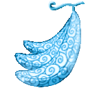

<!-- Generated by tools/build_pack_reference.py. Edit the pack sources and regenerate. -->

# InoFruits

Additional Paramecia, Logia and Zoan fruits, including fruit-specific moves and forms.

Installed build `4.0.0`. [Browse all mods](index.md).

## Pack guides

- [Devil Fruit box contents](../../characters/fruit-boxes.md)
- [Move damage multipliers · Inofruits](../../reference/settings/move-damage.md#inofruits)

## Related mods

- [AkumaLib](akumalib.md)
- [Missing Missing no Mi](inomissing.md)

## Abilities

| In-game name | ID | In-game description |
| --- | --- | --- |
| Crushing Lunge | `inofruits:lunging_bite_amplified` |  |
| Dai Bocho | `inofruits:bocho_amplified` |  |
| Dai Datto | `inofruits:datto_amplified` |  |
| Dai Togeuchi | `inofruits:togeuchi_amplified` |  |
| Dai Usagitobi | `inofruits:usagitobi_amplified` |  |
| Dai Ushiro Geri | `inofruits:ushiro_geri_amplified` |  |
| Dai-Jibashiri | `inofruits:jibashiri_amplified` |  |
| Dai-Jisuberi | `inofruits:jisuberi_amplified` |  |
| Dai-Kabe | `inofruits:kabe_amplified` |  |
| Dai-Nomikomi | `inofruits:nomikomi_amplified` |  |
| Dai-Ryusa | `inofruits:ryusa_amplified` |  |
| Dai-Shiofuki | `inofruits:shiofuki_amplified` |  |
| Dai-Taiatari | `inofruits:taiatari_amplified` |  |
| Dai-Tsubute | `inofruits:tsubute_amplified` |  |
| Dai-Utagoe | `inofruits:utagoe_amplified` |  |
| Gou Choyaku | `inofruits:choyaku_amplified` |  |
| Gou Hasai | `inofruits:hasai_amplified` |  |
| Oo Hasamikomi | `inofruits:hasamikomi_amplified` |  |
| Ossified Bone Blade | `inofruits:bone_blade_amplified` |  |
| Ossified Bone Mend | `inofruits:bone_mend_amplified` |  |
| Ossified Bone Shards | `inofruits:bone_shards_amplified` |  |
| Ossified Bone Throw | `inofruits:bone_throw_amplified` |  |
| Ossified Spare Bone | `inofruits:spare_bone_amplified` |  |
| Wata Karitori | `inofruits:watazumi_amplified` |  |
| Wata Renpo | `inofruits:wataho_amplified` |  |

## Effects

| In-game name | ID | In-game description |
| --- | --- | --- |
| Amahada | `inofruits:amahada` |  |
| Belly Crawl | `inofruits:belly_crawl` |  |
| Blood Shell | `inofruits:blood_shell` |  |
| Chibukure | `inofruits:chibukure` |  |
| Ekibyo | `inofruits:ekibyo` |  |
| Hydra's Blood | `inofruits:hydra_blood` |  |
| Joki | `inofruits:joki` |  |
| Kiza | `inofruits:kiza` |  |
| Kohaku | `inofruits:kohaku` |  |
| Law: Blindness | `inofruits:law_blindness` |  |
| Law: Ceasefire | `inofruits:law_ceasefire` |  |
| Law: Disarm | `inofruits:law_disarm` |  |
| Law: Grounded | `inofruits:law_grounded` |  |
| Law: Halt | `inofruits:law_halt` |  |
| Law: Inversion | `inofruits:law_inversion` |  |
| Law: Levitate | `inofruits:law_levitate` |  |
| Law: No Building | `inofruits:law_no_building` |  |
| Law: No Escape | `inofruits:law_no_escape` |  |
| Law: No Haki | `inofruits:law_no_haki` |  |
| Law: No Healing | `inofruits:law_no_healing` |  |
| Law: Retribution | `inofruits:law_retribution` |  |
| Law: Reveal | `inofruits:law_reveal` |  |
| Law: Silence | `inofruits:law_silence` |  |
| Law: Truce | `inofruits:law_truce` |  |
| Law: Walk | `inofruits:law_walk` |  |
| Marked | `inofruits:marked` |  |
| Nailed | `inofruits:nailed` |  |
| Namakura | `inofruits:namakura` |  |
| Nebatsuki | `inofruits:nebatsuki` |  |
| Nomikomi | `inofruits:nomikomi` |  |
| Purified | `inofruits:purified` |  |
| Shio Form | `inofruits:shio_form` |  |
| Shiozuke | `inofruits:shiozuke` |  |
| War Paint | `inofruits:war_paint` |  |

## Creatures and entities

| In-game name | ID | In-game description |
| --- | --- | --- |
| Air Blade | `inofruits:air_blade` |  |
| Bai Bai Clone | `inofruits:bai_bai_clone` |  |
| Blood Spear | `inofruits:blood_spear` |  |
| Bone Shard | `inofruits:bone_shard` |  |
| Bone Throw | `inofruits:bone_throw` |  |
| Cotton Bale | `inofruits:cotton_bale` |  |
| Feather | `inofruits:feather` |  |
| Force Bolt | `inofruits:force_bolt` |  |
| Great Tsubute | `inofruits:great_tsubute` |  |
| Gum Bubble | `inofruits:gum_bubble` |  |
| Gum Wad | `inofruits:gum_wad` |  |
| Hasai | `inofruits:hasai` |  |
| Hydra Head | `inofruits:hydra_head` |  |
| Hydra Head | `inofruits:hydra_bite` |  |
| Hydra Molt | `inofruits:hydra_molt` |  |
| Kaze Tornado | `inofruits:kaze_tornado` |  |
| Nail | `inofruits:nail` |  |
| Paint Blob | `inofruits:paint_blob` |  |
| Shita | `inofruits:shita` |  |
| Shita Muchi | `inofruits:shita_muchi` |  |
| Spine | `inofruits:spine` |  |
| Tobitsuki | `inofruits:tobitsuki` |  |
| Tsubute | `inofruits:tsubute` |  |

## Items

| In-game name | ID | In-game description |
| --- | --- | --- |
| Bone Blade | `inofruits:bone_blade` |  |
