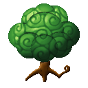

<!-- Generated by tools/build_pack_reference.py. Edit the pack sources and regenerate. -->

# Missing Missing no Mi

<div class="mod-page-icon" markdown="1">



</div>

An expanded fruit roster with new moves, forms and lineages.

Installed build `8.1.0`. [Browse all mods](index.md).

## Pack guides

- [Devil Fruit box contents](../../characters/fruit-boxes.md)
- [Move damage multipliers · Missing missing no mi](../../reference/settings/move-damage.md#missing-missing-no-mi)

## Related mods

- [AkumaLib](akumalib.md)
- [InoFruits](inofruits.md)

## Abilities

| In-game name | ID | In-game description |
| --- | --- | --- |
| A brush must be held to draw. | `inomissing:needs_brush` |  |
| A leaf cannot become that. | `inomissing:leaf_not_allowed` |  |
| A user on fire makes no spores. | `inomissing:needs_no_fire` |  |
| Alarm Call | `inomissing:alarm_call` | The alpaca's shrill alarm call slows and dizzies every nearby enemy. |
| Armored Charge | `inomissing:armored_charge` | The rhinoceros body of the user charges straight ahead for a few blocks, knocking over and hurting everyone on its way |
| As a pool of liquid the user cannot attack. | `inomissing:toro_pool_cannot_strike` |  |
| Back Gaze | `inomissing:back_gaze` | The face on the back of the user's head opens its eyes wide and every enemy behind them glows for a while. |
| Bat Lineage | `inomissing:lineage_bat_lineage` | The Lineage Factor of a bat gives the bearer echolocation: when they crouch, the creatures around them glow for a moment. |
| Bee Lineage | `inomissing:lineage_bee_lineage` | The Lineage Factor of a bee puts a sting in the bearer's bare fists: an unarmed blow poisons. |
| Belly Bite | `inomissing:belly_bite` | The wolf of the user's belly bites what is right in front of them, slowing it. |
| Belly Howl | `inomissing:belly_howl` | The wolf of the user's belly howls, weakening every nearby enemy. |
| Belly Oven | `inomissing:belly_oven_title` |  |
| Belt Bite | `inomissing:belt_bite` | The cobra at the user's belt bites what is right in front of them and slows it. |
| Big Nap | `inomissing:big_nap` | The user lies down for a nap with their tanuki, they heal for a few seconds but cannot move. |
| Bird Lineage | `inomissing:lineage_bird_lineage` | The Lineage Factor of a chicken or a parrot gives the bearer light bones that take falls well. |
| Biting Hair | `inomissing:biting_hair` | The eight snakes on the user's head bite everything around them. |
| Blaze Lineage | `inomissing:lineage_blaze_lineage` | The Lineage Factor of a blaze sets the bearer's bare fists ablaze: an unarmed blow sets the target on fire, and hits harder on a target already burning. |
| Blinding Spit | `inomissing:blinding_spit` | The cobra spits venom far ahead and blinds what it hits for a while. |
| Both gauntlets are already in use | `inomissing:kote_hands_full` |  |
| Bovine Lineage | `inomissing:lineage_bovine_lineage` | The Lineage Factor of a cow gives the bearer a sturdy, heavy body. |
| Bristling Fur | `inomissing:bristling_fur` | The user roars and their fur bristles, they take less damage for a while. |
| Brush Sweep | `inomissing:bake_brush_sweep` | The user spins round and their brush tail sweeps everything around them, leaving ink on it. |
| Buck | `inomissing:uma_buck` | The user's hind hoof kicks out, hurting and throwing back everything very close. |
| Buddha Shockwave | `inomissing:buddha_shockwave` | The golden Buddha hand strikes the air in front of the user and a shockwave hurts and throws back everything in its way. |
| Buzz | `inomissing:wing_buzz` | The user's small wings buzz loudly and leave every nearby enemy dizzy for a while. |
| Cackle | `inomissing:cackle` | The jackal on the user's head cackles and every nearby enemy loses strength for a while. |
| Camel Lineage | `inomissing:lineage_camel_lineage` | The Lineage Factor of a camel lets the bearer go long without eating. |
| Charge | `inomissing:centaur_charge` | The centaur rushes forward, knocking down everything on its way. |
| Coiled Guard | `inomissing:seiryu_coiled_guard` | The dragon at the user's waist rises before their chest and the user takes less damage for a while. |
| Cold Breath | `inomissing:okuchi_cold_breath` | The wolf head on the user's hand breathes an icy wind ahead and leaves what it reaches very slow for a while. |
| Creeper Lineage | `inomissing:lineage_creeper_lineage` | The Lineage Factor of a creeper lets the bearer's body take explosions well. |
| Crossed Claws | `inomissing:crossed_claws` | The user crosses their clawed paws and rakes everything very close to them. |
| Devil Fruits can't be eaten in the dream | `inomissing:uta_no_fruit` |  |
| Dolphin Lineage | `inomissing:lineage_dolphin_lineage` | The Lineage Factor of a dolphin makes the bearer a fast swimmer. |
| Dome Spin | `inomissing:dome_spin` | The user's heavy dome swings all around, it hurts every nearby enemy and leaves them dizzy. |
| Dragon Lineage | `inomissing:lineage_dragon_lineage` | The Lineage Factor of the Ender Dragon gives the bearer a dragon's body and might. |
| Dragon-Arm Bite | `inomissing:seiryu_arm_bite` | The user throws their dragon arm far ahead and its head bites what it reaches. |
| Dust Cloud | `inomissing:dust_cloud` | The user shakes their fur and raises a cloud of dust around them that blinds and slows the enemies inside |
| Dwarf Lineage | `inomissing:lineage_dwarf_lineage` | The Lineage Factor of a body of 0.6 a man or less makes the bearer shrink, over the size of their race. Never with a Giant Lineage. |
| Eagle Eye | `inomissing:eagle_eye` | The eagle on the user's head spots every enemy far around and they glow through the walls for a while. |
| Elephant Hakkushon | `inomissing:elephant_hakkushon` | The elephant head on the user's chest sneezes a blast of air down its trunk that bursts on the first enemy in front of them, hurting and throwing back everyone around |
| Ender Lineage | `inomissing:lineage_ender_lineage` | The Lineage Factor of an enderman makes the bearer blink away from a projectile that would hit them, now and then. |
| Failed Takeoff | `inomissing:failed_takeoff` | The user tries to take off, they rise for a moment then glide back down. |
| Fish Lineage | `inomissing:lineage_fish_lineage` | The Lineage Factor of a fish gives the bearer gills: they breathe under water and swim faster. |
| Fish-Man Strength | `inomissing:lineage_fishman_strength` | The Lineage Factor of a fish-man gives the bearer a fish-man's strength, breath under water and swimming. Never on a fish-man. |
| Flame Wing Sweep | `inomissing:flame_wing_sweep` | The user's blue flame wings sweep forward all around them, hurting and throwing back everyone close. |
| Four Slaps | `inomissing:four_slaps` | The user's four arms slap everything around them. |
| Four-Arm Hug | `inomissing:four_arm_hug` | The user's four arms grab what is right in front of them, hurt it and almost hold it still for a while. |
| Fox Lineage | `inomissing:lineage_fox_lineage` | The Lineage Factor of a fox gives the bearer a fox's quick pounce. |
| Frill Bash | `inomissing:frill_bash` | The user lowers their frilled head and rams what is in front of them, throwing it back. |
| Frill Shield | `inomissing:frill_shield` | The user pulls their head in behind the frill, they take much less damage for a while but are slowed. |
| Frog Lineage | `inomissing:lineage_frog_lineage` | The Lineage Factor of a frog gives the bearer a frog's great leaps. |
| Frost Fleece | `inomissing:frost_fleece` | Frost covers the user's wool for a while, the enemies close to them freeze and are slowed. The user never freezes in this form |
| Frozen Bite | `inomissing:okuchi_frozen_bite` | The wolf head on the user's hand lunges and bites what is right in front of them. |
| Gallop | `inomissing:uma_gallop` | The user gallops on their horse legs, much faster for a while. |
| Gauntlet Boulder | `inomissing:gauntlet_boulder` |  |
| Gauntlet Rush | `inomissing:gauntlet_rush` |  |
| Ghast Lineage | `inomissing:lineage_ghast_lineage` | The Lineage Factor of a ghast gives the bearer a great body of the Nether that fire burns less. |
| Giant Headbutt | `inomissing:giant_headbutt` | The user throws their giant hood at what is in front of them and knocks it far back. |
| Giant Lineage | `inomissing:lineage_giant_lineage` | The Lineage Factor of a body twice a man's size or more makes the bearer grow, over the size of their race. Never with a Dwarf Lineage. |
| Gill Regeneration | `inomissing:gill_regeneration` | The user's gills flap and redden as their body heals, twice as fast in water or rain. |
| Give Back a Soul | `inomissing:soru_mode_give_back` |  |
| Glide | `inomissing:glide` | The user leaps forward and spreads their wings, they fall slowly for a while. |
| Gliding Leap | `inomissing:gliding_leap` | The user leaps forward and spreads their wings, they fall slowly for a while. |
| Goat Lineage | `inomissing:lineage_goat_lineage` | The Lineage Factor of a goat gives the bearer a mountain goat's leaps and landings. |
| Gold Splash | `inomissing:gold_splash` |  |
| Gon Tempesta | `inomissing:gon_tempesta` |  |
| Guardian Lineage | `inomissing:lineage_guardian_lineage` | The Lineage Factor of a guardian covers the bearer in spikes that hurt whoever strikes them up close. |
| Heat Metal | `inomissing:heat_metal` |  |
| Heavy Skull | `inomissing:heavy_skull` | The user lowers their dome like a ram, they take less damage for a while but are slowed. |
| Heel Kick | `inomissing:heel_kick` | The user kicks straight ahead with their heel and knocks what is in front of them far back. |
| Hiss | `inomissing:hair_hiss` | The eight snakes hiss at once and leave every nearby enemy slowed and dizzy for a while. |
| Hoglin Lineage | `inomissing:lineage_hoglin_lineage` | The Lineage Factor of a hoglin gives the bearer blows that throw back. |
| Horn Whirl | `inomissing:horn_whirl` | The user spins around and their horns strike everything around them. |
| Horned Buck | `inomissing:horned_buck` | The bison head on the user's back sweeps low in front of them and tosses everyone close up in the air |
| Horned Guard | `inomissing:horned_guard` | The user hunches behind their 3 horns, they take less damage for a while. |
| Horse Lineage | `inomissing:lineage_horse_lineage` | The Lineage Factor of a horse, a donkey or a mule gives the bearer a long, fast stride. |
| Infused Beast | `inomissing:infused_beast` | Each weapon or tool in the bag that ate a Zoan fruit has this ability. It turns into the Zoan's beast and fights beside its holder, and a beast that can be ridden carries its owner. Used again, the beast turns back into the item. One beast out at a time, and once it is back none can come out for a minute. A beast killed leaves its own item unable to change for 5 minutes. |
| Infused Beast | `inomissing:infused_beast_2` |  |
| Infused Beast | `inomissing:infused_beast_3` |  |
| Infused Beast | `inomissing:infused_beast_4` |  |
| Infused Beast | `inomissing:infused_beast_5` |  |
| Infused Beast | `inomissing:infused_beast_6` |  |
| Infused Beast | `inomissing:infused_beast_7` |  |
| Infused Beast | `inomissing:infused_beast_8` |  |
| Infused Beast | `inomissing:infused_beast_9` |  |
| Infused Beast | `inomissing:infused_beast_10` |  |
| Infused Beast | `inomissing:infused_beast_11` |  |
| Infused Beast | `inomissing:infused_beast_12` |  |
| Infused Beast | `inomissing:infused_beast_13` |  |
| Infused Beast | `inomissing:infused_beast_14` |  |
| Infused Beast | `inomissing:infused_beast_15` |  |
| Infused Beast | `inomissing:infused_beast_16` |  |
| Infused Beast | `inomissing:infused_beast_17` |  |
| Infused Beast | `inomissing:infused_beast_18` |  |
| Infused Beast | `inomissing:infused_beast_19` |  |
| Infused Beast | `inomissing:infused_beast_20` |  |
| Infused Beast | `inomissing:infused_beast_21` |  |
| Infused Beast | `inomissing:infused_beast_22` |  |
| Infused Beast | `inomissing:infused_beast_23` |  |
| Infused Beast | `inomissing:infused_beast_24` |  |
| Infused Beast | `inomissing:infused_beast_25` |  |
| Infused Beast | `inomissing:infused_beast_26` |  |
| Infused Beast | `inomissing:infused_beast_27` |  |
| Infused Beast | `inomissing:infused_beast_28` |  |
| Infused Beast | `inomissing:infused_beast_29` |  |
| Infused Beast | `inomissing:infused_beast_30` |  |
| Infused Beast | `inomissing:infused_beast_31` |  |
| Infused Beast | `inomissing:infused_beast_32` |  |
| Infused Beast | `inomissing:infused_beast_33` |  |
| Infused Beast | `inomissing:infused_beast_34` |  |
| Infused Beast | `inomissing:infused_beast_35` |  |
| Infused Beast | `inomissing:infused_beast_36` |  |
| Infused Beast | `inomissing:infused_beast_37` |  |
| Ink does not hold in water. | `inomissing:ink_in_water` |  |
| It takes %s toys under contract nearby (you have %s). | `inomissing:needs_bound_toys` |  |
| Jurassic Bite | `inomissing:jurassic_bite` | The allosaurus head on the user's back lunges and snaps its jaws on what is in front of them, hurting and slowing it. |
| Lay | `inomissing:lay` | The chicken on the user's head lays an egg that shields the user with 4 hearts of absorption for a while. |
| Leg Rain | `inomissing:leg_rain` | The legs on the user's back strike everything around them, one after the other. |
| Lightning Catch | `inomissing:lightning_catch` |  |
| Llama Lineage | `inomissing:lineage_llama_lineage` | The Lineage Factor of a llama gives the bearer a pack animal's steady footing. |
| Look chosen: %s | `inomissing:face_chosen` |  |
| Lookout | `inomissing:lookout` | The giraffe head high above the user looks all around and the enemies nearby glow for a while, seen through the walls |
| Lunarian Traits | `inomissing:lineage_lunarian` | The Lineage Factor of a Lunarian gives the bearer the Lunarian traits of the Seraphim: a tough body, fire and burning do not hurt them (lava still does), Lunarian wings grow on their back, and holding jump in the air lets them glide down. Never on a Lunarian. |
| Maji Karu | `inomissing:hoya_maji_karu` |  |
| Meditation | `inomissing:meditation` | The user sits cross-legged and meditates, they heal and take less damage but cannot move. |
| Meditation | `inomissing:onyudo_meditation` | The user sits down to pray and heals for a while, without moving. |
| Mole Burrow | `inomissing:mole_burrow` | The user dives into the ground and stays under it for a while, out of reach, then bursts out throwing up everyone around |
| Molten Sphere | `inomissing:molten_sphere` |  |
| Neck Crush | `inomissing:neck_crush` | The brachiosaurus head rises, then crashes down in front of the user, hurting and slowing everyone there. |
| Neck Lash | `inomissing:neck_lash` | The user bows and the brachiosaurus neck whips far in front of them, throwing back what it hits. |
| Neck Whip | `inomissing:neck_whip` | The giraffe neck on the user's back swings down in a wide arc in front of them, hitting far away and throwing the enemies aside |
| Needs a brush in one hand | `inomissing:fude_brush_needed` |  |
| Needs laundry or someone hung out in front | `inomissing:woshu_needs_washed` |  |
| Needs metal blocks near you, or %s | `inomissing:needs_parts` |  |
| Needs Observation Haki mastery | `inomissing:snake_dance_mastery` |  |
| Night Vision | `inomissing:lineage_night_vision` | The Lineage Factor of a cat or an ocelot lets the bearer see in the dark. |
| No ability seen or taken in the last 30 seconds. | `inomissing:no_attack_seen` |  |
| No ally to arm nearby | `inomissing:gutsu_no_ally` |  |
| No block the gauntlet can take in sight | `inomissing:kote_needs_block` |  |
| No boat or minecart in sight | `inomissing:kote_needs_vehicle` |  |
| No brush needed on this server | `inomissing:fude_brush_free` |  |
| No collar to release | `inomissing:peto_needs_collar` |  |
| No collared creature nearby | `inomissing:peto_needs_creature` |  |
| No collared one in sight | `inomissing:peto_needs_collared` |  |
| No enemy in reach to coil round. | `inomissing:makitsuki_no_prey` |  |
| No enemy in reach to wrap round. | `inomissing:anaconda_no_prey` |  |
| No enemy in sight wears metal armor. | `inomissing:gutsu_no_metal_worn` |  |
| No enemy standing in lava or soft ground | `inomissing:modo_needs_sunk` |  |
| No explosive in the inventory | `inomissing:koro_no_bomb` |  |
| No ground to fall on there | `inomissing:beri_rain_no_ground` |  |
| No look is chosen: open the memory with the ability mode key. | `inomissing:nobody_chosen` |  |
| No metal to eat in the inventory | `inomissing:gutsu_no_metal_to_eat` |  |
| No room in the inventory for the leaf. | `inomissing:leaf_no_room` |  |
| No small animal in sight | `inomissing:kote_needs_small_animal` |  |
| No stone in sight that can turn to lava | `inomissing:modo_needs_rock` |  |
| No target in reach | `inomissing:dachshund_needs_target` |  |
| No throw left, land to get them back | `inomissing:kote_lift_spent` |  |
| No worn item in hand | `inomissing:modo_needs_worn` |  |
| Nobody in front to wash | `inomissing:woshu_nobody_in_front` |  |
| Nobody to wring in reach | `inomissing:shibo_no_target` |  |
| Not as a sapling. | `inomissing:not_as_sapling` |  |
| Not as a tree golem. | `inomissing:not_as_golem` |  |
| Not during an attack. | `inomissing:not_while_striking` |  |
| Not enough gold: stand among gold blocks, or carry %s gold that no ability is using (a nugget is 1, an ingot 9). | `inomissing:needs_gold` |  |
| Not enough ink. | `inomissing:needs_ink` |  |
| Not enough juice in the reserve | `inomissing:shibo_needs_juice` |  |
| Not enough metal in the furnace: %s needed | `inomissing:needs_metal` |  |
| Not enough plants: stand among plants, or carry %s plants (seeds, saplings, leaves, flowers). | `inomissing:needs_plants` |  |
| Not enough stone: stand on stone, or carry %s stone blocks. | `inomissing:needs_stone` |  |
| Not while Blindado is on. | `inomissing:not_while_blindado` |  |
| Not while inside the mech. | `inomissing:not_in_the_mech` |  |
| Not while the flower spins. | `inomissing:not_while_flying` |  |
| Not while the shell is shut. | `inomissing:not_while_guarding` |  |
| Nothing bad to wring out | `inomissing:shibo_nothing_to_wring` |  |
| Nothing can be drawn here. | `inomissing:cannot_draw_here` |  |
| Nothing can be set up here. | `inomissing:cannot_stand_here` |  |
| Nothing can be stored in the dream | `inomissing:uta_no_store` |  |
| Only a player can use this. | `inomissing:needs_player` |  |
| Only as the colossus. | `inomissing:needs_the_colossus` |  |
| Only in a bake-danuki form. | `inomissing:needs_bake_form` |  |
| Only in Uta World, in the user's own dream. | `inomissing:needs_uta_world` |  |
| Only in walk point | `inomissing:tanuki_needs_walk` |  |
| Only in walk point and on soft ground | `inomissing:dachshund_needs_soft_ground` |  |
| Only in walk point and on the ground | `inomissing:tanuki_needs_walk_ground` |  |
| Only on the wheels | `inomissing:koro_needs_wheels` |  |
| Only the whole anaconda can swallow. | `inomissing:marunomi_whole_only` |  |
| Only usable as a pool of liquid: use Flow first. | `inomissing:toro_needs_pool` |  |
| Only usable as Golden Tesoro. | `inomissing:needs_golden_tesoro` |  |
| Only while flying with the frill. | `inomissing:needs_frill_flight` |  |
| Outfit: %s | `inomissing:outfit_chosen` |  |
| Panda Lineage | `inomissing:lineage_panda_lineage` | The Lineage Factor of a panda gives the bearer a big, solid body. |
| Peck | `inomissing:peck` | The chicken on the user's head pecks everything very close to them. |
| Phantom Lineage | `inomissing:lineage_phantom_lineage` | The Lineage Factor of a phantom makes the bearer faster at night. |
| Pig Lineage | `inomissing:lineage_pig_lineage` | The Lineage Factor of a pig gives the bearer a pig's stomach: all food fills them up more. |
| Piglin Lineage | `inomissing:lineage_piglin_lineage` | The Lineage Factor of a piglin gives the bearer a brute's strength and hide. |
| Plunging Fangs | `inomissing:plunging_fangs` | The user bends forward and plunges the tiger's sabre fangs into what is in front of them, leaving it bleeding. |
| Pockets | `inomissing:poke_pockets_title` |  |
| Polar Bear Lineage | `inomissing:lineage_polar_bear_lineage` | The Lineage Factor of a polar bear gives the bearer heavy paws and a body the cold never freezes. |
| Pressure Jet | `inomissing:pressure_jet` |  |
| Pronk | `inomissing:pronk` |  |
| Pteranodon Dive | `inomissing:ptera_dive` | The user spreads their wings and dives forward, striking what they come down on |
| Pteranodon Gust | `inomissing:ptera_gust` | The user raises their wings high and beats them down once, blowing everyone around away. |
| Rabbit Lineage | `inomissing:lineage_rabbit_lineage` | The Lineage Factor of a rabbit gives the bearer quick, springy legs. |
| Rear Up | `inomissing:rear_up` | The centaur rears up and brings its front hooves down on what is in front of it. |
| Regenerating Flames | `inomissing:regenerating_flames` | The user's blue flame wings wrap around them and heal their body. |
| Regeneration | `inomissing:lineage_regeneration` | The Lineage Factor of an axolotl makes the bearer heal on their own, as Germa 66's modified children. |
| Remembered: %s | `inomissing:face_recorded` |  |
| Rending Claws | `inomissing:rending_claws` | The leopard's paws swipe three times in front of the user |
| Roar | `inomissing:seiryu_smile_roar` | The user roars like a dragon and leaves every nearby enemy dizzy for a while. |
| Rude Awakening | `inomissing:rude_awakening` | The tanuki on the user's back wakes with a start and bites all around them. |
| Sail Sweep | `inomissing:sail_sweep` | The user turns around and their sail strikes and pushes back everything around them. |
| Scales | `inomissing:seiryu_arm_scales` | The user holds their scaled dragon arm across their chest and takes less damage for a while. |
| Scavenger | `inomissing:scavenger` | For a while, every hit of the user on a target under half its health heals them. |
| Sefer Assiah | `inomissing:sefer_assiah` |  |
| Sefer Ha-Zohar | `inomissing:sefer_ha_zohar` |  |
| Shell Retreat | `inomissing:shell_retreat` | The tortoise withdraws into its shell with the user, hardly any damage gets through but they can barely move. |
| Short Sprint | `inomissing:short_sprint` | The user sprints very fast for a few seconds, then runs out of breath. |
| Shove | `inomissing:beetle_shove` | The user's four arms shove everything very close to them far away. |
| Shovel Toss | `inomissing:shovel_toss` | The user's mole hands rake the ground and throw the earth in front of them, hurting and blinding. |
| Shulker Lineage | `inomissing:lineage_shulker_lineage` | The Lineage Factor of a shulker gives the bearer a shell: crouching, they close up hard. |
| Silverfish Lineage | `inomissing:lineage_silverfish_lineage` | The Lineage Factor of a silverfish gives the bearer a burrower's knack for stone. |
| Skeleton Lineage | `inomissing:lineage_skeleton_lineage` | The Lineage Factor of a skeleton gives the bearer an archer's eye: their arrows hit harder. |
| Skull Beak | `inomissing:skull_beak` | The eagle on the user's head strikes what is right in front of them and poisons it. |
| Slime Lineage | `inomissing:lineage_slime_lineage` | The Lineage Factor of a slime makes the bearer bouncy: no fall hurts them. |
| Slither | `inomissing:slither` | The user slithers along the ground, much faster for a while. |
| SMILE Body | `inomissing:smile_body` | A failed SMILE, the user is stuck in this body for good, with what it gives |
| Smoke | `inomissing:bake_smoke` | The user's tail strikes the ground and a cloud of smoke blinds every nearby enemy for a while. |
| Sniff | `inomissing:sniff` | The user sniffs the air and every creature nearby glows through the walls for a while. |
| Sniffer Lineage | `inomissing:lineage_sniffer_lineage` | The Lineage Factor of a sniffer gives the bearer a digger's strength. |
| Snow Lineage | `inomissing:lineage_snow_lineage` | The Lineage Factor of a snow golem chills the bearer's bare fists, and the cold never freezes them. |
| Soul Pocus | `inomissing:soru_mode_take` |  |
| Spider Leap | `inomissing:spider_leap` | The user crouches on their spider legs and leaps far forward. |
| Spider Lineage | `inomissing:lineage_spider_lineage` | The Lineage Factor of a spider lets the bearer climb walls: walk into one to go up, crouch to hold on. |
| Spiked Charge | `inomissing:spiked_charge` |  |
| Spotted Spin | `inomissing:spotted_spin` | The user spins on the spot and their tail hits and pushes back everything around them. |
| Squid Lineage | `inomissing:lineage_squid_lineage` | The Lineage Factor of a squid gives the bearer an ink sac: whoever strikes them is blinded, now and then. |
| Steel Skin | `inomissing:lineage_steel_skin` | The Lineage Factor of an iron golem gives the bearer a steel exoskeleton, as Germa 66's modified children. |
| Sticky Spit | `inomissing:sticky_spit` |  |
| Storage Scroll | `inomissing:storage_scroll_title` |  |
| Strider Lineage | `inomissing:lineage_strider_lineage` | The Lineage Factor of a strider lets the bearer's skin stand lava a little. |
| Sunbathing | `inomissing:sunbathing` | The user spreads out to warm their sail, they heal for a while. |
| Superhuman Strength | `inomissing:lineage_superhuman_strength` | The Lineage Factor of a ravager gives the bearer the strength of Germa 66's modified children. |
| Syrup Grab | `inomissing:syrup_grab` |  |
| Tail Cocoon | `inomissing:kyubi_tail_cocoon` | The user rolls up in their nine tails and takes much less damage for a short while, without moving. |
| Tail Lash | `inomissing:tail_lash` | The user lashes their long tail forward, hitting everything on a line in front of them. |
| Tail Lash | `inomissing:anaconda_tail_lash` | The user's snake tail sweeps all around them and pushes back every nearby enemy. |
| Tail Slap | `inomissing:tail_slap` | The user spins and sweeps their axolotl tail around them, knocking back and slowing everyone close. |
| Tail Whip | `inomissing:allosaurus_tail_whip` | The user spins and the allosaurus tail sweeps everyone around them away. |
| Tail Whip | `inomissing:kyubi_tail_whip` | The user spins round and the nine tails lash everything around them. |
| Tamaceratops | `inomissing:tamaceratops` |  |
| Tank Hide | `inomissing:tank_hide` | The user's skin hardens for a while, they take less damage and nothing can push them back |
| Teeth | `inomissing:alpaca_teeth` | The alpaca neck shoots forward and bites what is in front of the user. |
| The anaconda is still digesting. | `inomissing:marunomi_digesting` |  |
| The body must be a net first. | `inomissing:needs_net_body` |  |
| The brush must be in the other hand. | `inomissing:needs_brush_off_hand` |  |
| The furnace is full | `inomissing:gutsu_furnace_full` |  |
| The hand must be empty. | `inomissing:needs_empty_hand` |  |
| The item in hand needs no repair. | `inomissing:nothing_to_repair` |  |
| The scroll holds %s of %s attacks. | `inomissing:scroll_holds` |  |
| The scroll holds no attack. | `inomissing:scroll_empty` |  |
| The scroll is full. | `inomissing:scroll_full` |  |
| The Swamp's Store | `inomissing:numa_kura_title` |  |
| The user already holds 6 cubes. | `inomissing:cubes_full` |  |
| The user cannot pass through water. | `inomissing:needs_dry` |  |
| The user carries no ammunition. | `inomissing:no_ammunition` |  |
| The user carries no bullet. | `inomissing:needs_bullets` |  |
| The user carries nothing to repair it with. | `inomissing:no_repair_material` |  |
| The user has no youth to give back. | `inomissing:batto_nothing_to_give` |  |
| The user has too many webs up already. | `inomissing:too_many_webs` |  |
| The user holds no cube: take some with Cubreak. | `inomissing:needs_cubes` |  |
| The user is already riding. | `inomissing:needs_no_mount` |  |
| The user is shut in a jar. | `inomissing:toro_jarred` |  |
| The user is too hungry. | `inomissing:too_hungry` |  |
| The user must be in the air. | `inomissing:needs_air` |  |
| The user must hold a weapon. | `inomissing:needs_weapon` |  |
| The user must look at a block. | `inomissing:needs_block_ahead` |  |
| The user must pounce on an enemy first. | `inomissing:needs_pounced_prey` |  |
| The user must sit in a boat. | `inomissing:needs_boat` |  |
| The user must stand on natural ground: earth, sand, stone or a tree. | `inomissing:needs_natural_ground` |  |
| The user must stand on the ground. | `inomissing:needs_ground` |  |
| The user must stand on the ground. | `inomissing:needs_feet_on_ground` |  |
| The user must stand on the ground. | `inomissing:needs_footing` |  |
| The user must wear something on the head. | `inomissing:needs_helmet` |  |
| The user needs a fire charge to swallow. | `inomissing:needs_fire` |  |
| The user needs a water bottle to drink. | `inomissing:needs_water` |  |
| The user needs an iron ingot to swallow. | `inomissing:needs_iron` |  |
| The user's liquid body is frozen stiff. | `inomissing:toro_frozen` |  |
| The user's nails must be out (Kama Tsume). | `inomissing:needs_kama_tsume` |  |
| The user's pages are smudged with paint. | `inomissing:pasa_smudged` |  |
| The user's paper is burning. | `inomissing:pasa_burning` |  |
| The water put out the flame clouds | `inomissing:seiryu_clouds_out` |  |
| The water puts the fire out | `inomissing:seiryu_fire_out` |  |
| There is no ally in sight to dress. | `inomissing:nobody_to_dress` |  |
| There is no ally within reach who can be sent ahead. | `inomissing:no_ally_to_shelter` |  |
| There is no block in sight. | `inomissing:needs_block_in_sight` |  |
| There is no caught enemy nearby. | `inomissing:needs_caught_prey` |  |
| There is no ceiling above the target. | `inomissing:no_ceiling` |  |
| There is no enemy and no ground in sight. | `inomissing:needs_ground_in_sight` |  |
| There is no enemy below to seize. | `inomissing:nothing_below` |  |
| There is no enemy covered in gold dust in sight. | `inomissing:needs_dusted_target` |  |
| There is no enemy in sight. | `inomissing:needs_target` |  |
| There is no enemy turned into a cube in sight, with ground under it: use Living Cube first. | `inomissing:needs_cubed_target` |  |
| There is no enemy within reach who can be sent ahead. | `inomissing:nobody_to_send` |  |
| There is no enemy within reach. | `inomissing:nobody_to_touch` |  |
| There is no enemy within reach. | `inomissing:needs_enemy_in_reach` |  |
| There is no fire nearby, and no lava. | `inomissing:needs_fire_nearby` |  |
| There is no free place in the hotbar. | `inomissing:no_free_hand` |  |
| There is no free space for a web here. | `inomissing:needs_free_space` |  |
| There is no ground close enough under the user. | `inomissing:needs_ground_below` |  |
| There is no ground to come up from beside the enemy. | `inomissing:needs_ground_near_target` |  |
| There is no ground to paint there. | `inomissing:mosaic_needs_ground` |  |
| There is no ground to raise it from. | `inomissing:needs_ground_ahead` |  |
| There is no ground within reach where the user is looking. | `inomissing:needs_ground_in_reach` |  |
| There is no leaf nor stone in the bag. | `inomissing:needs_leaf_or_stone` |  |
| There is no one close enough in front of you. | `inomissing:needs_close_target` |  |
| There is no room for it there. | `inomissing:needs_room_ahead` |  |
| There is no room here for that form. | `inomissing:no_room_for_form` |  |
| There is no room here for that look. | `inomissing:no_room_for_look` |  |
| There is no room in the bag for the armor worn. | `inomissing:no_room_to_dress` |  |
| There is no shot in flight in front of you. | `inomissing:no_shot_to_postpone` |  |
| There is no stone next to the target. | `inomissing:needs_stone_near_target` |  |
| There is no toy of yours in sight. | `inomissing:needs_any_toy` |  |
| There is no toy of yours without a contract in sight. | `inomissing:needs_toy` |  |
| There is no toy under contract near you. | `inomissing:needs_bound_toy` |  |
| There is no wall to flatten against. | `inomissing:needs_wall` |  |
| There is no water nearby, and no rain. | `inomissing:needs_water_nearby` |  |
| There is nobody within reach. | `inomissing:nobody_to_record` |  |
| There is not enough room here for the user's body. | `inomissing:toro_no_room` |  |
| There is nothing here that can be taken apart. | `inomissing:nothing_to_take_apart` |  |
| There is nothing here that can rot. | `inomissing:nothing_to_rot` |  |
| There is nothing to lift within reach. | `inomissing:needs_loose_ground` |  |
| There is nothing to ripen here. | `inomissing:juku_nothing_to_ripen` |  |
| This look cannot be taken. | `inomissing:look_not_taken` |  |
| This one can't be turned into a toy. | `inomissing:hobi_cannot_toy` |  |
| This weapon was turned into art and does not work anymore. | `inomissing:art_weapon` |  |
| Three collars are already out | `inomissing:peto_too_many` |  |
| Throat Pounce | `inomissing:throat_pounce` | The leopard leaps at the nearest enemy in front of the user and comes down on them, hurting and slowing them |
| Too big to swallow. | `inomissing:marunomi_too_big` |  |
| Tortoise Crush | `inomissing:tortoise_crush` | The tortoise rears up and comes crashing down, hurting and slowing everyone around. |
| Trunk Whip | `inomissing:trunk_whip` | The trunk hanging from the user's chest sweeps the ground in front of them, hitting everyone in a wide arc and throwing them away |
| Turtle Lineage | `inomissing:lineage_turtle_lineage` | The Lineage Factor of a turtle gives the bearer a shell's hard skin and a sea turtle's swim. |
| Tusk Skewer | `inomissing:tusk_skewer` | The user lunges forward, the tusks of their shoulders first. The first enemy in the way gets skewered and thrown far back |
| Twin Cry | `inomissing:twin_cry` | Both of the user's mouths scream at once, weakening and slowing everyone around them. |
| Ukiyo Yudachi Ezu | `inomissing:ukiyo_yudachi_ezu` |  |
| Uncoil | `inomissing:seiryu_uncoil` | The user spins round and the dragon at their waist uncoils and strikes everything around them. |
| Undead Lineage | `inomissing:lineage_undead_lineage` | The Lineage Factor of the walking dead gives the bearer flesh that takes a beating. |
| Uragiri Iro | `inomissing:uragiri_iro` |  |
| Waist Sweep | `inomissing:waist_sweep` | The user swings their long body all around them, hitting and pushing back every nearby enemy. |
| Warden Lineage | `inomissing:lineage_warden_lineage` | The Lineage Factor of a warden gives the bearer the might of the deep dark. |
| Warm Breath | `inomissing:seiryu_warm_breath` | The user breathes a hot wind ahead that sets what it reaches on fire. |
| Web Trap | `inomissing:web_trap` |  |
| Wing Buffet | `inomissing:wing_buffet` | The user's heavy wings strike all around them, hurting and pushing back every nearby enemy. |
| Wing Gale | `inomissing:wing_gale` | The user beats their huge wings and a gust pushes every nearby enemy far away. |
| Wing Gust | `inomissing:bat_wing_gust` | The user beats their bat wings and pushes every nearby enemy far away. |
| Winged Leap | `inomissing:winged_leap` | The user's ankle wings beat hard and the user leaps far forward. |
| Witch Lineage | `inomissing:lineage_witch_lineage` | The Lineage Factor of a witch hardens the bearer against magic. |
| Wither Lineage | `inomissing:lineage_wither_lineage` | The Lineage Factor of the Wither gives the bearer its great body, which the Wither never takes. |
| Wither Skeleton Lineage | `inomissing:lineage_wither_skeleton_lineage` | The Lineage Factor of a wither skeleton withers what the bearer's bare fists strike, and the Wither never takes them. |
| Wolf Lineage | `inomissing:lineage_wolf_lineage` | The Lineage Factor of a wolf gives the bearer a hunter's bite and pace. |
| Wool Lineage | `inomissing:lineage_wool_lineage` | The Lineage Factor of a sheep grows a thick fleece under the skin: tougher, and the cold of powder snow never freezes them. |
| You cant bring yourself to hit %s | `inomissing:mane_held_back` |  |


## Traits

| In-game name | ID | In-game description |
| --- | --- | --- |
| Bat Lineage | `inomissing:bat_lineage` |  |
| Bee Lineage | `inomissing:bee_lineage` |  |
| Bird Lineage | `inomissing:bird_lineage` |  |
| Blaze Lineage | `inomissing:blaze_lineage` |  |
| Bovine Lineage | `inomissing:bovine_lineage` |  |
| Camel Lineage | `inomissing:camel_lineage` |  |
| Creeper Lineage | `inomissing:creeper_lineage` |  |
| Dolphin Lineage | `inomissing:dolphin_lineage` |  |
| Dragon Lineage | `inomissing:dragon_lineage` |  |
| Dwarf Lineage | `inomissing:dwarf_lineage` |  |
| Ender Lineage | `inomissing:ender_lineage` |  |
| Fish Lineage | `inomissing:fish_lineage` |  |
| Fish-Man Strength | `inomissing:fishman_strength` |  |
| Fox Lineage | `inomissing:fox_lineage` |  |
| Frog Lineage | `inomissing:frog_lineage` |  |
| Ghast Lineage | `inomissing:ghast_lineage` |  |
| Giant Lineage | `inomissing:giant_lineage` |  |
| Goat Lineage | `inomissing:goat_lineage` |  |
| Guardian Lineage | `inomissing:guardian_lineage` |  |
| Hoglin Lineage | `inomissing:hoglin_lineage` |  |
| Horse Lineage | `inomissing:horse_lineage` |  |
| Llama Lineage | `inomissing:llama_lineage` |  |
| Lunarian Traits | `inomissing:lunarian` |  |
| Night Vision | `inomissing:night_vision` |  |
| Panda Lineage | `inomissing:panda_lineage` |  |
| Phantom Lineage | `inomissing:phantom_lineage` |  |
| Pig Lineage | `inomissing:pig_lineage` |  |
| Piglin Lineage | `inomissing:piglin_lineage` |  |
| Polar Bear Lineage | `inomissing:polar_bear_lineage` |  |
| Rabbit Lineage | `inomissing:rabbit_lineage` |  |
| Regeneration | `inomissing:regeneration` |  |
| Shulker Lineage | `inomissing:shulker_lineage` |  |
| Silverfish Lineage | `inomissing:silverfish_lineage` |  |
| Skeleton Lineage | `inomissing:skeleton_lineage` |  |
| Slime Lineage | `inomissing:slime_lineage` |  |
| Sniffer Lineage | `inomissing:sniffer_lineage` |  |
| Snow Lineage | `inomissing:snow_lineage` |  |
| Spider Lineage | `inomissing:spider_lineage` |  |
| Squid Lineage | `inomissing:squid_lineage` |  |
| Steel Skin | `inomissing:steel_skin` |  |
| Strider Lineage | `inomissing:strider_lineage` |  |
| Superhuman Strength | `inomissing:superhuman_strength` |  |
| Turtle Lineage | `inomissing:turtle_lineage` |  |
| Undead Lineage | `inomissing:undead_lineage` |  |
| Warden Lineage | `inomissing:warden_lineage` |  |
| Witch Lineage | `inomissing:witch_lineage` |  |
| Wither Lineage | `inomissing:wither_lineage` |  |
| Wither Skeleton Lineage | `inomissing:wither_skeleton_lineage` |  |
| Wolf Lineage | `inomissing:wolf_lineage` |  |
| Wool Lineage | `inomissing:wool_lineage` |  |


## Effects

| In-game name | ID | In-game description |
| --- | --- | --- |
| Absorbed | `inomissing:absorbed` |  |
| Aged | `inomissing:aged` |  |
| Anaconda Digesting | `inomissing:anaconda_digesting` |  |
| Anaconda Dodge | `inomissing:anaconda_dodge` |  |
| Antibodies | `inomissing:antibodies` |  |
| Art | `inomissing:art` |  |
| Asleep | `inomissing:asleep` |  |
| Buried | `inomissing:buried` |  |
| Buried in Clay | `inomissing:buried_in_clay` |  |
| Butter Cuffs | `inomissing:butter_cuffs` |  |
| Butter Wrap | `inomissing:butter_wrap` |  |
| Calmed | `inomissing:calmed` |  |
| Camouflapaint | `inomissing:camouflapaint` |  |
| Cased in Metal | `inomissing:cased_in_metal` |  |
| Clean Heart | `inomissing:clean_heart` |  |
| Coiled | `inomissing:coiled` |  |
| Collared | `inomissing:collared` |  |
| Corroded | `inomissing:corroded` |  |
| Coughing Fit | `inomissing:coughing_fit` |  |
| Cream Burn | `inomissing:cream_burn` |  |
| Cubed | `inomissing:cubed` |  |
| Devoted | `inomissing:devoted` |  |
| Dried Out | `inomissing:dried_out` |  |
| Drunkenness | `inomissing:drunkenness` |  |
| Exhausted | `inomissing:exhausted` |  |
| Exhausted Future | `inomissing:exhausted_future` |  |
| Feminization Disease | `inomissing:feminization_disease` |  |
| Fever | `inomissing:fever` |  |
| Flashback | `inomissing:flashback` |  |
| Floured | `inomissing:floured` |  |
| Forgotten Quarrel | `inomissing:forgotten_quarrel` |  |
| Frightened | `inomissing:frightened` |  |
| Frozen Stiff | `inomissing:frozen_stiff` |  |
| Genie Master | `inomissing:genie_master` |  |
| Giro Sight | `inomissing:giro_sight` |  |
| Gold Dust | `inomissing:gold_dust` |  |
| Golden Statue | `inomissing:golden_statue` |  |
| Hade Iro | `inomissing:hade_iro` |  |
| Hamstrung | `inomissing:hamstrung` |  |
| Hangover | `inomissing:hangover` |  |
| Haunted | `inomissing:haunted` |  |
| Held in the Syrup | `inomissing:held_in_the_syrup` |  |
| Hung Out | `inomissing:hung_out` |  |
| Hypnotized | `inomissing:hypnotized` |  |
| In His Darkness | `inomissing:in_his_darkness` |  |
| In the Swamp | `inomissing:in_the_swamp` |  |
| Island Spirit | `inomissing:island_spirit` |  |
| Juicy Giant | `inomissing:juicy_giant` |  |
| Jumped Ahead | `inomissing:jumped_ahead` |  |
| Just Woken | `inomissing:just_woken` |  |
| Kaen Daiko | `inomissing:kaen_daiko` |  |
| Kneeling | `inomissing:kneeling` |  |
| Launched | `inomissing:launched` |  |
| Laundry | `inomissing:laundry` |  |
| Lowered | `inomissing:lowered` |  |
| Marked | `inomissing:marked` |  |
| Memories Taken | `inomissing:memories_taken` |  |
| Merged | `inomissing:merged` |  |
| Murder of Crows | `inomissing:murder_of_crows` |  |
| Near Death Experience | `inomissing:near_death_experience` |  |
| Nemu Memories | `inomissing:nemu_memories` |  |
| Nemu Puppet Link | `inomissing:nemu_puppet_link` |  |
| Pinned | `inomissing:pinned` |  |
| Possessed | `inomissing:jake_possessed` |  |
| Puppet | `inomissing:puppet` |  |
| Rolling Low | `inomissing:rolling_low` |  |
| Rotting Gear | `inomissing:rotting_gear` |  |
| Scattered | `inomissing:scattered` |  |
| Sent Ahead | `inomissing:sent_ahead` |  |
| Shari Wheels | `inomissing:shari_wheels` |  |
| Shiku Primed | `inomissing:shiku_primed` |  |
| Shut in a Book | `inomissing:shut_in_a_book` |  |
| Shut in a Jar | `inomissing:shut_in_a_jar` |  |
| Slipping | `inomissing:slipping` |  |
| Smudged Pages | `inomissing:smudged_pages` |  |
| Softened | `inomissing:softened` |  |
| Spared by the Clay | `inomissing:spared_by_the_clay` |  |
| Spared by the Cream | `inomissing:spared_by_the_cream` |  |
| Spared by the Syrup | `inomissing:spared_by_the_syrup` |  |
| Spared by the Web | `inomissing:spared_by_the_web` |  |
| Spat On | `inomissing:spat_on` |  |
| Spores | `inomissing:spores` |  |
| Stomped Flat | `inomissing:stomped_flat` |  |
| Stuck in Mochi | `inomissing:stuck_in_mochi` |  |
| Stuffed Toy | `inomissing:stuffed_toy` |  |
| Swallowed | `inomissing:swallowed` |  |
| Swarm of Bats | `inomissing:swarm_of_bats` |  |
| Taken Along | `inomissing:taken_along` |  |
| Toy | `inomissing:toy` |  |
| Untouched | `inomissing:untouched` |  |
| Uragiri Iro | `inomissing:uragiri_iro` |  |
| Vanished | `inomissing:vanished` |  |
| Warded | `inomissing:warded` |  |
| Wasting | `inomissing:wasting` |  |
| Wide Awake | `inomissing:wide_awake` |  |
| World of Books | `inomissing:world_of_books` |  |
| Wound in Paper | `inomissing:wound` |  |
| Wrung | `inomissing:wrung` |  |
| Yolk | `inomissing:yolk` |  |
| Younger | `inomissing:younger` |  |


## Creatures and entities

| In-game name | ID | In-game description |
| --- | --- | --- |
| Air Cube | `inomissing:air_cube` |  |
| Alpaca Spit | `inomissing:alpaca_spit` |  |
| Ami Iron Cage | `inomissing:ami_iron_cage` |  |
| Ami Net | `inomissing:ami_net` |  |
| Ami Net Dome | `inomissing:ami_net_dome` |  |
| Ami Net Wrap | `inomissing:ami_net_wrap` |  |
| Art Cloud | `inomissing:art_cloud` |  |
| Atamawari Ningyo | `inomissing:atamawari_ningyo` |  |
| Ato Mural | `inomissing:ato_mural` |  |
| Bake Ink | `inomissing:bake_ink` |  |
| Bata Ball | `inomissing:bata_ball` |  |
| Bata Great Ball | `inomissing:bata_great_ball` |  |
| Bata Lump | `inomissing:bata_lump` |  |
| Berry Ball | `inomissing:berry_ball` |  |
| Biscuit Shields | `inomissing:biscuit_shields` |  |
| Biscuit Soldier | `inomissing:biscuit_soldier` |  |
| Biscuit Wall | `inomissing:biscuit_wall` |  |
| Bolo Breath | `inomissing:seiryu_fireball` |  |
| Bolo Breath | `inomissing:seiryu_beam` |  |
| Bomb | `inomissing:bomb` |  |
| Book Wall | `inomissing:book_wall` |  |
| Buki Bullet | `inomissing:buki_bullet` |  |
| Buki Sickle | `inomissing:buki_sickle` |  |
| Castle Body | `inomissing:castle_body` |  |
| Castle Portal | `inomissing:shiro_portal` |  |
| Catapult Punc | `inomissing:catapult_punc` |  |
| Clay Golem | `inomissing:clay_golem` |  |
| Clay Wall Panel | `inomissing:clay_wall_panel` |  |
| Clay Web | `inomissing:clay_web` |  |
| Clothesline | `inomissing:woshu_clothesline` |  |
| Collar | `inomissing:collar` |  |
| Cream Shell | `inomissing:cream_shell` |  |
| Cream Tentacle | `inomissing:cream_tentacle` |  |
| Cube Stack | `inomissing:cube_stack` |  |
| Cutting Page | `inomissing:cutting_page` |  |
| Dark Shot | `inomissing:dark_shot` |  |
| Devouring Plant | `inomissing:devouring_plant` |  |
| Drawbridge | `inomissing:shiro_drawbridge` |  |
| Dream Guest | `inomissing:dream_guest` |  |
| Dream Shards | `inomissing:dream_shards` |  |
| Enjambre Confetti | `inomissing:enjambre_confetti` |  |
| Enlarged Cannonball | `inomissing:enlarged_cannonball` |  |
| Enlarged Pebble | `inomissing:enlarged_pebble` |  |
| Enlarged Shot | `inomissing:enlarged_shot` |  |
| Enlarged Weapon | `inomissing:enlarged_weapon` |  |
| Falcon Feather | `inomissing:falcon_feather` |  |
| False Image | `inomissing:false_image` |  |
| Floating Book | `inomissing:floating_book` |  |
| Fox Fire | `inomissing:fox_fire` |  |
| Fuwa Block | `inomissing:fuwa_block` |  |
| Fuwa Giant Lion | `inomissing:fuwa_giant_lion` |  |
| Fuwa Helix | `inomissing:fuwa_helix` |  |
| Fuwa Lion | `inomissing:fuwa_lion` |  |
| Fuwa Spike | `inomissing:fuwa_spike` |  |
| Fuwa Water Sphere | `inomissing:fuwa_water_sphere` |  |
| Gasha Shell | `inomissing:gasha_shell` |  |
| Gasha Wall | `inomissing:gasha_wall` |  |
| Gauntlet | `inomissing:gauntlet` |  |
| Gauntlet Vise | `inomissing:gauntlet_vise` |  |
| Genie | `inomissing:genie` |  |
| Giant Mochi Arm | `inomissing:giant_mochi_arm` |  |
| Giant Note | `inomissing:giant_note` |  |
| Gofukuten Gate | `inomissing:gofukuten_gate` |  |
| Gold Splash Wave | `inomissing:gold_splash_wave` |  |
| Golden Bind | `inomissing:golden_bind` |  |
| Golden Spike | `inomissing:golden_spike` |  |
| Golden Tendril | `inomissing:golden_tendril` |  |
| Grande | `inomissing:grande` |  |
| Great Wheel | `inomissing:shari_great_wheel` |  |
| Gripping Vine | `inomissing:gripping_vine` |  |
| Ground Slab | `inomissing:ground_slab` |  |
| Ground Spikes | `inomissing:ground_spikes` |  |
| Hail Storm | `inomissing:seiryu_storm` |  |
| Heat Ball | `inomissing:heat_ball` |  |
| Heavenly Feuer | `inomissing:heavenly_feuer` |  |
| Holding Fungus | `inomissing:holding_fungus` |  |
| Ice Wall | `inomissing:okuchi_ice_wall` |  |
| Ice Wave | `inomissing:okuchi_ice_wave` |  |
| Image of the Past | `inomissing:image_of_the_past` |  |
| Infused Beast | `inomissing:infused_beast` |  |
| Ink Arrow | `inomissing:ink_arrow` |  |
| Ink Crane | `inomissing:ink_crane` |  |
| Ink Double | `inomissing:ink_double` |  |
| Ink Dragon | `inomissing:ink_dragon` |  |
| Ink Snakes | `inomissing:ink_snakes` |  |
| Iron Ball | `inomissing:iron_ball` |  |
| Island Arm | `inomissing:island_arm` |  |
| Island Face | `inomissing:island_face` |  |
| Island Lure | `inomissing:island_lure` |  |
| Jake Jacket | `inomissing:jake_jacket` |  |
| Jelly Collar | `inomissing:jelly_collar` |  |
| Kaifu | `inomissing:seiryu_kaifu` |  |
| Kaifu | `inomissing:seiryu_kaifu_dragon` |  |
| Kama Blade | `inomissing:kama_blade` |  |
| Kama Whirlwind | `inomissing:kama_whirlwind` |  |
| Kazenbo | `inomissing:kazenbo` |  |
| Kote Lightning | `inomissing:kote_lightning` |  |
| Kote Shock | `inomissing:kote_shock` |  |
| Kuri Ball | `inomissing:kuri_ball` |  |
| Lashing Stem | `inomissing:lashing_stem` |  |
| Leaf Clone | `inomissing:bake_clone` |  |
| Lightning Barrier | `inomissing:lightning_barrier` |  |
| Liquor Bottle | `inomissing:liquor_bottle` |  |
| Loose Cube | `inomissing:loose_cube` |  |
| Lupus Fall | `inomissing:lupus_fall` |  |
| Majin Saidan | `inomissing:majin_saidan` |  |
| Mato Mass | `inomissing:mato_mass` |  |
| Memory Film | `inomissing:memory_film` |  |
| Merged Seat | `inomissing:merged_seat` |  |
| Mirror Hand | `inomissing:mirror_hand` |  |
| Misery | `inomissing:misery` |  |
| Mochi Bullet | `inomissing:mochi_bullet` |  |
| Mochi Fist | `inomissing:mochi_fist` |  |
| Mochi Limb | `inomissing:mochi_limb` |  |
| Mochi Lump | `inomissing:mochi_lump` |  |
| Mochi Ring | `inomissing:mochi_ring` |  |
| Mochi Spike | `inomissing:mochi_spike` |  |
| Mochi Wall | `inomissing:mochi_wall` |  |
| Modo Modo Shot | `inomissing:modo_modo_shot` |  |
| Modoku Venom | `inomissing:modoku_venom` |  |
| Molten Shot | `inomissing:molten_shot` |  |
| Molten Sphere | `inomissing:molten_sphere` |  |
| Molten Stream | `inomissing:molten_stream` |  |
| Mori Root | `inomissing:mori_root` |  |
| Mori Stakes | `inomissing:mori_stakes` |  |
| Mori Tree Wall | `inomissing:mori_tree_wall` |  |
| Mosaic | `inomissing:mosaic` |  |
| Musical Note | `inomissing:musical_note` |  |
| Musical Staff | `inomissing:musical_staff` |  |
| NDE Shot | `inomissing:nde_shot` |  |
| Nemu Wave | `inomissing:nemu_wave` |  |
| Net Tire | `inomissing:net_tire` |  |
| Note Soldier | `inomissing:note_soldier` |  |
| Nui Needle | `inomissing:nui_needle` |  |
| Numa Effect | `inomissing:numa_effect` |  |
| Numa Mud Ball | `inomissing:numa_mud_ball` |  |
| Numa Sphere | `inomissing:numa_sphere` |  |
| O Rankyaku | `inomissing:o_rankyaku` |  |
| Painted Double | `inomissing:iro_decoy` |  |
| Paper Mummy | `inomissing:paper_mummy` |  |
| Paper Sheet | `inomissing:paper_sheet` |  |
| Paper Wall | `inomissing:paper_wall` |  |
| Parade Float | `inomissing:parade_float` |  |
| Pegasus Feather | `inomissing:pegasus_feather` |  |
| Pink Hornet | `inomissing:pink_hornet` |  |
| Plant Wall | `inomissing:plant_wall` |  |
| Poison Smoke | `inomissing:poison_smoke` |  |
| Portcullis | `inomissing:shiro_portcullis` |  |
| Punc Hair | `inomissing:punc_hair` |  |
| Raised Mirror | `inomissing:raised_mirror` |  |
| Rankyaku Koro | `inomissing:rankyaku_koro` |  |
| Readymade | `inomissing:readymade` |  |
| Riding Cube | `inomissing:riding_cube` |  |
| Risen Ground | `inomissing:risen_ground` |  |
| Salamander Head | `inomissing:salamander_head` |  |
| Scroll | `inomissing:scroll` |  |
| Scroll Wrap | `inomissing:scroll_wrap` |  |
| Sleeping Body | `inomissing:sleeping_body` |  |
| Soldado | `inomissing:soldado` |  |
| Soot Carrier | `inomissing:soot_carrier` |  |
| Soot Crow | `inomissing:soot_crow` |  |
| Soot Obelisk | `inomissing:soot_obelisk` |  |
| Soot Swarm | `inomissing:soot_swarm` |  |
| Soul Sword | `inomissing:soul_sword` |  |
| Spore Bomb | `inomissing:spore_bomb` |  |
| Spore Bullet | `inomissing:spore_bullet` |  |
| Spore Cloud | `inomissing:spore_cloud` |  |
| Spore Copy | `inomissing:spore_copy` |  |
| Steam Whirlwind | `inomissing:steam_whirlwind` |  |
| Still Life | `inomissing:still_life` |  |
| Stone | `inomissing:stone_construct` |  |
| Sumigumo | `inomissing:sumigumo` |  |
| Sun | `inomissing:sun` |  |
| Syrup Spikes | `inomissing:syrup_spikes` |  |
| Tear Whale | `inomissing:tear_whale` |  |
| Thorn Whip | `inomissing:thorn_whip` |  |
| Thrown Book | `inomissing:thrown_book` |  |
| Thrown Kibi Dango | `inomissing:thrown_kibi_dango` |  |
| Thundercloud | `inomissing:thundercloud` |  |
| Toki Dial | `inomissing:toki_dial` |  |
| Torn Pillar | `inomissing:torn_pillar` |  |
| Toro Blast | `inomissing:toro_blast` |  |
| Toro Sphere | `inomissing:toro_sphere` |  |
| Toro Wave | `inomissing:toro_wave` |  |
| Torreta | `inomissing:torreta` |  |
| Tot Musica | `inomissing:tot_musica` |  |
| Toy | `inomissing:toy` |  |
| Tsumujikaze | `inomissing:tsumujikaze` |  |
| Tsumujikaze Cross | `inomissing:tsumujikaze_cross` |  |
| Vipera Blade | `inomissing:vipera_blade` |  |
| Whip Lash | `inomissing:whip_lash` |  |


## Items

| In-game name | ID | In-game description |
| --- | --- | --- |
| A leaf: turns back in %s s | `inomissing:leaf_item` |  |
| Bandit Boots | `inomissing:bandit_boots` |  |
| Bandit Trousers | `inomissing:bandit_trousers` |  |
| Bandit Vest | `inomissing:bandit_vest` |  |
| Biscuit Pretzel | `inomissing:biscuit_pretzel` |  |
| Clay Morning Star | `inomissing:clay_morning_star` |  |
| Forged Blade | `inomissing:forged_blade` |  |
| Forged Gun | `inomissing:forged_gun` |  |
| Forged Maul | `inomissing:forged_maul` |  |
| Forged Spear | `inomissing:forged_spear` |  |
| Fur Boots | `inomissing:fur_boots` |  |
| Fur Hat | `inomissing:fur_hat` |  |
| Hard Biscuit | `inomissing:hard_biscuit` |  |
| Ink Dango | `inomissing:ink_dango` |  |
| Ink Sabre | `inomissing:ink_sabre` |  |
| Ink Spear | `inomissing:ink_spear` |  |
| Inu Inu no Mi, Model: Bake-danuki | `inomissing:inu_inu_no_mi_model_bake_danuki` |  |
| Kibi Dango | `inomissing:kibi_dango` |  |
| Lineage Factor Sample | `inomissing:lineage_factor_sample` |  |
| Liquor Bottle | `inomissing:liquor_bottle` |  |
| Memory Reel | `inomissing:memory_reel` |  |
| Mirror | `inomissing:mira_mirror` |  |
| Padded Trousers | `inomissing:padded_trousers` |  |
| Prison Book | `inomissing:buku_prison_book` |  |
| Revolutionary Boots | `inomissing:revolutionary_boots` |  |
| Revolutionary Cape | `inomissing:revolutionary_cape` |  |
| Revolutionary Trousers | `inomissing:revolutionary_trousers` |  |
| Samurai Cuirass | `inomissing:samurai_cuirass` |  |
| Samurai Hakama | `inomissing:samurai_hakama` |  |
| Samurai Helmet | `inomissing:samurai_helmet` |  |
| Samurai Shin Guards | `inomissing:samurai_shin_guards` |  |
| Shishi Coat | `inomissing:shishi_coat` |  |
| Shishi Head | `inomissing:shishi_head` |  |
| Shishi Tabi | `inomissing:shishi_tabi` |  |
| Shishi Trousers | `inomissing:shishi_trousers` |  |
| Soaked Biscuit | `inomissing:soaked_biscuit` |  |
| Soul Sword | `inomissing:soul_sword` |  |
| Whip | `inomissing:whip` |  |


## Blocks

| In-game name | ID | In-game description |
| --- | --- | --- |
| Butter | `inomissing:bata_butter` |  |
| Castle Ceiling | `inomissing:castle_ceiling` |  |
| Castle Cloth | `inomissing:castle_cloth` |  |
| Castle Dark | `inomissing:castle_dark` |  |
| Castle Floor | `inomissing:castle_floor` |  |
| Castle Light | `inomissing:castle_light` |  |
| Castle Panel | `inomissing:castle_panel` |  |
| Castle Pillar | `inomissing:castle_pillar` |  |
| Castle Wall | `inomissing:castle_wall` |  |
| Castle Wood | `inomissing:castle_wood` |  |
| Cream | `inomissing:kuri_cream` |  |
| Dream Beacon | `inomissing:dream_beacon` |  |
| Dream Black Concrete | `inomissing:dream_black_concrete` |  |
| Dream Blue Glass | `inomissing:dream_blue_glass` |  |
| Dream Calcite | `inomissing:dream_calcite` |  |
| Dream Curtain | `inomissing:dream_curtain` |  |
| Dream Cyan Wool | `inomissing:dream_cyan_wool` |  |
| Dream End Stone Bricks | `inomissing:dream_end_stone_bricks` |  |
| Dream Floor | `inomissing:dream_floor` |  |
| Dream Frame | `inomissing:dream_frame` |  |
| Dream Gray Wool | `inomissing:dream_gray_wool` |  |
| Dream Green Glass | `inomissing:dream_green_glass` |  |
| Dream Light | `inomissing:dream_light` |  |
| Dream Light Blue Glass | `inomissing:dream_light_blue_glass` |  |
| Dream Light Blue Terracotta | `inomissing:dream_light_blue_terracotta` |  |
| Dream Light Blue Wool | `inomissing:dream_light_blue_wool` |  |
| Dream Lime Glass | `inomissing:dream_lime_glass` |  |
| Dream Lime Terracotta | `inomissing:dream_lime_terracotta` |  |
| Dream Lime Wool | `inomissing:dream_lime_wool` |  |
| Dream Magenta Glass | `inomissing:dream_magenta_glass` |  |
| Dream Orange Glass | `inomissing:dream_orange_glass` |  |
| Dream Orange Wool | `inomissing:dream_orange_wool` |  |
| Dream Pink Glass | `inomissing:dream_pink_glass` |  |
| Dream Pink Wool | `inomissing:dream_pink_wool` |  |
| Dream Purple Glass | `inomissing:dream_purple_glass` |  |
| Dream Purple Wool | `inomissing:dream_purple_wool` |  |
| Dream Purpur Block | `inomissing:dream_purpur_block` |  |
| Dream Quartz Bricks | `inomissing:dream_quartz_bricks` |  |
| Dream Quartz Pillar | `inomissing:dream_quartz_pillar` |  |
| Dream Red Glass | `inomissing:dream_red_glass` |  |
| Dream Red Terracotta | `inomissing:dream_red_terracotta` |  |
| Dream Smooth Sandstone | `inomissing:dream_smooth_sandstone` |  |
| Dream Stage | `inomissing:dream_stage` |  |
| Dream Wall | `inomissing:dream_wall` |  |
| Dream White Concrete | `inomissing:dream_white_concrete` |  |
| Dream White Wool | `inomissing:dream_white_wool` |  |
| Dream Yellow Glass | `inomissing:dream_yellow_glass` |  |
| Dream Yellow Wool | `inomissing:dream_yellow_wool` |  |
| Gum Wall | `inomissing:gum_wall` |  |
| Hard Gum | `inomissing:hard_gum` |  |
| Liquid Trail | `inomissing:toro_slick` |  |
| Mirror | `inomissing:mira_mirror` |  |
| Mirror | `inomissing:mirro_mirror` |  |
| Mirror Frame | `inomissing:mirro_frame` |  |
| Mirror World Floor | `inomissing:mirro_floor_dark` |  |
| Mirror World Floor | `inomissing:mirro_floor_light` |  |
| Mirror World Wall | `inomissing:mirro_wall_dark` |  |
| Mirror World Wall | `inomissing:mirro_wall_light` |  |
| Mochi | `inomissing:mochi_layer` |  |
| Mochi | `inomissing:mochi` |  |
| Numa Swamp | `inomissing:numa_swamp` |  |
| Root Bridge | `inomissing:root_bridge` |  |
| Soft Clay | `inomissing:gunyo_clay` |  |
| Syrup | `inomissing:ame_syrup` |  |
| Web Trap | `inomissing:web_trap` |  |


## Recipes

1 entries shipped by this JAR.

```text
inomissing:mira_mirror
```
