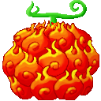

<!-- Generated by tools/build_pack_reference.py. Edit the pack sources and regenerate. -->

# Mine Mine no Mi

<div class="mod-page-icon" markdown="1">



</div>

Character creation, crews, Devil Fruits and the core combat system.

Installed build `0.11.6`. [Browse all mods](index.md).

See the [fighting style catalogue](../../characters/styles/index.md) for moves and training.

See the [race guide](../../characters/races/index.md) for abilities and variants.

## Pack guides

- [Combat stats and Doriki scaling](../../characters/combat-stats.md)
- [Devil Fruits and awakenings](../../characters/devil-fruits.md)
- [Getting started](../../voyage/first-voyage.md)

## Related mods

- [AkumaLib](akumalib.md)
- [Haki Realm](hakirework.md)
- [Eternal Voyage Companion](eternalvoyage.md)

## Abilities

| In-game name | ID | In-game description |
| --- | --- | --- |
| 1 Million Vari | `mineminenomi:1_million_vari` |  |
| 100 Million Vari | `mineminenomi:100_million_vari` |  |
| 20 Million Vari | `mineminenomi:20_million_vari` |  |
| 200 Million Vari | `mineminenomi:200_million_vari` |  |
| Atomic Rush | `mineminenomi:atomic_rush` |  |
| Bakudan | `mineminenomi:bakudan` | Throws a bunch of bombs near the user, when enemies come in close proximity with these bombs they'll explode. |
| Bara Bara Festival: Shield | `mineminenomi:bara_bara_festival_shield` |  |
| Batto Strike | `mineminenomi:batto_strike` |  |
| Belly Flop | `mineminenomi:belly_flop` | The user jumps in the air and uses their whole body to hit all the targets while falling, targets hit on ground will also get dizzy for a few seconds. |
| Black Leg Attack Speed | `mineminenomi:black_leg_attack_speed` |  |
| Black Leg Damage | `mineminenomi:black_leg_damage` |  |
| Bomb Throw | `mineminenomi:bomb_throw` | Throws a bomb. |
| Brawler Damage | `mineminenomi:brawler_damage` |  |
| Busoshoku Haki: Emission | `mineminenomi:busoshoku_haki_emission` | Allows the user to emit their haki over a short distance without a medium. |
| Busoshoku Haki: Full Body Hardening | `mineminenomi:busoshoku_haki_full_body_hardening` | Covers the whole body of the user user in a layer of Armament haki, used for a balance between offense and defense. |
| Busoshoku Haki: Hardening | `mineminenomi:busoshoku_haki_hardening` | Covers the fist of the user in Armament haki, making their physical attacks more powerful and being able to damage Logia users. |
| Busoshoku Haki: Imbuing | `mineminenomi:busoshoku_haki_imbuing` | Covers the weapon of the user in Armament haki, making their weapon attacks stronger and being able to damage Logia users. |
| Busoshoku Haki: Internal Destruction | `mineminenomi:busoshoku_haki_internal_destruction` | Allows the user to emit their haki through the target's body dealing great internal damage. |
| Champ Fight | `mineminenomi:champ_fight` |  |
| Charged Cleave | `mineminenomi:charged_cleave` |  |
| Cola Backpack Bonus | `mineminenomi:cola_backpack_bonus` |  |
| Cola Fuel | `mineminenomi:cola_fuel` |  |
| Cola Overdrive | `mineminenomi:cola_overdrive` | The user absorbs cola from their reserves to boost their physical abilities. |
| Command: Attack | `mineminenomi:attack_command` |  |
| Command: Follow | `mineminenomi:follow_command` |  |
| Command: Guard | `mineminenomi:guard_command` |  |
| Command: Idle | `mineminenomi:idle_command` |  |
| Command: Stay | `mineminenomi:stay_command` |  |
| Coup De Boo | `mineminenomi:coup_de_boo` | Launches the user into the sky and poisons all nearby enemies on launch. |
| Coup de Vent | `mineminenomi:coup_de_vent` | Launches a powerful blast of compressed air that blows the opponent away. |
| Cyborg Armor | `mineminenomi:cyborg_armor` |  |
| Cyborg Passive Bonuses | `mineminenomi:cyborg_passive_bonuses` |  |
| Dai Enkai: Onibi | `mineminenomi:dai_enkai_onibi` |  |
| Demon Road | `mineminenomi:venom_road_venom` |  |
| Demonic Dance | `mineminenomi:demonic_dance` |  |
| Demonic Dash | `mineminenomi:demonic_dash` |  |
| Demonic Smash | `mineminenomi:demonic_smash` |  |
| Elemental Flight | `mineminenomi:elemental_flight` |  |
| Empty Hands | `mineminenomi:empty_hands` | When active items picked from ground will never be put in the user's main hand. If there's space in the inventory it will be put there, othewise it won't get picked up at all. |
| Fresh Fire | `mineminenomi:fresh_fire` | The user heats up and breathes fire like a flamethrower at the enemy. |
| Gomu Gomu no Bajrang Gun | `mineminenomi:gomu_gomu_no_bajrang_gun` |  |
| Gomu Gomu no Dawn Rocket | `mineminenomi:gomu_gomu_no_dawn_rocket` |  |
| Gomu Gomu no Elephant Gatling | `mineminenomi:gomu_gomu_no_elephant_gatling` |  |
| Gomu Gomu no Elephant Gun | `mineminenomi:gomu_gomu_no_elephant_gun` |  |
| Gomu Gomu no Grizzly Magnum | `mineminenomi:gomu_gomu_no_grizzly_magnum` |  |
| Gomu Gomu no Jet Bazooka | `mineminenomi:gomu_gomu_no_jet_bazooka` |  |
| Gomu Gomu no Jet Gatling | `mineminenomi:gomu_gomu_no_jet_gatling` |  |
| Gomu Gomu no Jet Pistol | `mineminenomi:gomu_gomu_no_jet_pistol` |  |
| Gomu Gomu no King Kong Gun | `mineminenomi:gomu_gomu_no_king_kong_gun` |  |
| Gomu Gomu no Kong Gatling | `mineminenomi:gomu_gomu_no_kong_gatling` |  |
| Gomu Gomu no Leo Bazooka | `mineminenomi:gomu_gomu_no_leo_bazooka` |  |
| Grab Lock | `mineminenomi:grab_lock` | Grabs an opponent from the back and keeps them pinned like that. |
| Gravi Zone: Reject | `mineminenomi:gravi_zone_reject` |  |
| Ground Secco | `mineminenomi:ground_secco` | Dries out the area around the user. While in a desert the cooldown of this ability is reduced by %s. |
| Gun Array | `mineminenomi:gun_array` | While active it automatically fires bullets from the inventory. |
| Haoshoku Haki | `mineminenomi:haoshoku_haki` | A burst of the unique Conqueror's haki, that knocks out enemies that are weaker than the user. |
| Haoshoku Haki: Infusion | `mineminenomi:haoshoku_haki_infusion` | Allows the user to infuse their haoshoku haki into whatever weapon they're holding. |
| Honk | `mineminenomi:honk` | honk honk |
| Hook Grab | `mineminenomi:hook_grab` | Shoot's the equipped Hook catching the enemy and dragging them towards the user. |
| Ichirin Zashi | `mineminenomi:ichirin_zashi` | The user leaps into the air and drops down on ground hitting the target on their descent |
| Kaishin | `mineminenomi:kaishin` |  |
| Kaji Oyaji | `mineminenomi:kaji_oyaji` | Breathes fire. |
| Kamikaze Hyakkoma Gekijo | `mineminenomi:kamikaze_hyakkoma_gekijo` | The user throws several tops at their opponent, some of them exploding on impact. |
| Kenbunshoku Haki: Aura | `mineminenomi:kenbunshoku_haki_aura` | Uses Observation Haki to see the auras of all nearby creatures, differentiated by colors. |
| Kenbunshoku Haki: Future Sight | `mineminenomi:kenbunshoku_haki_future_sight` | Using Observation Haki allows the user to see a short period into the future to avoid attacks. |
| Knockdown | `mineminenomi:knockdown` | When active, enemies will be left unconscious instead of killed. |
| Leap | `mineminenomi:leap` | Leaps at the enemy and damages all nearby entities on landing. |
| Liberation: Release | `mineminenomi:liberation_release` |  |
| Logia Invulnerability | `mineminenomi:logia_invulnerability` | Allows the user to avoid attacks by instinctively transforming parts of their body into their specific element |
| Mamaragan | `mineminenomi:mamaragan` |  |
| MH5 | `mineminenomi:mh5` | Charges a deathly poison bomb causing all within its radius to die when inhaling the resulting gas. |
| Mil Fleur: Clutch | `mineminenomi:mil_fleur_clutch` |  |
| Mil Fleur: Slap | `mineminenomi:mil_fleur_slap` |  |
| Mil Fleur: Twist | `mineminenomi:mil_fleur_twist` |  |
| Mink Jump | `mineminenomi:mink_jump` |  |
| Mink Passive Bonuses | `mineminenomi:mink_passive_bonuses` |  |
| Mink Speed | `mineminenomi:mink_speed` |  |
| Muster | `mineminenomi:muster` | The user musters some reinforcements. |
| One Two Jango | `mineminenomi:one_two_jango` |  |
| Pearl Fire | `mineminenomi:pearl_fire` | Sets the pearl armor on fire causing any enemy that hits you to take damage and any enemy you hit to be set on fire. |
| Poêle à Frire | `mineminenomi:poele_a_frire` |  |
| Radical Beam | `mineminenomi:radical_beam` | The user launches a powerful beam of energy at the opponent. |
| Rideable | `mineminenomi:rideable` |  |
| Ryuseigun | `mineminenomi:genkotsu_meteor_ryuseigun` |  |
| Sables Guard | `mineminenomi:sables_guard` | The user starts a sandstorm with themselves as the center of it, sending all nearby enemies flying away. While in a desert the cooldown of this ability is reduced by %s. |
| Shakushi | `mineminenomi:shakushi` |  |
| Shingen no Ichigeki: Crowd | `mineminenomi:shingen_no_ichigeki_crowd` |  |
| Slam | `mineminenomi:slam` | The user jumps in the air and uses their fists or weapon to smash the target and the ground around it. |
| Small Muster | `mineminenomi:small_muster` | The user musters a few low level reinforcements. |
| Sniper Accuracy | `mineminenomi:sniper_accuracy` |  |
| Sniper Goggles | `mineminenomi:sniper_goggles` |  |
| Southland Suplex | `mineminenomi:southland_suplex` | The user grabs a person with both of their arms and smashes the opponent's head by throwing them backwards |
| Steal Punch | `mineminenomi:steal_punch` | Hits the enemy and throws their held item away from them. |
| Stealth Foot | `mineminenomi:stealth_foot` |  |
| Strong Right | `mineminenomi:strong_right` | The user punches the opponent with an extensible short range metal fist. |
| Sulong Check | `mineminenomi:sulong_check` |  |
| Swordsman Damage | `mineminenomi:swordsman_damage` |  |
| Tail Spin | `mineminenomi:tail_spin` | Spins around hitting all nearby enemies with the user's tail. |
| Takedown Kick | `mineminenomi:takedown_kick` | Jumps high in the sky and kicks down any enemies it reaches temporarily stunning them too. |
| Test | `mineminenomi:test` | Test Description  Ability: %s Item: %s Effect: %s. |
| Test Parts | `mineminenomi:test_parts` | Ability for testing part entities. |
| Tokudai Candle | `mineminenomi:tokudai_candle` |  |
| Venom Chloro Ball | `mineminenomi:chloro_ball_venom` |  |
| Venom Doku Gumo | `mineminenomi:doku_gumo_venom` |  |
| Venom Hydra | `mineminenomi:hydra_venom` |  |
| Virus Zone: Ice Oni | `mineminenomi:virus_zone_ice_oni` |  |
| Virus Zone: Mummy | `mineminenomi:virus_zone_mummy` |  |
| Weapon Spin | `mineminenomi:weapon_spin` | Spins around hitting all nearby enemies with the held weapon. |
| Weapon Throw | `mineminenomi:weapon_throw` | Throws the held weapon dealing damage based on the weapon's damage. |
| Wootz Net Launcher | `mineminenomi:wootz_net_launcher` | Shoots a net from one of the many guns hidden within the armor. |
| Zoom | `mineminenomi:zoom` | Zooms into the direction the user is looking, massively reduces inaccuracy when shooting projectiles. |


## Effects

| In-game name | ID | In-game description |
| --- | --- | --- |
| Animal Lookout | `mineminenomi:animal_lookout` |  |
| Anti Knockback | `mineminenomi:anti_knockback` |  |
| Antidote | `mineminenomi:antidote` |  |
| Bind | `mineminenomi:bind` |  |
| Black Box | `mineminenomi:black_box` |  |
| Bleeding | `mineminenomi:bleeding` |  |
| Bubbly Coral | `mineminenomi:bubbly_coral` |  |
| Candle Lock | `mineminenomi:candle_lock` |  |
| Candy Stuck | `mineminenomi:candy_stuck` |  |
| Carrying | `mineminenomi:carrying` |  |
| Caught in Net | `mineminenomi:caught_in_kairoseki_net` |  |
| Caught in Net | `mineminenomi:caught_in_net` |  |
| Challenge Failed | `mineminenomi:challenge_failed` |  |
| Chiyu Hormone | `mineminenomi:chiyu_hormone` |  |
| Chiyupopo | `mineminenomi:chiyupopo` |  |
| Cyclone Tempo | `mineminenomi:cyclone_tempo` |  |
| Dehydration | `mineminenomi:dehydration` |  |
| Dizzy | `mineminenomi:dizzy` |  |
| Doa Invisibility | `mineminenomi:doa_invisibility` |  |
| Doku Poison | `mineminenomi:doku_poison` |  |
| Door Head | `mineminenomi:door_head` |  |
| Drunk | `mineminenomi:drunk` |  |
| Fatigue | `mineminenomi:fatigue` |  |
| Fragile | `mineminenomi:fragile` |  |
| Frostbite | `mineminenomi:frostbite` |  |
| Frozen | `mineminenomi:frozen` |  |
| Ganmen Seicho Hormone | `mineminenomi:ganmen_seicho_hormone` |  |
| Genocide Raid | `mineminenomi:genocide_raid` |  |
| Grabbed | `mineminenomi:grabbed` |  |
| Haki Overuse | `mineminenomi:haki_overuse` |  |
| Handcuffed | `mineminenomi:handcuffed` |  |
| Handcuffed | `mineminenomi:handcuffed_explosive` |  |
| Handcuffed | `mineminenomi:handcuffed_kairoseki` |  |
| Heat Egg Tempo | `mineminenomi:heat_egg_tempo` |  |
| Hunger | `mineminenomi:hunger` |  |
| Ice Oni | `mineminenomi:ice_oni` |  |
| Ice Oni Antibody | `mineminenomi:ice_oni_antibody` |  |
| Ice Oni Frostbite | `mineminenomi:ice_oni_frostbite` |  |
| Impact Frame | `mineminenomi:impact_frame` |  |
| In Event | `mineminenomi:in_event` |  |
| Kairoseki Weakness | `mineminenomi:kairoseki_weakness` |  |
| Launched | `mineminenomi:launched` |  |
| Lovestruck | `mineminenomi:lovestruck` |  |
| Movement Blocked | `mineminenomi:movement_blocked` |  |
| Mummy | `mineminenomi:mummy` |  |
| Mummy Antibody | `mineminenomi:mummy_antibody` |  |
| Negative | `mineminenomi:negative` |  |
| No Hands | `mineminenomi:no_hands` |  |
| Noro Slowness | `mineminenomi:noro_slowness` |  |
| Oil Covered | `mineminenomi:oil_covered` |  |
| Paralysis | `mineminenomi:paralysis` |  |
| Play Dead | `mineminenomi:play_dead` |  |
| Punk Cross | `mineminenomi:punk_cross` |  |
| Reduced Fall | `mineminenomi:reduced_fall` |  |
| Saboten Boshi | `mineminenomi:saboten_boshi` |  |
| Seismic Bubble | `mineminenomi:seismic_bubble` |  |
| Silent | `mineminenomi:silent` |  |
| Smoke | `mineminenomi:smoke` |  |
| Sticky | `mineminenomi:sticky` |  |
| Suke Invisibility | `mineminenomi:suke_invisibility` |  |
| Swim Slowdown | `mineminenomi:swim_slowdown` |  |
| Tension Hormone | `mineminenomi:tension_hormone` |  |
| Tokudai Candle Poison | `mineminenomi:tokudai_candle_poison` |  |
| Unconscious | `mineminenomi:unconscious` |  |
| Vanish | `mineminenomi:vanish` |  |
| Washed | `mineminenomi:washed` |  |
| Water Weakness | `mineminenomi:water_weakness` |  |
| Wet | `mineminenomi:wet` |  |


## Creatures and entities

| In-game name | ID | In-game description |
| --- | --- | --- |
| Alvida | `mineminenomi:alvida` |  |
| Alvida | `mineminenomi:alvida2` |  |
| Amaterasu | `mineminenomi:amaterasu` |  |
| Arlong | `mineminenomi:arlong` |  |
| Art of Weather Trainer | `mineminenomi:art_of_weather_trainer` |  |
| Awase Baori | `mineminenomi:awase_baori` |  |
| Axe Dial | `mineminenomi:axe_dial` |  |
| Bananawani | `mineminenomi:bananawani` |  |
| Bandit Brute | `mineminenomi:bandit_brute` |  |
| Bandit Grunt | `mineminenomi:bandit_grunt` |  |
| Bandit Leader | `mineminenomi:bandit_leader` |  |
| Bandit Sniper | `mineminenomi:bandit_sniper` |  |
| Bara Bara Ho | `mineminenomi:bara_bara_ho` |  |
| Bara Festival | `mineminenomi:bara_festival` |  |
| Barizodon | `mineminenomi:barizodon` |  |
| Barkeeper | `mineminenomi:barkeeper` |  |
| Barrier Crash | `mineminenomi:barrier_crash` |  |
| Barrierbility Stairs | `mineminenomi:barrierbility_stairs` |  |
| Bero Cannon | `mineminenomi:bero_cannon` |  |
| Beta Chain | `mineminenomi:beta_chain` |  |
| Black Knight | `mineminenomi:black_knight` |  |
| Black Leg Trainer | `mineminenomi:black_leg_trainer` |  |
| Black Road | `mineminenomi:black_road` |  |
| Blagori | `mineminenomi:blagori` |  |
| Blugori | `mineminenomi:blugori` |  |
| Bomb | `mineminenomi:bomb` |  |
| Bottom Half | `mineminenomi:bottom_half` |  |
| Boxing Dugong | `mineminenomi:boxing_dugong` |  |
| Brawler Trainer | `mineminenomi:brawler_trainer` |  |
| Breeze Breath Bomb | `mineminenomi:breeze_breath_bomb` |  |
| Brick Bat | `mineminenomi:brick_bat` |  |
| Brick Box | `mineminenomi:brick_box` |  |
| Buchi | `mineminenomi:buchi` |  |
| Buggy | `mineminenomi:buggy` |  |
| Cabaji | `mineminenomi:cabaji` |  |
| Campo de Flores | `mineminenomi:campo_de_flores` |  |
| Candle Lock | `mineminenomi:candle_lock` |  |
| Candy Escalator | `mineminenomi:candy_escalator` |  |
| Candy Wave | `mineminenomi:candy_wave` |  |
| Cannon | `mineminenomi:cannon` |  |
| Cannon Ball | `mineminenomi:cannon_ball` |  |
| Celestial Dragon | `mineminenomi:celestial_dragon` |  |
| Chakram | `mineminenomi:chakram` |  |
| Champ Fight | `mineminenomi:champ_fight` |  |
| Charging Ursus Shock | `mineminenomi:charging_ursus_shock` |  |
| Chew | `mineminenomi:chew` |  |
| Chloro Ball | `mineminenomi:chloro_ball` |  |
| Chloro Ball Cloud | `mineminenomi:chloro_ball_cloud` |  |
| Cool Ball | `mineminenomi:cool_ball` |  |
| Coup de Vent | `mineminenomi:coup_de_vent` |  |
| Dai Circus | `mineminenomi:dai_circus` |  |
| Dai Enkai: Entei | `mineminenomi:dai_enkai_entei` |  |
| Dai Enkai: Onibi | `mineminenomi:dai_enkai_onibi` |  |
| Dai Funka | `mineminenomi:dai_funka` |  |
| Damned Punk | `mineminenomi:damned_punk` |  |
| Dark Matter | `mineminenomi:dark_matter` |  |
| Den Den Mushi | `mineminenomi:den_den_mushi` |  |
| Desert Grande Spada | `mineminenomi:desert_grande_spada` |  |
| Desert Spada | `mineminenomi:desert_spada` |  |
| Devil Fruit | `mineminenomi:devil_fruit` |  |
| Doctor Trainer | `mineminenomi:doctor_trainer` |  |
| Don Krieg | `mineminenomi:don_krieg` |  |
| Doppelman | `mineminenomi:doppelman` |  |
| Doru Doru Arts: Mori | `mineminenomi:doru_doru_arts_mori` |  |
| Dragon's Roar | `mineminenomi:dragons_roar` |  |
| El Thor | `mineminenomi:el_thor` |  |
| Electro Visual | `mineminenomi:electro_visual` |  |
| Extra Hachis | `mineminenomi:extra_hachis` |  |
| Feet | `mineminenomi:feet` |  |
| Fighting Fish | `mineminenomi:fighting_fish` |  |
| Flying Fish | `mineminenomi:flying_fish` |  |
| Fresh Fire | `mineminenomi:fresh_fire` |  |
| Gas Robe | `mineminenomi:gas_robe` |  |
| Gastille | `mineminenomi:gastille` |  |
| Gekishin | `mineminenomi:gekishin` |  |
| Genocide Raid Effect | `mineminenomi:genocide_raid_effect` |  |
| Gin | `mineminenomi:gin` |  |
| Gomu Gomu no Bajrang Gun | `mineminenomi:gomu_gomu_no_bajrang_gun` |  |
| Gomu Gomu no Bazooka | `mineminenomi:gomu_gomu_no_bazooka` |  |
| Gomu Gomu no Elephant Gun | `mineminenomi:gomu_gomu_no_elephant_gun` |  |
| Gomu Gomu no Grizzly Magnum | `mineminenomi:gomu_gomu_no_grizzly_magnum` |  |
| Gomu Gomu no Jet Bazooka | `mineminenomi:gomu_gomu_no_jet_bazooka` |  |
| Gomu Gomu no Jet Pistol | `mineminenomi:gomu_gomu_no_jet_pistol` |  |
| Gomu Gomu no King Kong Gun | `mineminenomi:gomu_gomu_no_king_kong_gun` |  |
| Gomu Gomu no Leo Bazooka | `mineminenomi:gomu_gomu_no_leo_bazooka` |  |
| Gomu Gomu no Pistol | `mineminenomi:gomu_gomu_no_pistol` |  |
| Gomu Gomu no Rocket | `mineminenomi:gomu_gomu_no_rocket` |  |
| Gust Sword | `mineminenomi:gust_sword` |  |
| Hana Hands | `mineminenomi:hana_hands` |  |
| Heat Ball | `mineminenomi:heat_ball` |  |
| Hi no Tori Boshi | `mineminenomi:hi_no_tori_boshi` |  |
| Hidaruma | `mineminenomi:hidaruma` |  |
| Higan | `mineminenomi:higan` |  |
| Higuma | `mineminenomi:higuma` |  |
| Hiken | `mineminenomi:hiken` |  |
| Hook | `mineminenomi:hook` |  |
| Humandrill | `mineminenomi:humandrill` |  |
| Hyakuhachi Pound Ho | `mineminenomi:hyakuhachi_pound_ho` |  |
| Hydra | `mineminenomi:hydra` |  |
| Ice Ball | `mineminenomi:ice_ball` |  |
| Ice Block: Avalanche | `mineminenomi:ice_block_avalanche` |  |
| Ice Block: Partisan | `mineminenomi:ice_block_partisan` |  |
| Ice Block: Pheasant | `mineminenomi:ice_block_pheasant` |  |
| Impact Blast | `mineminenomi:impact_blast` |  |
| Jango | `mineminenomi:jango` |  |
| Jujika | `mineminenomi:jujika` |  |
| Kaen Boshi | `mineminenomi:kaen_boshi` |  |
| Kairoseki Bullet | `mineminenomi:kairoseki_bullet` |  |
| Kairoseki Net | `mineminenomi:kairoseki_net` |  |
| Kemuri Boshi | `mineminenomi:kemuri_boshi` |  |
| Kemuri Boshi Cloud | `mineminenomi:kemuri_boshi_cloud` |  |
| King Punch | `mineminenomi:king_punch` |  |
| Kung Fu Dugong | `mineminenomi:kung_fu_dugong` |  |
| Kuro | `mineminenomi:kuro` |  |
| Kuroobi | `mineminenomi:kuroobi` |  |
| Lapahn | `mineminenomi:lapahn` |  |
| Legendary Master Dugong | `mineminenomi:legendary_master_dugong` |  |
| Liberation | `mineminenomi:liberation` |  |
| Lightning Discharge | `mineminenomi:lightning_discharge` |  |
| Marine Brute | `mineminenomi:marine_brute` |  |
| Marine Captain | `mineminenomi:marine_captain` |  |
| Marine Grunt | `mineminenomi:marine_grunt` |  |
| Marine Sniper | `mineminenomi:marine_sniper` |  |
| Marine Trader | `mineminenomi:marine_trader` |  |
| Marine Vice Admiral | `mineminenomi:marine_vice_admiral` |  |
| Meigo | `mineminenomi:meigo` |  |
| Mero Mero Mellow | `mineminenomi:mero_mero_mellow` |  |
| MH5 Cloud | `mineminenomi:mh5_cloud` |  |
| Milky Dial | `mineminenomi:milky_dial` |  |
| Mini Hollow | `mineminenomi:mini_hollow` |  |
| Mirage Clone | `mineminenomi:mirage_clone` |  |
| Mirage Cloud | `mineminenomi:mirage_cloud` |  |
| Miss Valentine | `mineminenomi:miss_valentine` |  |
| Mizu Shuryudan | `mineminenomi:mizu_shuryudan` |  |
| Mizu Taiho | `mineminenomi:mizu_taiho` |  |
| Moko | `mineminenomi:moko` |  |
| Morgan | `mineminenomi:morgan` |  |
| Mr 0 | `mineminenomi:mr_0` |  |
| Mr 1 | `mineminenomi:mr_1` |  |
| Mr 3 | `mineminenomi:mr_3` |  |
| Mr 5 | `mineminenomi:mr_5` |  |
| Mucus Bomb | `mineminenomi:mucus_bomb` |  |
| Nanahyakuniju Pound Ho | `mineminenomi:nanahyakuniju_pound_ho` |  |
| Nanajuni Pound Ho | `mineminenomi:nanajuni_pound_ho` |  |
| Negative Hollow | `mineminenomi:negative_hollow` |  |
| Nekkai Gyorai | `mineminenomi:nekkai_gyorai` |  |
| Nemuri Boshi | `mineminenomi:nemuri_boshi` |  |
| Nightmare Soldier | `mineminenomi:nightmare_soldier` |  |
| Normal Bullet | `mineminenomi:normal_bullet` |  |
| Noro Noro Beam | `mineminenomi:noro_noro_beam` |  |
| Nose Fancy Cannon | `mineminenomi:nose_fancy_cannon` |  |
| Overheat | `mineminenomi:overheat` |  |
| Pacifista | `mineminenomi:pacifista` |  |
| Pack of Sharks | `mineminenomi:pack_of_sharks` |  |
| Pad Ho | `mineminenomi:pad_ho` |  |
| Pain | `mineminenomi:pain` |  |
| Panda Shark | `mineminenomi:panda_shark` |  |
| Pearl | `mineminenomi:pearl` |  |
| Phoenix Goen | `mineminenomi:phoenix_goen` |  |
| Physical Body | `mineminenomi:physical_body` |  |
| Pirate Brute | `mineminenomi:pirate_brute` |  |
| Pirate Captain | `mineminenomi:pirate_captain` |  |
| Pirate Grunt | `mineminenomi:pirate_grunt` |  |
| Pirate Notorious Captain | `mineminenomi:pirate_notorious_captain` |  |
| Pirate Trader | `mineminenomi:pirate_trader` |  |
| Pistol Kiss | `mineminenomi:pistol_kiss` |  |
| Poele a Frire | `mineminenomi:poele_a_frire` |  |
| Poison Spit | `mineminenomi:poison_spit` |  |
| Pop Green | `mineminenomi:pop_green` |  |
| Punk Gibson | `mineminenomi:punk_gibson` |  |
| Punk Pistol | `mineminenomi:punk_pistol` |  |
| Radical Beam | `mineminenomi:radical_beam` |  |
| Raigo | `mineminenomi:raigo` |  |
| Raigo Lightning | `mineminenomi:raigo_lightning` |  |
| Rankyaku | `mineminenomi:rankyaku` |  |
| Relax Hour | `mineminenomi:relax_hour` |  |
| Renpatsu Namari Boshi | `mineminenomi:renpatsu_namari_boshi` |  |
| Rokuogan | `mineminenomi:rokuogan` |  |
| Rope Net | `mineminenomi:rope_net` |  |
| Ryusei Kazan | `mineminenomi:ryusei_kazan` |  |
| Sables Pesado | `mineminenomi:sables_pesado` |  |
| Sagari no Ryusei | `mineminenomi:sagari_no_ryusei` |  |
| Sakuretsu Saboten Boshi | `mineminenomi:sakuretsu_saboten_boshi` |  |
| Sanbyakurokuju Pound Ho | `mineminenomi:sanbyakurokuju_pound_ho` |  |
| Sango | `mineminenomi:sango` |  |
| Sanjuroku Pound Ho | `mineminenomi:sanjuroku_pound_ho` |  |
| Sea Cow | `mineminenomi:sea_cow` |  |
| Senhachiju Pound Ho | `mineminenomi:senhachiju_pound_ho` |  |
| Sham | `mineminenomi:sham` |  |
| Shisha no Te | `mineminenomi:shisha_no_te` |  |
| Skelly Body | `mineminenomi:skelly_body` |  |
| Skypiean Civilian | `mineminenomi:skypiean_civilian` |  |
| Skypiean Trader | `mineminenomi:skypiean_trader` |  |
| Slave Arrow | `mineminenomi:slave_arrow` |  |
| Sniper Target | `mineminenomi:sniper_target` |  |
| Sniper Trainer | `mineminenomi:sniper_trainer` |  |
| Sparkling Daisy Aftereffect | `mineminenomi:sparkling_daisy_aftereffect` |  |
| Sphere | `mineminenomi:sphere` |  |
| Spike | `mineminenomi:spike` |  |
| Spiral Hollow | `mineminenomi:spiral_hollow` |  |
| Spring Death Knock | `mineminenomi:spring_death_knock` |  |
| Striker | `mineminenomi:striker` |  |
| String Pillar | `mineminenomi:string_pillar` |  |
| Strong Right | `mineminenomi:strong_right` |  |
| Super Spot-Billed Duck | `mineminenomi:super_spotbilled_duck` |  |
| Swordsman Trainer | `mineminenomi:swordsman_trainer` |  |
| Tamaito | `mineminenomi:tamaito` |  |
| Tatsu Maki | `mineminenomi:tatsu_maki` |  |
| Tempuraudon | `mineminenomi:tempuraudon` |  |
| Tetsu Boshi | `mineminenomi:tetsu_boshi` |  |
| Throwing Weapon | `mineminenomi:throwing_weapon` |  |
| Thrown Spear | `mineminenomi:thrown_spear` |  |
| Thunder Ball | `mineminenomi:thunder_ball` |  |
| Thunder Lance | `mineminenomi:thunder_lance` |  |
| Thunderbolt | `mineminenomi:thunderbolt` |  |
| Thunderstorm | `mineminenomi:thunderstorm` |  |
| Todoroki | `mineminenomi:todoroki` |  |
| Toku Hollow | `mineminenomi:toku_hollow` |  |
| Tokuyo Abura Boshi | `mineminenomi:tokuyo_abura_boshi` |  |
| Top | `mineminenomi:top` |  |
| Tornado | `mineminenomi:tornado` |  |
| Trunk Shot | `mineminenomi:trunk_shot` |  |
| Tsuno Tokage | `mineminenomi:tsuno_tokage` |  |
| Uchimizu | `mineminenomi:uchimizu` |  |
| Unicycle | `mineminenomi:unicycle` |  |
| Ursus Shock | `mineminenomi:ursus_shock` |  |
| Venom Road | `mineminenomi:venom_road` |  |
| Vivre Card | `mineminenomi:vivre_card` |  |
| Wandering Dugong | `mineminenomi:wandering_dugong` |  |
| Wanted Poster Package | `mineminenomi:wanted_poster_package` |  |
| Wax Clone | `mineminenomi:wax_clone` |  |
| Weather Cloud | `mineminenomi:weather_cloud` |  |
| Weather Egg | `mineminenomi:weather_egg` |  |
| White Blow | `mineminenomi:white_blow` |  |
| White Blow Rush | `mineminenomi:white_blow_rush` |  |
| White Out | `mineminenomi:white_out` |  |
| White Snake | `mineminenomi:white_snake` |  |
| White Walkie | `mineminenomi:white_walkie` |  |
| Wrestling Dugong | `mineminenomi:wrestling_dugong` |  |
| Yagara Bull | `mineminenomi:yagara_bull` |  |
| Yakkodori | `mineminenomi:yakkodori` |  |
| Yarinami | `mineminenomi:yarinami` |  |
| Yasakani no Magatama | `mineminenomi:yasakani_no_magatama` |  |
| Yuki Rabi | `mineminenomi:yuki_rabi` |  |


## Items

| In-game name | ID | In-game description |
| --- | --- | --- |
| %s Completed | `mineminenomi:df_encyclopedia_completion` |  |
| 5t Hammer | `mineminenomi:5t_hammer` |  |
| Ace | `mineminenomi:ace` |  |
| Ace's Hat | `mineminenomi:aces_hat` |  |
| Ace's Knife | `mineminenomi:aces_knife` |  |
| Ama no Murakumo | `mineminenomi:ama_no_murakumo` |  |
| Ame no Habakiri | `mineminenomi:ame_no_habakiri` |  |
| Ancient Manual | `mineminenomi:ancient_manual` |  |
| Arlong's Hat | `mineminenomi:arlongs_hat` |  |
| Arlong's Pants | `mineminenomi:arlongs_pants` |  |
| Arlong's Shirt | `mineminenomi:arlongs_shirt` |  |
| Arlong's Shoes | `mineminenomi:arlongs_shoes` |  |
| Axe | `mineminenomi:axe` |  |
| Axe Dial | `mineminenomi:axe_dial` |  |
| Axe Hand | `mineminenomi:axe_hand` |  |
| Bandana | `mineminenomi:bandana` |  |
| Barrier | `mineminenomi:barrier` |  |
| Barrierbility Bat | `mineminenomi:barrierbility_bat` |  |
| Bastille Mask | `mineminenomi:bastille_mask` |  |
| Bazooka | `mineminenomi:bazooka` |  |
| Belly Pouch | `mineminenomi:belly_pouch` |  |
| Belly: %s | `mineminenomi:belly_pouch_amount` |  |
| Bicorne | `mineminenomi:bicorne` |  |
| Big Red Nose | `mineminenomi:big_red_nose` |  |
| Bisento | `mineminenomi:bisento` |  |
| Blue Sword | `mineminenomi:blue_sword` |  |
| Blugori Hood | `mineminenomi:blugori_hood` |  |
| Bottle of Rum | `mineminenomi:bottle_of_rum` |  |
| Breath Dial | `mineminenomi:breath_dial` |  |
| Broadsword | `mineminenomi:broadsword` |  |
| Bubbly Coral | `mineminenomi:bubbly_coral` |  |
| Bullet | `mineminenomi:bullet` |  |
| Cabaji's Scarf | `mineminenomi:cabajis_scarf` |  |
| Candy Block | `mineminenomi:candy_block` |  |
| Cannon | `mineminenomi:cannon` |  |
| Cannon Ball | `mineminenomi:cannon_ball` |  |
| Cannot carry any more belly! | `mineminenomi:belly_full` |  |
| Cannot carry any more extol! | `mineminenomi:extol_full` |  |
| Cat Claws | `mineminenomi:cat_claws` |  |
| Celestial Dragon Bubble | `mineminenomi:celestial_dragon_bubble` |  |
| Chakram | `mineminenomi:chakram` |  |
| Challenge Air | `mineminenomi:challenge_air` |  |
| Challenge Poster | `mineminenomi:challenge_poster` |  |
| Character Creator | `mineminenomi:character_creator` |  |
| Chew's Pants | `mineminenomi:chews_pants` |  |
| Chew's Shirt | `mineminenomi:chews_shirt` |  |
| Chew's Shoes | `mineminenomi:chews_shoes` |  |
| Chopper's Hat | `mineminenomi:choppers_hat` |  |
| Chopper's Hat | `mineminenomi:choppers_hat_2` |  |
| Cigar | `mineminenomi:cigar` |  |
| Cigarette | `mineminenomi:cigarette` |  |
| Cleaver | `mineminenomi:cleaver` |  |
| Clima Tact | `mineminenomi:clima_tact` |  |
| Cola | `mineminenomi:cola` |  |
| Cola Backpack | `mineminenomi:cola_backpack` |  |
| Color Palette | `mineminenomi:color_palette` |  |
| Cooked Sea King Meat | `mineminenomi:cooked_sea_king_meat` |  |
| CP9 Boots | `mineminenomi:cp9_boots` |  |
| CP9 Jacket | `mineminenomi:cp9_jacket` |  |
| CP9 Pants | `mineminenomi:cp9_pants` |  |
| Crocodile's Pants | `mineminenomi:crocodiles_pants` |  |
| Crocodile's Shoes | `mineminenomi:crocodiles_shoes` |  |
| Crocodile's Suit | `mineminenomi:crocodiles_suit` |  |
| Custom Spawner | `mineminenomi:custom_spawner` |  |
| Cutlass | `mineminenomi:cutlass` |  |
| Dagger | `mineminenomi:dagger` |  |
| Daisenso | `mineminenomi:daisenso` |  |
| Dalton's Spade | `mineminenomi:daltons_spade` |  |
| Dandelion | `mineminenomi:dandelion` |  |
| Darkness | `mineminenomi:darkness` |  |
| Deepslate Kairoseki Ore | `mineminenomi:deepslate_kairoseki_ore` |  |
| Demon Poison | `mineminenomi:demon_poison` |  |
| Den Den Mushi | `mineminenomi:den_den_mushi` |  |
| Dense Kairoseki | `mineminenomi:dense_kairoseki` |  |
| Design Barrel | `mineminenomi:design_barrel` |  |
| Devil Fruit | `mineminenomi:generic_fruit` |  |
| Devil Fruit Clue | `mineminenomi:fruit_clue` |  |
| Devil Fruit Encyclopedia | `mineminenomi:devil_fruit_encyclopedia` |  |
| Doflamingo's Glasses | `mineminenomi:doflamingos_glasses` |  |
| Doru Doru Arts: Ken | `mineminenomi:doru_doru_arts_ken` |  |
| Doru Doru Arts: Pickaxe | `mineminenomi:doru_doru_arts_pickaxe` |  |
| Durandal | `mineminenomi:durandal` |  |
| Eisen Dial | `mineminenomi:eisen_dial` |  |
| Empty Cola | `mineminenomi:empty_cola` |  |
| Empty Ultra Cola | `mineminenomi:empty_ultra_cola` |  |
| Enma | `mineminenomi:enma` |  |
| Explosive Handcuffs | `mineminenomi:explosive_handcuffs` |  |
| Extol Pouch | `mineminenomi:extol_pouch` |  |
| Extol: %s | `mineminenomi:extol_pouch_amount` |  |
| Flag | `mineminenomi:flag` |  |
| Flame Dial | `mineminenomi:flame_dial` |  |
| Flash Dial | `mineminenomi:flash_dial` |  |
| Fleet Admiral's Hat | `mineminenomi:fleet_admirals_hat` |  |
| Flintlock | `mineminenomi:flintlock` |  |
| Fluffy Cape | `mineminenomi:fluffy_cape` |  |
| Franky's Glasses | `mineminenomi:frankys_glasses` |  |
| Franky's Shirt | `mineminenomi:frankys_shirt` |  |
| Fuel Left: %s | `mineminenomi:fuel_left` |  |
| Gamma Knife | `mineminenomi:gamma_knife` |  |
| Ginga Pachinko | `mineminenomi:ginga_pachinko` |  |
| Golden Box | `mineminenomi:golden_box` |  |
| Golden Den Den Mushi | `mineminenomi:golden_den_den_mushi` |  |
| Gourmetamorphosis - You can eat this item! | `mineminenomi:gourmetamorphosis_food` |  |
| Gryphon | `mineminenomi:gryphon` |  |
| Gun Powder: %s | `mineminenomi:gun_powder_amount` |  |
| Handcuffs | `mineminenomi:handcuffs` |  |
| Hardened Snow | `mineminenomi:hardened_snow` |  |
| Hassaikai | `mineminenomi:hassaikai` |  |
| Heart | `mineminenomi:heart` |  |
| Heart Glasses | `mineminenomi:heart_glasses` |  |
| Hook | `mineminenomi:hook` |  |
| Ice Saber | `mineminenomi:ice_saber` |  |
| Impact Dial | `mineminenomi:impact_dial` |  |
| Iron Box | `mineminenomi:iron_box` |  |
| Iron Jaw | `mineminenomi:iron_jaw` |  |
| Jitte | `mineminenomi:jitte` |  |
| Kabuto | `mineminenomi:kabuto` |  |
| Kairoseki | `mineminenomi:kairoseki` |  |
| Kairoseki Bars | `mineminenomi:kairoseki_bars` |  |
| Kairoseki Block | `mineminenomi:kairoseki_block` |  |
| Kairoseki Bullet | `mineminenomi:kairoseki_bullet` |  |
| Kairoseki Handcuffs | `mineminenomi:kairoseki_handcuffs` |  |
| Kairoseki Item | `mineminenomi:kairoseki_item` |  |
| Kairoseki Net | `mineminenomi:kairoseki_net` |  |
| Kairoseki Ore | `mineminenomi:kairoseki_ore` |  |
| Katana | `mineminenomi:katana` |  |
| Key | `mineminenomi:key` |  |
| Kikoku | `mineminenomi:kikoku` |  |
| Killer's Mask | `mineminenomi:killers_mask` |  |
| Kiribachi | `mineminenomi:kiribachi` |  |
| Kizaru's Glasses | `mineminenomi:kizarus_glasses` |  |
| Kuja Bow | `mineminenomi:kuja_bow` |  |
| Kuma Boots | `mineminenomi:kuma_boots` |  |
| Kuma Pants | `mineminenomi:kuma_pants` |  |
| Kuma Shirt | `mineminenomi:kuma_shirt` |  |
| Kuro Kabuto | `mineminenomi:kuro_kabuto` |  |
| Kuro's Glasses | `mineminenomi:kuros_glasses` |  |
| Kuro's Pants | `mineminenomi:kuros_pants` |  |
| Kuro's Shoes | `mineminenomi:kuros_shoes` |  |
| Kuro's Suit | `mineminenomi:kuros_suit` |  |
| Kuroobi's Ki | `mineminenomi:kuroobis_ki` |  |
| Kuroobi's Pants | `mineminenomi:kuroobis_pants` |  |
| Kuroobi's Shoes | `mineminenomi:kuroobis_shoes` |  |
| Law's Hat | `mineminenomi:laws_hat` |  |
| Lollipop | `mineminenomi:lollipop` |  |
| Luffy's Pants | `mineminenomi:luffys_pants` |  |
| Luffy's Sandals | `mineminenomi:luffys_sandals` |  |
| Luffy's Shirt | `mineminenomi:luffys_shirt` |  |
| Mace | `mineminenomi:mace` |  |
| Mangrove Leaves | `mineminenomi:mangrove_leaves` |  |
| Mangrove Log | `mineminenomi:mangrove_log` |  |
| Mangrove Planks | `mineminenomi:mangrove_planks` |  |
| Mangrove Wood | `mineminenomi:mangrove_wood` |  |
| Marine Boots | `mineminenomi:marine_boots` |  |
| Marine Captain Cape | `mineminenomi:marine_captain_cape` |  |
| Marine Hat | `mineminenomi:marine_hat` |  |
| Marine Pants | `mineminenomi:marine_pants` |  |
| Marine Shirt | `mineminenomi:marine_shirt` |  |
| Medic Bag | `mineminenomi:medic_bag` |  |
| MH5 Gas Mask | `mineminenomi:mh5_gas_mask` |  |
| Mihawk's Hat | `mineminenomi:mihawks_hat` |  |
| Mihawk's Knife | `mineminenomi:mihawks_knife` |  |
| Milky Dial | `mineminenomi:milky_dial` |  |
| Mochi Mochi no Mi | `mineminenomi:mochi_mochi_no_mi` |  |
| Mogura | `mineminenomi:mogura` |  |
| Mr 1's Pants | `mineminenomi:mr_1s_pants` |  |
| Mr 1's Shirt | `mineminenomi:mr_1s_shirt` |  |
| Mr 1's Shoes | `mineminenomi:mr_1s_shoes` |  |
| Mr 3's Glasses | `mineminenomi:mr_3s_glasses` |  |
| Mr 3's Pants | `mineminenomi:mr_3s_pants` |  |
| Mr 3's Shirt | `mineminenomi:mr_3s_shirt` |  |
| Mr 3's Shoes | `mineminenomi:mr_3s_shoes` |  |
| Mr 5's Glasses | `mineminenomi:mr_5s_glasses` |  |
| Mr 5's Pants | `mineminenomi:mr_5s_pants` |  |
| Mr 5's Shirt | `mineminenomi:mr_5s_shirt` |  |
| Mr 5's Shoes | `mineminenomi:mr_5s_shoes` |  |
| Mucus | `mineminenomi:mucus` |  |
| Murakumogiri | `mineminenomi:murakumogiri` |  |
| Nidai Kitetsu | `mineminenomi:nidai_kitetsu` |  |
| No cannon ball found | `mineminenomi:needs_cannonball_loaded` |  |
| No gunpowder found | `mineminenomi:needs_gunpowder_loaded` |  |
| Nonosama Staff | `mineminenomi:nonosama_staff` |  |
| Nonosama Trident | `mineminenomi:nonosama_trident` |  |
| Noro Noro Beam Sword | `mineminenomi:noro_noro_beam_sword` |  |
| Oil Spill | `mineminenomi:oil_spill` |  |
| Ope | `mineminenomi:ope` |  |
| Ori Bars | `mineminenomi:ori_bars` |  |
| Pearl Body Armor | `mineminenomi:pearl_body_armor` |  |
| Pearl Head Armor | `mineminenomi:pearl_head_armor` |  |
| Pearl Legs Armor | `mineminenomi:pearl_legs_armor` |  |
| Perfect Clima Tact | `mineminenomi:perfect_clima_tact` |  |
| Pipe | `mineminenomi:pipe` |  |
| Pirate Boots | `mineminenomi:pirate_boots` |  |
| Pirate Captain Cape | `mineminenomi:pirate_captain_cape` |  |
| Pirate Pants | `mineminenomi:pirate_pants` |  |
| Pirate Shirt | `mineminenomi:pirate_shirt` |  |
| Plume Hat | `mineminenomi:plume_hat` |  |
| Poison | `mineminenomi:poison` |  |
| Poneglyph | `mineminenomi:poneglyph` |  |
| Pop Green | `mineminenomi:pop_green` |  |
| Reject Dial | `mineminenomi:reject_dial` |  |
| Road Poneglyph | `mineminenomi:road_poneglyph` |  |
| Rope Net | `mineminenomi:rope_net` |  |
| Sabo's Hat | `mineminenomi:sabos_hat` |  |
| Sake Bottle | `mineminenomi:sake_bottle` |  |
| Sake Cup | `mineminenomi:sake_cup` |  |
| Samekiri Bocho | `mineminenomi:samekiri_bocho` |  |
| Sandai Kitetsu | `mineminenomi:sandai_kitetsu` |  |
| Sanji's Pants | `mineminenomi:sanjis_pants` |  |
| Sanji's Shirt | `mineminenomi:sanjis_shirt` |  |
| Sanji's Shoes | `mineminenomi:sanjis_shoes` |  |
| Scissors | `mineminenomi:scissors` |  |
| Sea King Meat | `mineminenomi:sea_king_meat` |  |
| Senor Pink's Bonnet | `mineminenomi:senor_pinks_bonnet` |  |
| Senor Pink's Diaper | `mineminenomi:senor_pinks_diaper` |  |
| Senor Pink's Shirt | `mineminenomi:senor_pinks_shirt` |  |
| Senriku | `mineminenomi:senriku` |  |
| Shadow | `mineminenomi:shadow` |  |
| Shusui | `mineminenomi:shusui` |  |
| Sky Block | `mineminenomi:sky_block` |  |
| Smoker Boots | `mineminenomi:smoker_boots` |  |
| Smoker Jacket | `mineminenomi:smoker_jacket` |  |
| Smoker Pants | `mineminenomi:smoker_pants` |  |
| Smoking Pipe | `mineminenomi:smoking_pipe` |  |
| Sniper Goggles | `mineminenomi:sniper_goggles` |  |
| Sogeking Mask | `mineminenomi:sogeking_mask` |  |
| Sorcery Clima Tact | `mineminenomi:sorcery_clima_tact` |  |
| Soul King Crown | `mineminenomi:soul_king_crown` |  |
| Soul Solid | `mineminenomi:soul_solid` |  |
| Spawn Art of Weather Trainer | `mineminenomi:art_of_weather_trainer_spawn_egg` |  |
| Spawn Bananawani | `mineminenomi:bananawani_spawn_egg` |  |
| Spawn Bandit Brute | `mineminenomi:bandit_brute_spawn_egg` |  |
| Spawn Bandit Grunt | `mineminenomi:bandit_grunt_spawn_egg` |  |
| Spawn Bandit Leader | `mineminenomi:bandit_leader_spawn_egg` |  |
| Spawn Bandit Sniper | `mineminenomi:bandit_sniper_spawn_egg` |  |
| Spawn Barkeeper | `mineminenomi:barkeeper_spawn_egg` |  |
| Spawn Black Leg Trainer | `mineminenomi:black_leg_trainer_spawn_egg` |  |
| Spawn Blagori | `mineminenomi:blagori_spawn_egg` |  |
| Spawn Blugori | `mineminenomi:blugori_spawn_egg` |  |
| Spawn Boxing Dugong | `mineminenomi:boxing_dugong_spawn_egg` |  |
| Spawn Brawler Trainer | `mineminenomi:brawler_trainer_spawn_egg` |  |
| Spawn Celestial Dragon | `mineminenomi:celestial_dragon_spawn_egg` |  |
| Spawn Den Den Mushi | `mineminenomi:den_den_mushi_spawn_egg` |  |
| Spawn Doctor Trainer | `mineminenomi:doctor_trainer_spawn_egg` |  |
| Spawn Fighting Fish | `mineminenomi:fighting_fish_spawn_egg` |  |
| Spawn Flying Fish | `mineminenomi:flying_fish_spawn_egg` |  |
| Spawn Humandrill | `mineminenomi:humandrill_spawn_egg` |  |
| Spawn Kung Fu Dugong | `mineminenomi:kung_fu_dugong_spawn_egg` |  |
| Spawn Lapahn | `mineminenomi:lapahn_spawn_egg` |  |
| Spawn Legendary Master Dugong | `mineminenomi:legendary_master_dugong_spawn_egg` |  |
| Spawn Marine Brute | `mineminenomi:marine_brute_spawn_egg` |  |
| Spawn Marine Captain | `mineminenomi:marine_captain_spawn_egg` |  |
| Spawn Marine Grunt | `mineminenomi:marine_grunt_spawn_egg` |  |
| Spawn Marine Sniper | `mineminenomi:marine_sniper_spawn_egg` |  |
| Spawn Marine Trader | `mineminenomi:marine_trader_spawn_egg` |  |
| Spawn Marine Vice Admiral | `mineminenomi:marine_vice_admiral_spawn_egg` |  |
| Spawn Pacifista | `mineminenomi:pacifista_spawn_egg` |  |
| Spawn Panda Shark | `mineminenomi:panda_shark_spawn_egg` |  |
| Spawn Pirate Brute | `mineminenomi:pirate_brute_spawn_egg` |  |
| Spawn Pirate Captain | `mineminenomi:pirate_captain_spawn_egg` |  |
| Spawn Pirate Grunt | `mineminenomi:pirate_grunt_spawn_egg` |  |
| Spawn Pirate Notorious Captain | `mineminenomi:pirate_notorious_captain_spawn_egg` |  |
| Spawn Pirate Trader | `mineminenomi:pirate_trader_spawn_egg` |  |
| Spawn Sea Cow | `mineminenomi:sea_cow_spawn_egg` |  |
| Spawn Skypiean Civilian | `mineminenomi:skypiean_civilian_spawn_egg` |  |
| Spawn Skypiean Trader | `mineminenomi:skypiean_trader_spawn_egg` |  |
| Spawn Sniper Trainer | `mineminenomi:sniper_trainer_spawn_egg` |  |
| Spawn Super Spot-Billed Duck | `mineminenomi:super_spotbilled_duck_spawn_egg` |  |
| Spawn Swordsman Trainer | `mineminenomi:swordsman_trainer_spawn_egg` |  |
| Spawn Wandering Dugong | `mineminenomi:wandering_dugong_spawn_egg` |  |
| Spawn White Walkie | `mineminenomi:white_walkie_spawn_egg` |  |
| Spawn Wrestling Dugong | `mineminenomi:wrestling_dugong_spawn_egg` |  |
| Spawn Yagara Bull | `mineminenomi:yagara_bull_spawn_egg` |  |
| Spear | `mineminenomi:spear` |  |
| Sponge Cake | `mineminenomi:sponge_cake` |  |
| Straw Doll | `mineminenomi:straw_doll` |  |
| Straw Hat | `mineminenomi:straw_hat` |  |
| Striker | `mineminenomi:striker` |  |
| String Wall | `mineminenomi:string_wall` |  |
| Stripped Mangrove Log | `mineminenomi:stripped_mangrove_log` |  |
| Stripped Mangrove Wood | `mineminenomi:stripped_mangrove_wood` |  |
| Structure Air | `mineminenomi:structure_air` |  |
| Suna Sand | `mineminenomi:suna_sand` |  |
| Swordsman Bonus applies | `mineminenomi:swordsman_bonus` |  |
| Tabira Yuki | `mineminenomi:tabira_yuki` |  |
| Tangerine | `mineminenomi:tangerine` |  |
| Tangerine Crop | `mineminenomi:tangerine_crop` |  |
| Tears: %s | `mineminenomi:watering_can_tears` |  |
| This encyclopedia contains %s entries | `mineminenomi:df_encyclopedia_entries` |  |
| Three Cigars | `mineminenomi:three_cigars` |  |
| Tomoe Drums | `mineminenomi:tomoe_drums` |  |
| Tonfa | `mineminenomi:tonfa` |  |
| Tricorne | `mineminenomi:tricorne` |  |
| Ultra Cola | `mineminenomi:ultra_cola` |  |
| Umbrella | `mineminenomi:umbrella` |  |
| Unicycle | `mineminenomi:unicycle` |  |
| Usopp's Boots | `mineminenomi:usopps_boots` |  |
| Usopp's Overall | `mineminenomi:usopps_overall` |  |
| Usopp's Pants | `mineminenomi:usopps_pants` |  |
| Vice Admiral Boots | `mineminenomi:vice_admiral_boots` |  |
| Vice Admiral Jacket | `mineminenomi:vice_admiral_jacket` |  |
| Vice Admiral Pants | `mineminenomi:vice_admiral_pants` |  |
| Vivre Card | `mineminenomi:vivre_card` |  |
| Wado Ichimonji | `mineminenomi:wado_ichimonji` |  |
| Walker | `mineminenomi:walker` |  |
| Wanted Poster | `mineminenomi:wanted_poster` |  |
| Wanted Poster Package | `mineminenomi:wanted_poster_package` |  |
| Warabide Sword | `mineminenomi:warabide_sword` |  |
| Watering Can | `mineminenomi:watering_can` |  |
| Wax Block | `mineminenomi:wax_block` |  |
| White Walkie Coat | `mineminenomi:white_walkie_coat` |  |
| Who's Who Mask | `mineminenomi:whos_who_mask` |  |
| Wide Brim Hat | `mineminenomi:wide_brim_hat` |  |
| Wizard Hat | `mineminenomi:wizard_hat` |  |
| Wooden Box | `mineminenomi:wooden_box` |  |
| Wootz Steel Armor | `mineminenomi:wootz_steel_armor` |  |
| Yoru | `mineminenomi:yoru` |  |
| You need a key! | `mineminenomi:need_key` |  |
| You've obtained %s belly! | `mineminenomi:pouch_belly_gained` |  |
| You've obtained %s extol! | `mineminenomi:pouch_extol_gained` |  |
| Zoro's Boots | `mineminenomi:zoros_boots` |  |
| Zoro's Pants | `mineminenomi:zoros_pants` |  |
| Zoro's Shirt | `mineminenomi:zoros_shirt` |  |


## Blocks

| In-game name | ID | In-game description |
| --- | --- | --- |
| Axe Dial | `mineminenomi:axe_dial` |  |
| Barrier | `mineminenomi:barrier` |  |
| Breath Dial | `mineminenomi:breath_dial` |  |
| Candy Block | `mineminenomi:candy_block` |  |
| Challenge Air | `mineminenomi:challenge_air` |  |
| Custom Spawner | `mineminenomi:custom_spawner` |  |
| Darkness | `mineminenomi:darkness` |  |
| Deepslate Kairoseki Ore | `mineminenomi:deepslate_kairoseki_ore` |  |
| Demon Poison | `mineminenomi:demon_poison` |  |
| Den Den Mushi | `mineminenomi:den_den_mushi` |  |
| Design Barrel | `mineminenomi:design_barrel` |  |
| Eisen Dial | `mineminenomi:eisen_dial` |  |
| Flag | `mineminenomi:flag` |  |
| Flame Dial | `mineminenomi:flame_dial` |  |
| Flash Dial | `mineminenomi:flash_dial` |  |
| Hardened Snow | `mineminenomi:hardened_snow` |  |
| Impact Dial | `mineminenomi:impact_dial` |  |
| Kairoseki Bars | `mineminenomi:kairoseki_bars` |  |
| Kairoseki Block | `mineminenomi:kairoseki_block` |  |
| Kairoseki Ore | `mineminenomi:kairoseki_ore` |  |
| Mangrove Leaves | `mineminenomi:mangrove_leaves` |  |
| Mangrove Log | `mineminenomi:mangrove_log` |  |
| Mangrove Planks | `mineminenomi:mangrove_planks` |  |
| Mangrove Wood | `mineminenomi:mangrove_wood` |  |
| Milky Dial | `mineminenomi:milky_dial` |  |
| Mucus | `mineminenomi:mucus` |  |
| Oil Spill | `mineminenomi:oil_spill` |  |
| Ope | `mineminenomi:ope` |  |
| Ori Bars | `mineminenomi:ori_bars` |  |
| Poison | `mineminenomi:poison` |  |
| Poneglyph | `mineminenomi:poneglyph` |  |
| Reject Dial | `mineminenomi:reject_dial` |  |
| Road Poneglyph | `mineminenomi:road_poneglyph` |  |
| Sky Block | `mineminenomi:sky_block` |  |
| Sponge Cake | `mineminenomi:sponge_cake` |  |
| String Wall | `mineminenomi:string_wall` |  |
| Stripped Mangrove Log | `mineminenomi:stripped_mangrove_log` |  |
| Stripped Mangrove Wood | `mineminenomi:stripped_mangrove_wood` |  |
| Structure Air | `mineminenomi:structure_air` |  |
| Suna Sand | `mineminenomi:suna_sand` |  |
| Tangerine Crop | `mineminenomi:tangerine_crop` |  |
| Wanted Poster | `mineminenomi:wanted_poster` |  |
| Wax Block | `mineminenomi:wax_block` |  |


## Loot Tables

155 entries shipped by this JAR.

```text
mineminenomi:blocks/axe_dial
mineminenomi:blocks/breath_dial
mineminenomi:blocks/deepslate_kairoseki_ore
mineminenomi:blocks/den_den_mushi
mineminenomi:blocks/design_barrel
mineminenomi:blocks/eisen_dial
mineminenomi:blocks/flame_dial
mineminenomi:blocks/flash_dial
mineminenomi:blocks/impact_dial
mineminenomi:blocks/kairoseki_bars
mineminenomi:blocks/kairoseki_block
mineminenomi:blocks/kairoseki_ore
mineminenomi:blocks/mangrove_log
mineminenomi:blocks/mangrove_planks
mineminenomi:blocks/mangrove_wood
mineminenomi:blocks/milky_dial
mineminenomi:blocks/reject_dial
mineminenomi:blocks/sky_block
mineminenomi:blocks/stripped_mangrove_log
mineminenomi:blocks/stripped_mangrove_wood
mineminenomi:chests/bandit/arena/tower
mineminenomi:chests/bandit/camp/large_tent
mineminenomi:chests/bandit/camp/small_tent
mineminenomi:chests/bandit/cave/armory
mineminenomi:chests/bandit/cave/food
mineminenomi:chests/bandit/cave/gold
mineminenomi:chests/bandit/cave/lab
mineminenomi:chests/bandit/cave/lab_lever
mineminenomi:chests/bandit/cave/mine
mineminenomi:chests/bandit/cave/ores
mineminenomi:chests/bandit/fort/dorm
mineminenomi:chests/bandit/fort/food
mineminenomi:chests/bandit/fort/secret_stash
mineminenomi:chests/caravan/easy
mineminenomi:chests/caravan/hard
mineminenomi:chests/ghost_ship/captain
mineminenomi:chests/ghost_ship/supplies
mineminenomi:chests/marine/battleship/rum
mineminenomi:chests/marine/battleship/supplies
mineminenomi:chests/marine/battleship/treasure
mineminenomi:chests/marine/camp/large_tent
mineminenomi:chests/marine/camp/small_tent
mineminenomi:chests/marine/large_base/captain
mineminenomi:chests/marine/large_base/food
mineminenomi:chests/marine/large_base/lab
mineminenomi:chests/marine/large_base/supplies
mineminenomi:chests/marine/small_base/captain
mineminenomi:chests/marine/small_base/dorm
mineminenomi:chests/marine/small_base/supplies
mineminenomi:chests/marine/watch_tower/tower
mineminenomi:chests/pirate/large_ship/captain
mineminenomi:chests/pirate/large_ship/supplies
mineminenomi:chests/pirate/large_ship/treasure
mineminenomi:chests/pirate/large_ship/weapons
mineminenomi:chests/pirate/medium_ship/captain
mineminenomi:chests/pirate/medium_ship/food
mineminenomi:chests/pirate/medium_ship/map
mineminenomi:chests/pirate/medium_ship/supplies
mineminenomi:chests/pirate/small_ship/supplies
mineminenomi:chests/sky_island/house
mineminenomi:chests/tavern/food
mineminenomi:dfboxes/golden_box
mineminenomi:dfboxes/iron_box
mineminenomi:dfboxes/wooden_box
mineminenomi:entities/bandit_brute
mineminenomi:entities/bandit_grunt
mineminenomi:entities/bandit_leader
mineminenomi:entities/bandit_sniper
mineminenomi:entities/blagori
mineminenomi:entities/blugori
mineminenomi:entities/boxing_dugong
mineminenomi:entities/den_den_mushi
mineminenomi:entities/kung_fu_dugong
mineminenomi:entities/lapahn
mineminenomi:entities/legendary_master_dugong
mineminenomi:entities/marine_brute
mineminenomi:entities/marine_captain
mineminenomi:entities/marine_grunt
mineminenomi:entities/marine_sniper
mineminenomi:entities/marine_trader
mineminenomi:entities/pirate_brute
mineminenomi:entities/pirate_captain
mineminenomi:entities/pirate_grunt
mineminenomi:entities/pirate_trader
mineminenomi:entities/sea_cow
mineminenomi:entities/skypiean_civilian
mineminenomi:entities/skypiean_trader
mineminenomi:entities/super_spotbilled_duck
mineminenomi:entities/trader/marine_trader
mineminenomi:entities/trader/pirate_trader
mineminenomi:entities/trader/skypiean_trader
mineminenomi:entities/wandering_dugong
mineminenomi:entities/white_walkie
mineminenomi:entities/wrestling_dugong
mineminenomi:entities/yagara_bull
mineminenomi:rewards/alvida
mineminenomi:rewards/alvida_hard
mineminenomi:rewards/arlong
mineminenomi:rewards/arlong_hard
mineminenomi:rewards/buggy
mineminenomi:rewards/buggy_hard
mineminenomi:rewards/cabaji
mineminenomi:rewards/cabaji_hard
mineminenomi:rewards/chew
mineminenomi:rewards/chew_hard
mineminenomi:rewards/don_krieg
mineminenomi:rewards/don_krieg_hard
mineminenomi:rewards/gin
mineminenomi:rewards/gin_hard
mineminenomi:rewards/higuma
mineminenomi:rewards/higuma_hard
mineminenomi:rewards/jango
mineminenomi:rewards/jango_hard
mineminenomi:rewards/kuro
mineminenomi:rewards/kuro_hard
mineminenomi:rewards/kuroobi
mineminenomi:rewards/kuroobi_hard
mineminenomi:rewards/morgan
mineminenomi:rewards/morgan_hard
mineminenomi:rewards/mr_0
mineminenomi:rewards/mr_0_hard
mineminenomi:rewards/mr_1
mineminenomi:rewards/mr_1_hard
mineminenomi:rewards/mr_3
mineminenomi:rewards/mr_3_hard
mineminenomi:rewards/mr_5_and_miss_valentine
mineminenomi:rewards/mr_5_and_miss_valentine_hard
mineminenomi:rewards/nyanban_brothers
mineminenomi:rewards/nyanban_brothers_hard
mineminenomi:rewards/pearl
mineminenomi:rewards/pearl_hard
mineminenomi:vanilla/archaeology/desert_pyramid
mineminenomi:vanilla/archaeology/desert_well
mineminenomi:vanilla/archaeology/trail_ruins_rare
mineminenomi:vanilla/blocks/brain_coral_block
mineminenomi:vanilla/chests/abandoned_mineshaft
mineminenomi:vanilla/chests/buried_treasure
mineminenomi:vanilla/chests/desert_pyramid
mineminenomi:vanilla/chests/jungle_temple
mineminenomi:vanilla/chests/pillager_outpost
mineminenomi:vanilla/chests/shipwreck_supply
mineminenomi:vanilla/chests/shipwreck_treasure
mineminenomi:vanilla/chests/spawn_bonus_chest
mineminenomi:vanilla/chests/stronghold_corridor
mineminenomi:vanilla/chests/underwater_ruin_big
mineminenomi:vanilla/chests/underwater_ruin_small
mineminenomi:vanilla/chests/village/village_armorer
mineminenomi:vanilla/chests/village/village_butcher
mineminenomi:vanilla/chests/village/village_fisher
mineminenomi:vanilla/chests/village/village_fletcher
mineminenomi:vanilla/chests/village/village_shepherd
mineminenomi:vanilla/chests/village/village_tannery
mineminenomi:vanilla/chests/village/village_temple
mineminenomi:vanilla/chests/village/village_weaponsmith
mineminenomi:vanilla/chests/woodland_mansion
```

## Recipes

54 entries shipped by this JAR.

```text
mineminenomi:axe_dial_smithing
mineminenomi:breath_dial_smithing
mineminenomi:bullet
mineminenomi:cannon
mineminenomi:cannon_ball
mineminenomi:clima_tact
mineminenomi:cola
mineminenomi:cola_backpack
mineminenomi:cola_from_empty_bottle
mineminenomi:cooked_sea_king_meat
mineminenomi:cooked_sea_king_meat_from_campfire_cooking
mineminenomi:cooked_sea_king_meat_from_smoking
mineminenomi:dense_kairoseki
mineminenomi:devil_fruit_encyclopedia_merge
mineminenomi:eisen_dial_smithing
mineminenomi:flag
mineminenomi:flag_upgrade
mineminenomi:flame_dial_smithing
mineminenomi:flash_dial_smithing
mineminenomi:handcuffs
mineminenomi:impact_dial_smithing
mineminenomi:jitte
mineminenomi:kairoseki
mineminenomi:kairoseki_bars
mineminenomi:kairoseki_block
mineminenomi:kairoseki_bullet
mineminenomi:kairoseki_handcuffs
mineminenomi:key
mineminenomi:mace
mineminenomi:mangrove_planks
mineminenomi:mangrove_wood
mineminenomi:medic_bag
mineminenomi:melee_breath_dial_enchanting
mineminenomi:melee_eisen_dial_enchanting
mineminenomi:melee_flame_dial_enchanting
mineminenomi:melee_flash_dial_enchanting
mineminenomi:melee_impact_dial_enchanting
mineminenomi:melee_kairoseki_enchanting
mineminenomi:milky_dial_smithing
mineminenomi:multi_channel_dye
mineminenomi:perfect_clima_tact
mineminenomi:pipe
mineminenomi:ranged_breath_dial_enchanting
mineminenomi:ranged_eisen_dial_enchanting
mineminenomi:ranged_flame_dial_enchanting
mineminenomi:sake_cup
mineminenomi:scissors
mineminenomi:sorcery_clima_tact
mineminenomi:stripped_mangrove_wood
mineminenomi:ultra_cola
mineminenomi:ultra_cola_from_empty_bottle
mineminenomi:umbrella
mineminenomi:vivre_card
mineminenomi:wanted_poster_upgrade
```

## Worldgen

132 entries shipped by this JAR.

```text
mineminenomi:biome/drum
mineminenomi:configured_feature/beach_natural_dial
mineminenomi:configured_feature/diorite_boulder
mineminenomi:configured_feature/kairoseki_ore
mineminenomi:configured_feature/lake_air
mineminenomi:configured_feature/large_ice_spike
mineminenomi:configured_feature/poneglyph
mineminenomi:configured_feature/sky_natural_dial
mineminenomi:configured_feature/snow_floor
mineminenomi:configured_feature/snow_mountain
mineminenomi:configured_surface_builder/sabaody
mineminenomi:configured_surface_builder/thunder_plains
mineminenomi:placed_feature/beach_natural_dial_placed
mineminenomi:placed_feature/kairoseki_ore_placed
mineminenomi:placed_feature/large_ice_spike
mineminenomi:placed_feature/poneglyph_placed
mineminenomi:placed_feature/sky_natural_dial_placed
mineminenomi:placed_feature/snow_floor
mineminenomi:placed_feature/snow_mountain
mineminenomi:processor_list/bandit/arena
mineminenomi:processor_list/ignore_waterlogging
mineminenomi:processor_list/sky_islands/black_variant
mineminenomi:processor_list/sky_islands/blue_variant
mineminenomi:processor_list/sky_islands/pink_variant
mineminenomi:processor_list/sky_islands/yellow_variant
mineminenomi:processor_list/stone_texture
mineminenomi:structure/bandit/arena
mineminenomi:structure/bandit/camp
mineminenomi:structure/bandit/fort
mineminenomi:structure/bandit/house
mineminenomi:structure/marine/battleship
mineminenomi:structure/marine/large_base
mineminenomi:structure/marine/small_base
mineminenomi:structure/marine/watch_tower
mineminenomi:structure/pirate/large_ship
mineminenomi:structure/pirate/medium_ship
mineminenomi:structure/pirate/small_ship
mineminenomi:structure/sky_islands/single
mineminenomi:structure/sky_islands/town
mineminenomi:structure/unaligned/black_leg_kitchen
mineminenomi:structure/unaligned/brawler_ring
mineminenomi:structure/unaligned/ghost_ship
mineminenomi:structure/unaligned/medic_tent
mineminenomi:structure/unaligned/sniper_range
mineminenomi:structure/unaligned/swordsman_dojo
mineminenomi:structure/unaligned/tavern
mineminenomi:structure_set/camps
mineminenomi:structure_set/large_bases
mineminenomi:structure_set/large_ships
mineminenomi:structure_set/medium_ships
mineminenomi:structure_set/sky_islands
mineminenomi:structure_set/small_bases
mineminenomi:structure_set/small_ships
mineminenomi:structure_set/taverns
mineminenomi:structure_set/towers
mineminenomi:structure_set/trainers
mineminenomi:template_pool/bandit/camp/base
mineminenomi:template_pool/bandit/camp/large_tent
mineminenomi:template_pool/bandit/camp/maybe_small_tent
mineminenomi:template_pool/bandit/mobs/brutes_3
mineminenomi:template_pool/bandit/mobs/brutes_5
mineminenomi:template_pool/bandit/mobs/captain
mineminenomi:template_pool/bandit/mobs/grunts_2
mineminenomi:template_pool/bandit/mobs/grunts_5
mineminenomi:template_pool/bandit/mobs/snipers_3
mineminenomi:template_pool/bandit/small_base/arena
mineminenomi:template_pool/bandit/small_base/cave
mineminenomi:template_pool/bandit/small_base/fort
mineminenomi:template_pool/bandit/small_base/house
mineminenomi:template_pool/bandit/small_tent
mineminenomi:template_pool/marine/battleship/back_hull
mineminenomi:template_pool/marine/battleship/front_hull
mineminenomi:template_pool/marine/battleship/mast
mineminenomi:template_pool/marine/large_base/ground_floors
mineminenomi:template_pool/marine/large_base/middle_floors
mineminenomi:template_pool/marine/large_base/middle_floors_1_double_chest
mineminenomi:template_pool/marine/large_base/middle_floors_1_triple_chest
mineminenomi:template_pool/marine/large_base/prison
mineminenomi:template_pool/marine/large_base/prisoners
mineminenomi:template_pool/marine/large_base/prisoners_event
mineminenomi:template_pool/marine/large_base/top_floors
mineminenomi:template_pool/marine/large_base/top_floors_1_double_chest
mineminenomi:template_pool/marine/large_base/upper_floors
mineminenomi:template_pool/marine/mobs/brutes_3
mineminenomi:template_pool/marine/mobs/brutes_5
mineminenomi:template_pool/marine/mobs/captain
mineminenomi:template_pool/marine/mobs/grunts_10
mineminenomi:template_pool/marine/mobs/grunts_2
mineminenomi:template_pool/marine/mobs/grunts_5
mineminenomi:template_pool/marine/mobs/snipers_3
mineminenomi:template_pool/marine/small_base
mineminenomi:template_pool/marine/watch_tower
mineminenomi:template_pool/pirate/large_ship/back_hull
mineminenomi:template_pool/pirate/large_ship/back_mast
mineminenomi:template_pool/pirate/large_ship/front_hull
mineminenomi:template_pool/pirate/large_ship/front_mast
mineminenomi:template_pool/pirate/medium_ship/back_hull
mineminenomi:template_pool/pirate/medium_ship/front_hull
mineminenomi:template_pool/pirate/medium_ship/mast
mineminenomi:template_pool/pirate/mobs/brutes_3
mineminenomi:template_pool/pirate/mobs/brutes_5
mineminenomi:template_pool/pirate/mobs/captain
mineminenomi:template_pool/pirate/mobs/grunts_10
mineminenomi:template_pool/pirate/mobs/grunts_2
mineminenomi:template_pool/pirate/mobs/grunts_5
mineminenomi:template_pool/pirate/small_ship
mineminenomi:template_pool/props/empty_chest
mineminenomi:template_pool/sky_islands/bridge
mineminenomi:template_pool/sky_islands/extension
mineminenomi:template_pool/sky_islands/feature
mineminenomi:template_pool/sky_islands/maybe_feature
mineminenomi:template_pool/sky_islands/mobs/villager
mineminenomi:template_pool/sky_islands/monument
mineminenomi:template_pool/sky_islands/single
mineminenomi:template_pool/sky_islands/single_deco
mineminenomi:template_pool/sky_islands/town
mineminenomi:template_pool/sky_islands/town_deco
mineminenomi:template_pool/unaligned/black_leg_kitchen
mineminenomi:template_pool/unaligned/brawler_ring
mineminenomi:template_pool/unaligned/brawler_ring_prop
mineminenomi:template_pool/unaligned/ghost_ship
mineminenomi:template_pool/unaligned/medic_tent
mineminenomi:template_pool/unaligned/mobs/barkeeper
mineminenomi:template_pool/unaligned/mobs/black_leg_trainer
mineminenomi:template_pool/unaligned/mobs/brawler_trainer
mineminenomi:template_pool/unaligned/mobs/doctor_trainer
mineminenomi:template_pool/unaligned/mobs/sniper_trainer
mineminenomi:template_pool/unaligned/mobs/swordsman_trainer
mineminenomi:template_pool/unaligned/mobs/tavern_mob
mineminenomi:template_pool/unaligned/sniper_range
mineminenomi:template_pool/unaligned/swordsman_dojo
mineminenomi:template_pool/unaligned/tavern
```
