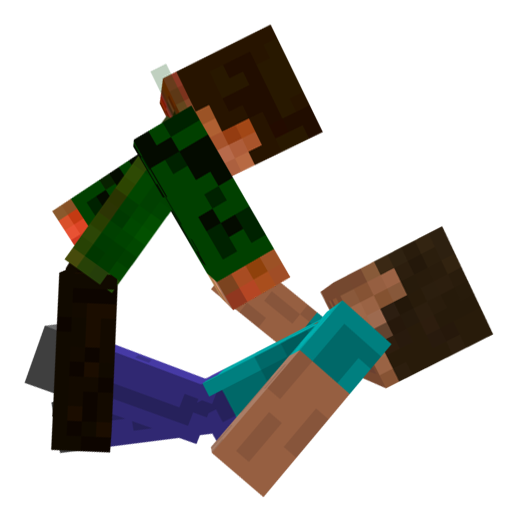

<!-- Generated by tools/build_pack_reference.py. Edit the pack sources and regenerate. -->

# PlayerRevive

Multiplayer bleed-out and teammate revival.

Installed build `2.0.31`. [Browse all mods](index.md).

## Pack guides

- [Survival at sea · Downed players and death](../../world/survival.md#downed-players-and-death)

## Related mods

- [Corpse](corpse.md)
- [Eternal Voyage Companion](eternalvoyage.md)
