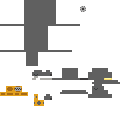

<!-- Generated by tools/build_pack_reference.py. Edit the pack sources and regenerate. -->

# Proximity Chat

Talk to nearby players in local text chat.

Installed build `1.1.6`. [Browse all mods](index.md).

## Pack guides

- [Getting started · Form up before sailing](../../voyage/first-voyage.md#form-up-before-sailing)

See the [mod inventory](../mods.md) for its role in the pack and declared dependencies.
