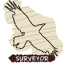

<!-- Generated by tools/build_pack_reference.py. Edit the pack sources and regenerate. -->

# Surveyor Map Framework

Discovery and map sharing for crews.

Installed build `1.1.2+1.20`. [Browse all mods](index.md).

## Pack guides

- [Seas and navigation · Log pose and atlas](../../voyage/navigation.md#log-pose-and-atlas)

See the [mod inventory](../mods.md) for its role in the pack and declared dependencies.
