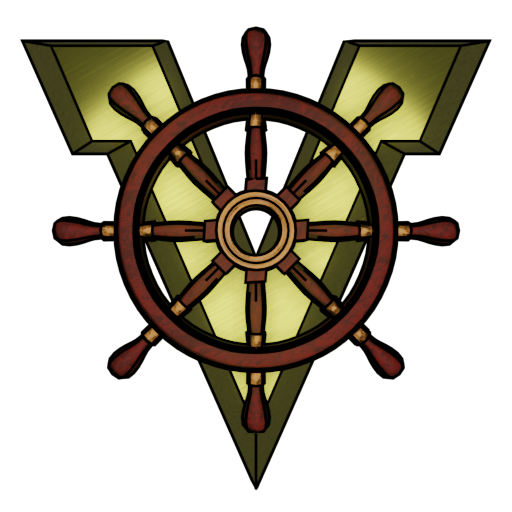

<!-- Generated by tools/build_pack_reference.py. Edit the pack sources and regenerate. -->

# Valkyrien Skies 2

Physics for ships built from blocks, including ship travel through the Knock-Up Stream.

Installed build `2.4.11`. [Browse all mods](index.md).

## Pack guides

- [Build and captain a ship](../../voyage/shipbuilding.md)
- [Skypiea · Skypiea](../../voyage/special-destinations.md#skypiea)

## Creatures and entities

| In-game name | ID | In-game description |
| --- | --- | --- |
| Physics Entity | `valkyrienskies:vs_physics_entity` |  |

## Items

| In-game name | ID | In-game description |
| --- | --- | --- |
| Area Assembler | `valkyrienskies:area_assembler` |  |
| Connection Checker | `valkyrienskies:connection_checker` |  |
| Mini Ship Creator | `valkyrienskies:ship_creator_smaller` |  |
| Physics Entity Creator | `valkyrienskies:physics_entity_creator` |  |
| Ship Assembler | `valkyrienskies:ship_assembler` |  |
| Ship Creator | `valkyrienskies:ship_creator` |  |
| Ship Remover | `valkyrienskies:ship_remover` |  |

## Blocks

| In-game name | ID | In-game description |
| --- | --- | --- |
| Debug Chair | `valkyrienskies:test_chair` |  |
| Debug Flap | `valkyrienskies:test_flap` |  |
| Debug Hinge | `valkyrienskies:test_hinge` |  |
| Debug Levitator | `valkyrienskies:test_antigrav` |  |
| Debug Sphere | `valkyrienskies:test_sphere` |  |
| Debug Thruster | `valkyrienskies:test_thruster` |  |
| Debug Wing | `valkyrienskies:test_wing` |  |
